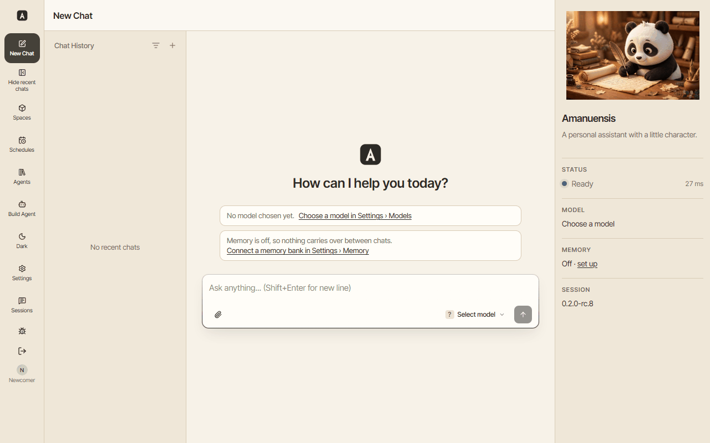
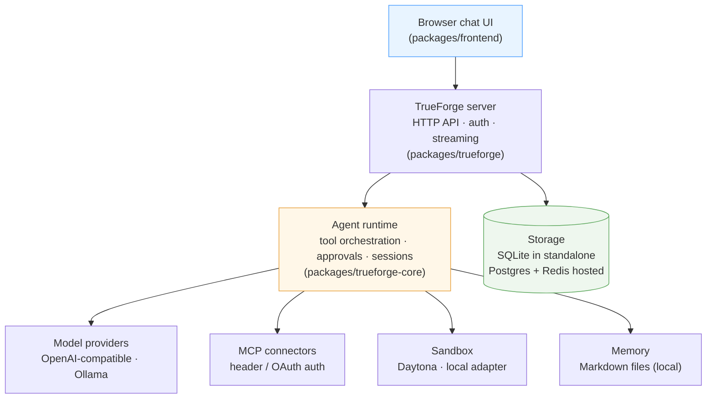
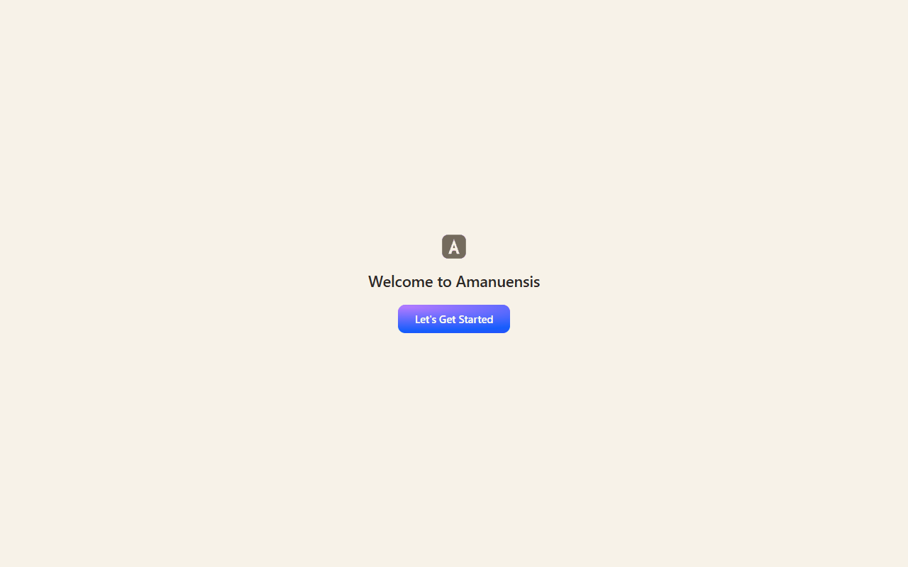
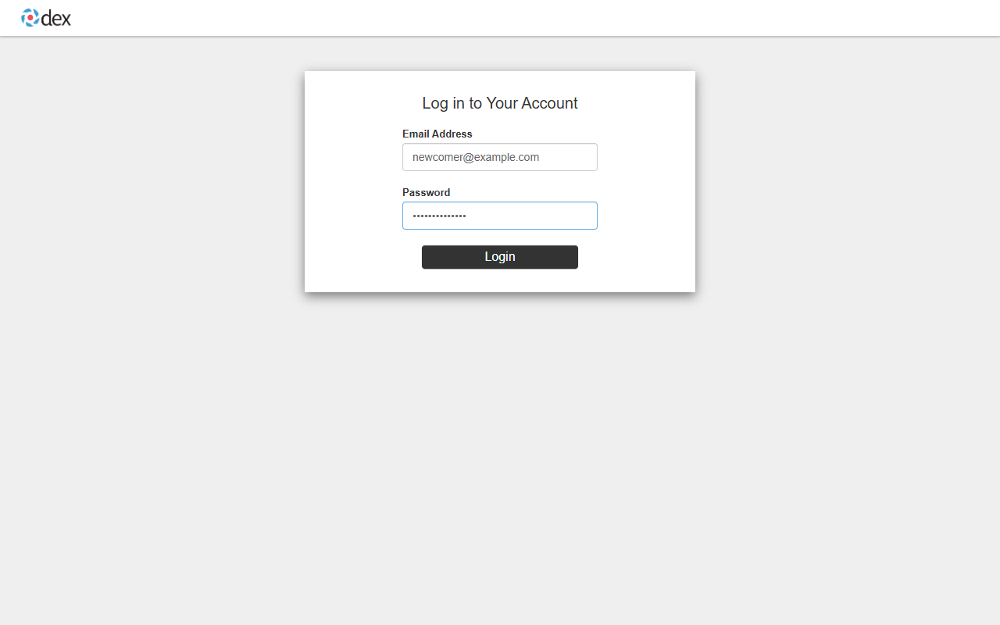
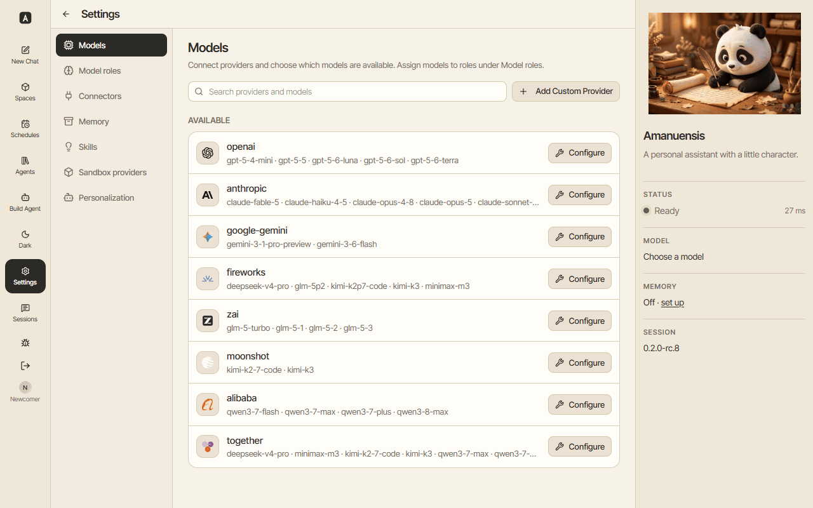
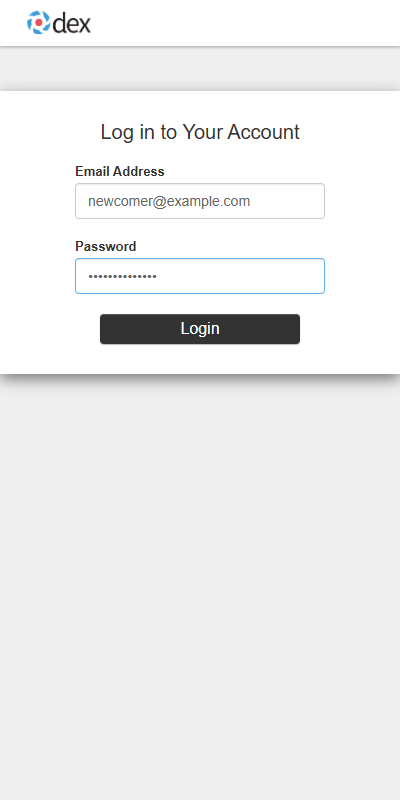
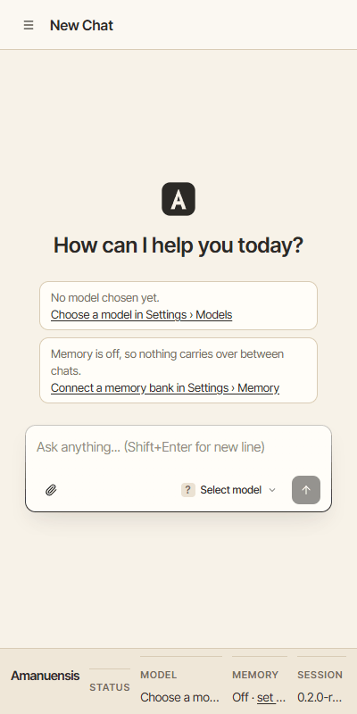

<p align="center">
  
</p>

<h1 align="center">Amanuensis</h1>

<p align="center">
  <em>Any model. Your memory, as files on your disk. Messages, deletions and installs wait for your OK.</em>
</p>

<p align="center">
  <a href="LICENSE"></a>
  = 22.14">
  
  
</p>

<p align="center">
  <a href="docs/quickstart.mdx"><strong>Developer quickstart</strong></a> &nbsp;·&nbsp;
  <a href="docs/install.mdx">Install</a> &nbsp;·&nbsp;
  <a href="docs/introduction.mdx">Introduction</a> &nbsp;·&nbsp;
  <a href="docs/deployment-security.mdx">Deployment security</a> &nbsp;·&nbsp;
  <a href="CONTRIBUTING.md">Contributing</a>
</p>

<p align="center">
  
</p>

Amanuensis (Aman) is a private, local-first AI workbench built on the TrueForge agent harness. It combines a browser chat interface with configurable models, MCP tools, reusable agents and skills, sandboxed execution, session persistence, and Aman-specific personalization and memory features.

- Your memory is plain files you own, and your chats and personas are stored on your machine, where you can back them up.
- Use a hosted model or a local one, and switch any time.
- Aman reads, searches the web and saves memories on its own. Sending messages, deleting or installing anything waits for your OK, and so does changing your files unless you turn that off.

If you use a hosted model, the company running it sees each chat: your messages, what Aman knows about you, the memories it recalls, and anything Aman reads for you, such as emails and files. To keep chats on your computer, use only local models. Web searches, maps and connectors still reach their own services. See [Safety story](docs/safety.md), [Privacy](docs/privacy.md), [Schedules](docs/schedules.md) and [Backups](docs/backup.md).

## ✨ Features

- 💬 **Streamed, resumable chat** — sessions organized with saved agents and folders.
- 🧠 **Your choice of model** — configurable providers, including OpenAI-compatible endpoints and fully local Ollama; model roles assign separate models to conversation and auxiliary work.
- 🔌 **MCP connectors** — header or OAuth authentication, tool approvals, and per-chat capability selection.
- 📦 **Reusable skills and subagents** — `SKILL.md` instruction packs, dynamic subagents, and generative UI that renders interactive results instead of plain text.
- 💻 **Sandboxed execution** — on-demand code and file execution through the Daytona adapter; standalone mode also supports a built-in local adapter on macOS and Linux hosts.
- 👤 **Personalization** — personas and an inspectable personalization profile.
- 🗄️ **Long-term memory** — on by default as local Markdown files: the model retains what matters from each chat and recalls it in later ones, with bounded recall and auditable recall events. Self-hosted Hindsight banks remain available as an experimental opt-in.

Capabilities are configurable. A fresh checkout does not include a model, MCP credentials, or sandbox credentials — memory works out of the box with local Markdown files.

## 🏗️ Architecture



## Repository layout

| Path                      | Purpose                                                               |
| ------------------------- | --------------------------------------------------------------------- |
| `packages/trueforge`      | HTTP server, persistence, provider management, and Aman host features |
| `packages/trueforge-core` | Agent runtime, tool orchestration, and session contracts              |
| `packages/frontend`       | Browser application                                                   |
| `packages/trueforge-ui`   | Reusable UI components and server-facing UI contracts                 |
| `packages/trueforge-sdk`  | Generated TypeScript SDK                                              |
| `docs`                    | Product, setup, architecture, and API documentation                   |
| `ops`                     | Aman-specific design records, evaluations, and runbooks               |

## Install on your own computer

The installer sets everything up in one command. You need Docker (on Linux the installer can install it for you). Check out the release tag you were given, then run the installer.

```bash
git clone https://github.com/ClimbOutLabs/amanuensis && cd amanuensis
git checkout vX.Y.Z
./installer/install.sh
```

Then open http://localhost:8791 and see [docs/try-aman.md](docs/try-aman.md).

## Development quick start

> **`main` is active development and may be unstable.** To build a tagged release instead, add `--branch <tag>` to the `git clone` below; tags are listed under [Releases](https://github.com/ClimbOutLabs/amanuensis/releases).
>
> A guided one-command installer (`installer/install.sh`, described in [docs/install.mdx](docs/install.mdx)) is coming; until it lands on `main`, use the steps below.

The fastest path to a working chat is standalone mode: one process on your own machine, SQLite storage, no database server. Login is mandatory: `pnpm dev:login` runs Aman's own sign-in service in Docker. Aman uses its own sign-in. Outside sign-in services are not supported. You need [Node.js](https://nodejs.org/en/download) 22.14 or newer and pnpm 11.16.0 through [Corepack](https://pnpm.io/installation#using-corepack) (the exact version is pinned in `package.json`); on Windows, run these from [WSL](https://learn.microsoft.com/windows/wsl/install) or [Git Bash](https://git-scm.com/downloads/win):

```bash
git clone https://github.com/ClimbOutLabs/amanuensis && cd amanuensis
corepack enable
pnpm install --frozen-lockfile
cp packages/trueforge/.env.example packages/trueforge/.env
pnpm dev:login   # second terminal; prints the OIDC_* lines for .env
# add those lines and PUBLIC_BASE_URL=http://localhost:3000 to packages/trueforge/.env, then:
pnpm standalone:dev
```

Open `http://localhost:3000` and sign in with the account `pnpm dev:login` prints. The app ships with no model configured — connect one under **Settings, Models** before starting a chat.

The server runs without a file watcher (on some Windows machines the watcher stalls before the server starts), so restart `pnpm standalone:dev` to pick up backend changes — the UI itself still hot-reloads.

[docs/quickstart.mdx](docs/quickstart.mdx) walks through this path in full: prerequisites, connecting your first model (a hosted API key or a fully local Ollama model), confirming a chat works, and troubleshooting the failures a fresh install actually hits.

## Docker Compose (production path)

When you're ready to run Aman as a shared service instead of a personal install. This is the production topology — the server containerized, Postgres replacing SQLite as durable storage, and Redis so streams and cancellations follow the client across server replicas — with no Node.js or pnpm needed on the host. Choose it when the app needs to serve more than just you, or when you want to evaluate a deployment.

The app is single-user and, as shipped, this stack has no login screen: every port is bound to `127.0.0.1`, and whoever reaches port `8791` is the admin. The stack's `login` profile adds a real sign-in screen with an account you define, and uses Aman's own sign-in service; turn it on before anyone but you can reach the app (see [Deployment Security](docs/deployment-security.mdx)).

```bash
git clone https://github.com/ClimbOutLabs/amanuensis && cd amanuensis
cp packages/trueforge/.env.example packages/trueforge/.env
docker compose up --build
```

The first build takes several minutes. `docker compose up` keeps streaming container logs in the foreground; the stack is ready when the `server` line `Agent server listening on http://0.0.0.0:8790` appears. Open `http://localhost:8791`.

**Turn on login.** Generate a client secret and a password hash, uncomment the **Compose login profile** block in `packages/trueforge/.env`, fill in the values it names (the hash stays inside its single quotes), then start the stack with the profile. From then on, always start it with the profile.

```bash
openssl rand -hex 32
docker run --rm httpd:2.4-alpine htpasswd -nbBC 10 "" 'your-password' | cut -d: -f2
docker compose --profile login up --build
```

Open `http://localhost:8791` and click **Let's Get Started**. The sign-in service runs at `https://localhost:5556` with a certificate the stack minted on first start, so the browser warns once: choose **Advanced**, proceed to localhost, and sign in with the email and password you chose.

<p align="center">
  
  
</p>

You land in **Settings, Models** as that user, with your name at the bottom of the navigation rail. Connect a model there before starting a chat; nothing is configured on a fresh stack.

<p align="center">
  
</p>

The layout adapts to a phone-width window:

<p align="center">
  
  
</p>

See the [quickstart's Docker Compose section](docs/quickstart.mdx#other-ways-to-run-it) for the details that differ on this path (ports, environment, the login profile in full, reaching a host-run Ollama from the container).

## Deployment modes

| Mode               | Storage and coordination                                          | Intended use                                          | Start command                                                  |
| ------------------ | ----------------------------------------------------------------- | ----------------------------------------------------- | -------------------------------------------------------------- |
| Standalone         | SQLite; one process; no Redis peering                             | Recommended install; personal use on the same machine | `pnpm standalone:dev`                                          |
| Hosted Compose     | Containerized server, Postgres, and Redis                         | Production path; shared deployments                   | `docker compose up --build` (`--profile login` for sign-in)    |
| Hosted development | Postgres and Redis from Compose; API and Vite app run on the host | Multi-process development                             | `pnpm dev:infra`, then `pnpm dev`                              |
| Kubernetes         | Helm chart with bundled or external Postgres and Redis            | Managed hosted deployments                            | See [`charts/trueforge/README.md`](charts/trueforge/README.md) |

The untracked `packages/trueforge/.env` file created during setup is required by both standalone and hosted server development commands. Review every value before network exposure. The example database credentials are for local development only.

## Security boundaries and limitations

- Standalone mode requires OIDC login and refuses to start without `OIDC_ISSUER_URL`, `OIDC_CLIENT_ID`, and `OIDC_CLIENT_SECRET`, and it refuses an `OIDC_ISSUER_URL` that is not Aman's own sign-in service (path `/dex`). An http issuer is accepted only on a loopback host. It also refuses to start unless `OIDC_ALLOWED_EMAILS` holds exactly one email address, and it accepts only sign-ins with a verified email.
- Hosted mode also uses a shared admin identity when OIDC is unset. Configure OIDC (the Compose `login` profile) and appropriate network controls before any shared or internet-facing deployment.
- Tool approval and sandboxing reduce risk; they are not an unlimited safety boundary. Review enabled capabilities, provider trust, egress policy, and approval requests.
- Model credentials stay in the harness. Built-in MCP access from Code Mode is bridged back through the harness so its stored MCP tokens do not enter the sandbox; do not assume the same boundary for arbitrary custom code, tools, or integrations. Administrators remain responsible for secret storage, transport security, and provider configuration.
- Markdown memory stores memories as plain files under `MEMORY_MARKDOWN_DIR` (default `./data/memory`) — treat that directory as sensitive. Recall screening and live tool-output screening default off.
- The Prompt Guard sidecar under `ops/prompt-guard` is evaluation-only and is not an accepted production security control.

See [authentication](docs/authentication/overview.mdx), [sandboxing](docs/sandbox.mdx), and the [memory runbook](ops/memory/RUNBOOK.md) before enabling those features outside local development.

## How memory works

Aman remembers things between conversations so you don't have to repeat yourself. Here is the plain-English version of how that works — the technical details live in [Memory](#memory) below.

**Memories are ordinary files.** Aman saves what matters from your conversations as plain text files (Markdown) on the server, in its memory folder (by default, `./data/memory` next to the server). There is no database to manage and nothing locked away: the files are human-readable, and they're yours.

**After each chat, Aman writes a short summary.** Instead of keeping every turn word for word, Aman distills each conversation down to the important details — decisions, facts about you, things to follow up on — and saves that. This keeps the memory folder small and useful. If you'd rather keep the full transcript of every turn instead, flip the **Turn summaries** switch off in **Settings → Memory**; new turns are then saved verbatim. Either way, if summarizing ever fails, Aman keeps the full transcript as a fallback, so nothing is lost.

**Aman finds memories by meaning, not just words.** When you ask something, Aman searches your memories for meaning — so "where did we stay in Paris" finds the hotel note even though it says "Hotel Lumiere" and never mentions Paris. To do that, the first time Aman runs it downloads a small helper model once (about 120 MB), automatically in the background: the download starts when the server starts, so it's usually finished before you need it. There is nothing to install and nothing to click. After that one download, memory search works fully offline, and everything stays on this server. If the download can't finish, Aman just keeps finding memories with keywords, and keeps retrying in the background.

**Keep the memory folder safe.** The downloaded helper model lives inside the memory folder too, so they travel together. If you run Aman with Docker, make sure the memory folder is stored on a persistent volume: without one, your memories — and the downloaded model — disappear whenever the container is recreated.

## Memory

Memory is on by default. Amanuensis recalls from local Markdown files before every reply and retains what matters from each completed turn, so the model never has to remember to use it. Memories live as plain files under `MEMORY_MARKDOWN_DIR` (default `./data/memory`, relative to the server's working directory) — human-readable, portable, and yours. In Docker, mount a volume at that path so memories survive container recreates.

Memories are scoped by persona. While a persona is active, what it learns is kept in that persona's own vault and is private to it until you share the vault. With no persona active, memories go to the shared vault, which every persona can read. A persona recalls from its own vault, the shared vault, and any vault shared with it. Renaming or deleting a persona never deletes its vault.

Manage it in **Settings → Memory**: see what's stored, turn recall on or off (the rail toggle does the same), and check the memory status. Recall is bounded, so a large memory can't blow up the model's context window, and every recall is auditable.

Prefer a hosted memory bank? Set `MEMORY_BACKEND=hindsight` to use a self-hosted [Hindsight](ops/memory/RUNBOOK.md) instance instead — currently experimental. Point Amanuensis at your bank's MCP endpoint (`{apiBase}/mcp/{bank}`) with a `Bearer` API key in **Settings → Memory**. Memory calls Hindsight's REST API directly for recall and retain, so use a key valid on both surfaces; see [the runbook's two-surfaces note](ops/memory/RUNBOOK.md#two-surfaces-one-connector) if recall stops working after a key rotation.

Two optional Prompt Guard screens can check content around memory before it reaches the model, both off by default:

- **Memory recall screen**: screens memories recalled from the bank before they reach the model. Turn it on per bank in Settings → Memory with the "Screen recalled memories with Prompt Guard" switch; it needs a classifier URL configured and reachable first. Your own stated memories are never withheld; it only applies to memories that came from tools, documents, or email.
- **Tool output screen**: screens tool results before they re-enter model context. This one is environment-only, with no Settings switch, and shares the same classifier URL, token, and threshold as the recall screen.

See [Deployment Security](docs/deployment-security.mdx#prompt-guard-screens) for the full configuration and [Memory design](ops/memory/DESIGN.md) for how recall and retention work.

## How Nemotron and Token Factory are used

With `NEBIUS_API_KEY` set, the server connects a read-only `tokenfactory` provider (Nebius Token Factory) at startup. It lists `TOKEN_FACTORY_MODEL` (default `nvidia/nemotron-3-super-120b-a12b`, NVIDIA Nemotron 3 Super) and `TOKEN_FACTORY_CHEAPER_MODEL` (default `nvidia/NVIDIA-Nemotron-3-Nano-30B-A3B`, NVIDIA Nemotron 3 Nano), and makes Nemotron 3 Super the chat default. The provider is managed by the environment, so to change the small model, set `TOKEN_FACTORY_CHEAPER_MODEL` to another id and restart; set it empty to register only the main model. Both appear in **Settings, Models** and can be assigned to roles. A model an earlier start registered stays listed after either variable changes, so roles, personas and agents that still point at it keep working.

**Which role uses which model.** Every job the server does with a model is a role, and each role can have its own model under **Settings, Roles and Personas**. A role left unset uses the main chat model, except the helper jobs below: while a turn runs on Token Factory, they use the small model unless you pick one for that role.

| Role                | What it does                                            | Where the model comes from                                      |
| ------------------- | ------------------------------------------------------- | --------------------------------------------------------------- |
| Main chat           | Answers you, including requests for a briefing          | Main chat model                                                 |
| Coding / sub-agent  | Work the assistant hands to sub-agents                  | Coding / subagent model, else the main chat model               |
| Compaction          | Summarizes old context in long conversations            | Compaction model, else the main chat model                      |
| Summarization       | Condenses each turn before it is written to memory      | Summarization model, else the small model on Token Factory      |
| Profile learning    | Rewrites the learned profile after a turn, when enabled | `PROFILE_LEARNING_MODEL`, else the small model on Token Factory |
| Knowledge relevance | Checks which library passages help answer a question    | The small model on Token Factory, else the persona's model      |
| Persona             | Answers as that persona                                 | The model bound to the persona under **Roles and Personas**     |

**Why tier them.** Helper jobs are short and structured: a few hundred tokens in, a short summary or a yes/no list out. They run on every turn, so their price and latency add up, and a small model such as Nemotron 3 Nano does them at a fraction of the cost of Nemotron 3 Super (see the price table below). Chat answers and briefings are open-ended reasoning over memory and tools, so they stay on Nemotron 3 Super. A weak compaction summary degrades every later turn of a conversation, so keep that role on a model you trust.

**What it costs.** Prices are USD per million tokens, read on 2026-10-15 from the Token Factory model catalog (`https://tokenfactory.nebius.com/model-catalog.md`) and confirmed against its models endpoint (`https://api.tokenfactory.nebius.com/v1/models?verbose=true`).

| Model                                   | Input | Output |
| --------------------------------------- | ----- | ------ |
| `nvidia/nemotron-3-super-120b-a12b`     | 0.30  | 0.90   |
| `nvidia/NVIDIA-Nemotron-3-Nano-30B-A3B` | 0.06  | 0.24   |
| `nvidia/Nemotron-3-Ultra-550b-a55b`     | 1.00  | 3.00   |
| `nvidia/Nemotron-3_5-Lightning`         | 0.06  | 0.24   |
| `nvidia/Nemotron-3.5-Super-VL`          | 0.30  | 0.90   |
| `openai/gpt-oss-120b`                   | 0.15  | 0.60   |

These defaults are a snapshot and are meant to be edited. Set `TOKEN_FACTORY_PRICES` to JSON keyed by model id, for example `{"nvidia/nemotron-3-super-120b-a12b":{"input_per_million":0.3,"output_per_million":0.9}}`. Entries add to and win over the defaults, and an entry also gives a model on another provider a cost. A model with no price shows tokens only.

**Where cost shows.**

- Under each answer, a quiet line names the model, its provider, and the tokens and cost of the whole turn, for example `Nemotron 3 Super · Token Factory · 2,140 tokens (1,800 in, 340 out) · $0.0011 at list price · + 2 helper calls on Nemotron 3 Nano`. Helper calls are included in the total.
- With **Show agent details** on for the chat, each role that ran appears in the turn's details with its model, calls, tokens and cost.
- **Settings, Models** shows today's tokens and cost per Token Factory model and the daily cap remaining.
- **Settings, Themes, Answers** switches the line and the helper rows off for you. This changes only what is shown; usage is still counted.

Token counts are the usage the provider reported for each call and are never estimated: if a provider reports no usage for a call, the line says `usage not reported`. Cost is an estimate from the price table above, labelled "at list price", not your bill. Usage is recorded for completed turns; a turn that errors or is cancelled shows no line, though its tokens still count toward the daily total.

**Daily cap.** Set `TOKEN_FACTORY_DAILY_TOKEN_CAP` to limit Token Factory tokens per UTC day for the whole instance. Input and output tokens from every Token Factory call count, including helper calls and the fallback in `TOKEN_FACTORY_MODE=fallback`. The cap is checked before every model call: once it is reached, a new turn on a Token Factory model is refused with a 429 (`token_factory_daily_cap_reached`) and a turn already running stops before its next model call. It resets at midnight UTC. Without the variable there is no cap, but the daily tokens are still counted per model for the Settings view.

## Deployment security

The `docker-compose.yml` app port is unauthenticated unless `OIDC_ISSUER_URL`, `OIDC_CLIENT_ID`, and `OIDC_CLIENT_SECRET` are all set (the `login` profile sets them against its bundled Dex); the Postgres and Redis debug ports it publishes are bound to `127.0.0.1` only. See [Deployment Security](docs/deployment-security.mdx) for the full picture: what "everyone is admin without OIDC" means, changing the default Postgres password, the two optional Prompt Guard screens, the always-on sandbox network policy and Spaces iframe restrictions, and the `minimumReleaseAge: 0` supply-chain setting.

## Development and verification

Use root `package.json` scripts for workspace tasks:

```bash
pnpm format:check
pnpm typecheck
pnpm lint:ci
pnpm build
pnpm test
```

`pnpm verify` runs the secret scan plus all checks above. The Git pre-push hook is change-aware: it always scans the pushed tree for private data, then runs formatting, linting, type checks, or policy tests selected from the changed files. It does not always run the full verification suite.

Useful targeted commands include `pnpm test:trueforge-core`, `pnpm test:trueforge`, `pnpm test:frontend`, and `pnpm smoke`. Read [AGENTS.md](AGENTS.md) and any package-local `AGENTS.md` before changing code. Generated SDK and OpenAPI files are not edited by hand.

## Further reading

- [Introduction and architecture](docs/introduction.mdx)
- [Quickstart and initial configuration](docs/quickstart.mdx)
- [Models, roles and personas](docs/model-roles.mdx)
- [MCP connectors](docs/mcp-servers.mdx)
- [Memory design](ops/memory/DESIGN.md) and [operations runbook](ops/memory/RUNBOOK.md)
- [Upstream synchronization runbook](docs/UPSTREAM_SYNC.md) and [divergence policy](DIVERGENCE.md)

## Attribution and license

Amanuensis is derived from [TrueForge](https://github.com/truefoundry/trueforge), an open-source agent harness by [TrueFoundry](https://truefoundry.com). Upstream package names, copyright notices, source lineage, and attribution are retained; see [the attribution note](docs/AMANUENSIS_ATTRIBUTION.md).

Licensed under the Mozilla Public License 2.0. Portions derived from TrueForge are MIT licensed, Copyright 2024-2026 TrueFoundry; see NOTICE. Third-party components with their own terms are listed in [THIRD_PARTY_NOTICES.md](THIRD_PARTY_NOTICES.md).
