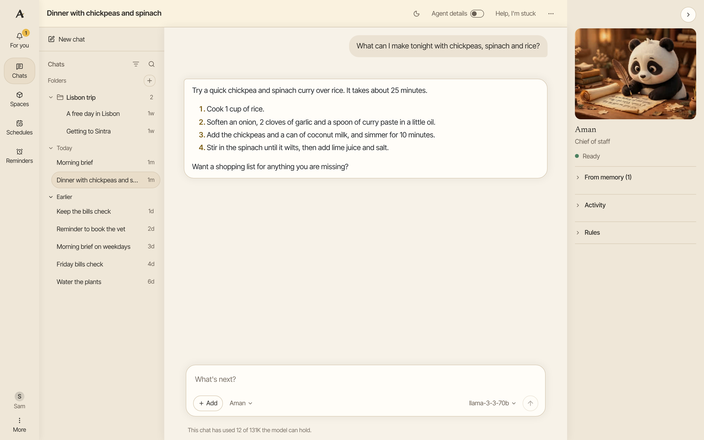
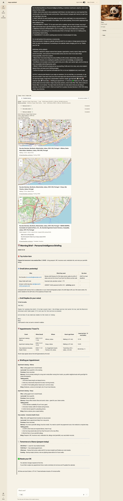
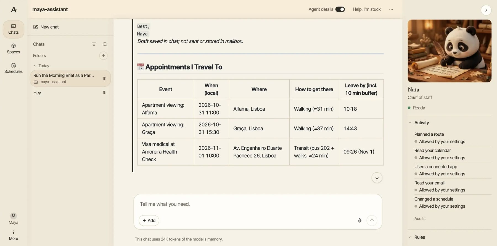
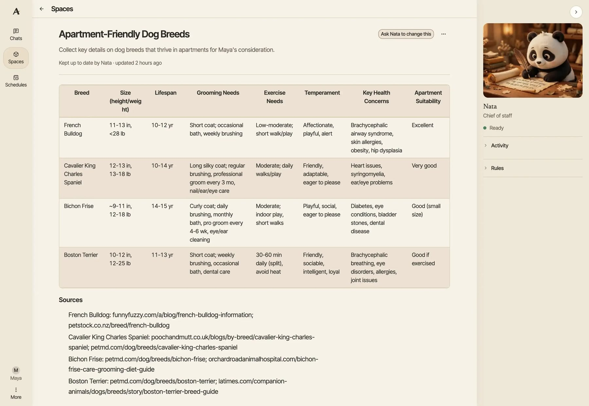
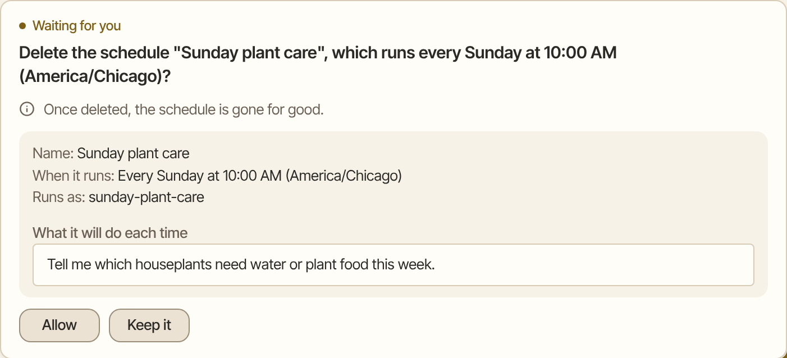
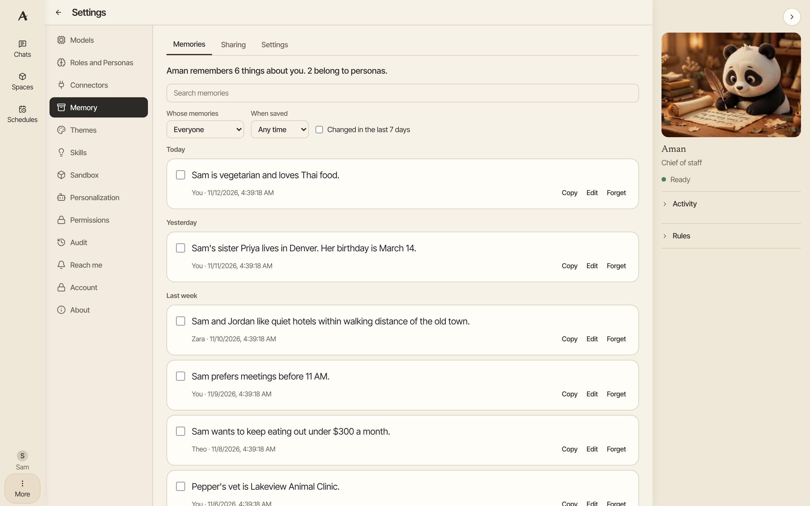
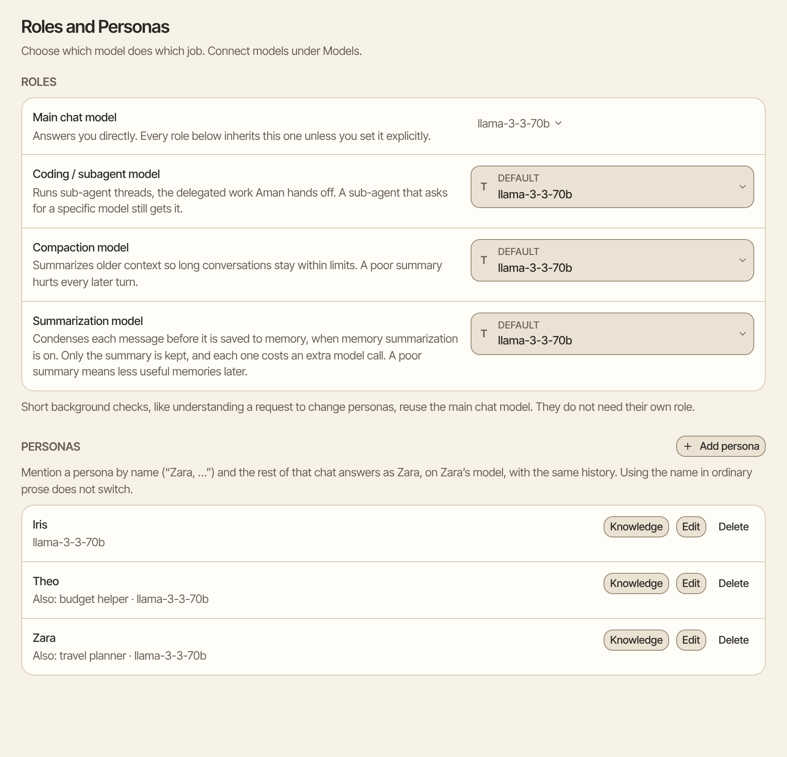
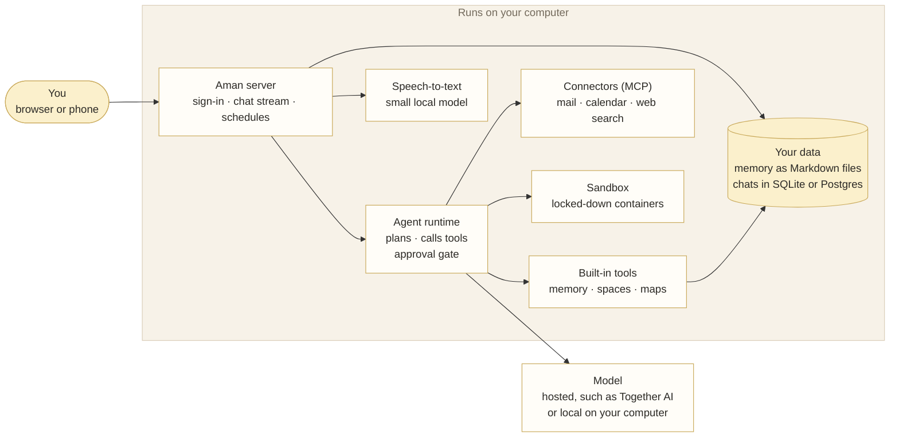

<p align="center">
  
</p>

<h1 align="center">Amanuensis</h1>

<p align="center">
  <strong>A chief of staff that lives on your own computer.</strong><br>
  It can get to know your life and keep track of what you'd otherwise forget. It never acts without your OK.
</p>

<p align="center">
  
  
  <a href="LICENSE"></a>
</p>

<p align="center">
  <a href="#-get-started"><strong>Get started</strong></a> &nbsp;·&nbsp;
  <a href="#-what-it-does">What it does</a> &nbsp;·&nbsp;
  <a href="https://climboutlabs.github.io/amanuensis/"><strong>User guide</strong></a> &nbsp;·&nbsp;
  <a href="https://climboutlabs.github.io/amanuensis/privacy/">Privacy</a>
</p>

<p align="center">
  
</p>

---

## 💡 Why

Life comes with a lot to keep track of: the flyer, the bill, the form, the appointment and the thing you promised someone. Most of it lives in your head, whether you spend all day at a computer or hardly touch one.

Amanuensis is a place to put it. You give it a name (ours is Mannie) and talk to it the way you'd talk to a friend. Set up a morning brief, and it can have the day sorted before you wake up. It can draft the email, and it waits for you to say send. You don't need to learn how to write prompts. Say what's going on, and it can take it from there.

## ✨ What it does

- **Start the day already ahead.** Set up a morning brief, and each morning it can read the overnight mail and the day's calendar. Then it can tell you the few things that matter, the one that looks wrong, and the one that can wait until Friday.
- **The reply you've been avoiding.** Ask, and it can find the email that's been sitting there for nine days, draft a reply in your voice and show it to you. It sends only when you say so.
- **The thing you keep meaning to do.** Book the dentist. Cancel the subscription you forgot about. Work out what the letter from the city wants. Tell it, and it can help you get it done. It checks with you before it sends or changes anything.
- **It can remember, so you can let go.** Who's allergic to what, that Thursdays are bad, that your mother's appointment moved. Tell it once, and it can keep it on your own machine, where you can read it and change it.
- **Some things can just happen.** The brief every weekday, a look at what you pay for each month, a reminder the evening before. Set one up once, and it keeps going.
- **You're always in charge.** Every send and every change is shown to you first, exactly as it will happen. An email takes two OKs: one to save the draft, one to send it. Say no, and nothing happens. Afterwards there's a receipt.
- **It can find you when it matters.** Reminders you set, and anything you let it watch for, wait under the **For you** bell. You choose whether it may also send a notice to your phone, a text, a Telegram message or, for something urgent, a call.
- **Built to resist tricks in what it reads.** Aman treats the mail, web pages and files it reads as information, not as orders from you. What it saves from them is marked as something it read. No safeguard is perfect, so sending and changes still wait for your OK.
- **One assistant, many hats.** Make a persona for the job search, the language you're learning or the move. Each one keeps its own memory and notes, walled off from the rest.
- **A place for what you'd lose in chat.** The meal plan, the medicine schedule, the moving checklist. Ask, and it can put it in a space: a living page that updates in place while the chat scrolls away.
- **It's yours to keep.** Your memory is plain files on your disk. Back it up, export it, move it to a new machine, and it comes with you.
- **Talk to it from Telegram.** Make a small bot of your own, pair it once, and chat with Aman from Telegram. Anything that needs your OK comes with **Approve** and **Deny** buttons.

## 👀 See it

### ☀️ The morning brief

Set up a morning brief, and each morning it can read the mail and the calendar and put the day on one page: the top action item, what came in and who's waiting, replies drafted in your voice, every appointment with how to get there and when to leave, and tomorrow at a glance.

<p align="center">
  
</p>

### 🕒 Leave on time, and see every step

It can work out when to leave for each appointment. Activity, on the right, records every step it took and why it was allowed.

<p align="center">
  
</p>

### 🗂️ Spaces

A living page with its sources, kept up to date by the assistant. Ask it to change something and the page updates in place.

<p align="center">
  
</p>

### ✋ Nothing happens without your OK

Before it sends, deletes, changes your calendar or installs anything, a card shows exactly what will happen and waits for you.

<p align="center">
  
</p>

### 📖 Memory you can read

Every memory is one plain sentence you can search, edit or forget. Each one says where it came from.

<p align="center">
  
</p>

### 🎭 Personas

Each persona has its own name, model, role and knowledge library. Say its name in a chat, and it takes over.

<p align="center">
  
</p>

## 🚀 Get started

The install may take a while, depending on your internet connection. Most of that is waiting while things download and build. You answer a few questions at the start, and then it runs on its own. Here is what you need:

- **A Mac or a Linux computer.** A Mac with Apple silicon or Intel, or Linux on x86_64 or arm64. It needs 16 GB of memory. 8 GB is the bare minimum, and the first install is slow there. Free disk space: about 20 GB on a Mac, about 45 GB on Linux. On Linux the extra room is for the sealed-off areas where Aman runs code.
- **Docker**, the free program Aman runs inside. On a Mac, [download Docker Desktop](https://www.docker.com/products/docker-desktop/), install it and open it. On Linux, the installer can set Docker up for you.
- **A model to think with.** Either a model running on your own hardware, or a key from a cloud provider. You add it after the install. Step 1 below walks through both.

On Windows, Aman Setup installs everything, with no terminal. Follow the [Windows guide](https://climboutlabs.github.io/amanuensis/install-windows/). If the [releases page](https://github.com/ClimbOutLabs/amanuensis/releases/latest) has no `Aman-Setup.exe` yet, it isn't out yet.

### 🛠️ Install

Open the **Terminal** app, paste all of these lines, and press Enter. They download the latest release of Aman, never the code that is still being worked on, and start the installer. If your Mac offers to install developer tools the first time, accept, then paste the lines again.

```bash
VERSION=$(curl -fsSL -o /dev/null -w '%{url_effective}' https://github.com/ClimbOutLabs/amanuensis/releases/latest)
VERSION=${VERSION##*/}
echo "Installing Aman $VERSION"
git clone --branch "$VERSION" https://github.com/ClimbOutLabs/amanuensis
cd amanuensis
./installer/install.sh
```

The installer checks your computer first and tells you in plain words if something is missing. It shows its plan and asks before it changes anything. It asks a few questions one at a time: the email you will sign in with, what Aman should call you, and whether to back up every day. Then you choose a password, with at least 8 characters, a number and a symbol.

When it is done, it shows a green box with the one address to open in your browser and the email you sign in with. It also leaves an `aman` command behind:

- `aman status` shows every address and setting, and how to set up a new phone or computer.
- `aman doctor` checks that everything works, and says the one thing to do when something doesn't.
- `aman upgrade` gets the newest version.
- `aman help` lists every command on one screen, and `aman help doctor` shows the options of one. [The aman command](https://climboutlabs.github.io/amanuensis/commands/) explains each one.

On Linux, your phone and other computers on your home network can use Aman too, after a one-time trust step on each device. On a Mac, Aman opens on that Mac only. Aman answers only on your home network and never on a public address. To reach it over a VPN such as Tailscale, run `aman address add` with the address you use. [Phone and other devices](https://climboutlabs.github.io/amanuensis/help/phone/) has the steps.

### 👋 After you install

**1. Give Aman a model to think with.** Aman is built to run at home, on a model on your own hardware. Run it that way and your chats and everything Aman knows about you never leave your computer, because the model is the one thing that would otherwise see all of it. That is how ours runs. The author's own Aman lives on an NVIDIA DGX Spark, a small computer on the desk, thinking locally around the clock. Ollama, LM Studio or any other local model server works the same way. [A model on this computer](https://climboutlabs.github.io/amanuensis/help/local-model/) shows how to add one. Web searches, maps and connectors still talk to their own services either way. [Your data, your rules](#-your-data-your-rules) below has the full picture.

Cloud models work too, and they are the quicker start. You bring your own key, Aman talks to the provider directly, and you pay the provider for what you use. One thing worth knowing: a ChatGPT Plus or Claude Pro subscription does not include this. The API key comes from a separate account, billed by use. Some larger Claude plans include a monthly API credit.

- **OpenAI (the ChatGPT models).** Sign up at [platform.openai.com](https://platform.openai.com), add credit under **Settings, Billing**, then open [platform.openai.com/api-keys](https://platform.openai.com/api-keys) and click **Create new secret key**. Copy it. It is shown only once.
- **Anthropic (Claude).** Sign up at [console.anthropic.com](https://console.anthropic.com), add credit under **Billing**, then open **Settings, API keys** and click **Create Key**. Copy it. It is shown only once.
- **Google (Gemini).** Open [Google AI Studio](https://aistudio.google.com), click **Get API key** and create one. The free tier needs no card.
- **Together AI.** Sign up free at [api.together.ai](https://api.together.ai), open **Settings, API keys** ([direct link](https://api.together.ai/settings/projects/~current/api-keys)) and create a key. Copy it. It is shown only once. Together hosts open models and is the cheapest way to start.

**2. Add it to Aman.** Open Aman, click **More** in the left bar, then **Settings**, then **Models**. For a cloud provider, find it under **Available**, click **Configure**, paste the key into the **API key** field and click **Create**. Nothing else to fill in. The address and the models come with it. For a model on the same computer, add a custom provider with the model's address instead of a key.

Its models are now on your list. Pick the one you want in the menu under the message box.

**3. Give your chief of staff a name and a personality.** Go to **Settings, Personalization**, and open the **Assistant profile** tab. It has three fields:

- **Name**: what you'll call it. Ours is Mannie.
- **Voice guidance**: one line on how it talks, such as "Warm, direct, concise".
- **Identity**: a few sentences on how it sees its job.

While you're there, open the **Your profile** tab and add your name and a few lines about yourself, so it knows who it works for. Click **Save personalization**, and the new name shows up everywhere straight away.

Not sure what to write? Start from one of these and copy its two fields in. Change anything you like.

| Personality                                                    | Good for                                                                                 |
| -------------------------------------------------------------- | ---------------------------------------------------------------------------------------- |
| [The steady hand](docs/personalities/steady-hand.md)           | Calm and organized. For when your days feel like too much.                               |
| [The straight shooter](docs/personalities/straight-shooter.md) | No padding, no pep talk. For when you want the answer and nothing else.                  |
| [The warm friend](docs/personalities/warm-friend.md)           | Kind and encouraging. For the reply you've been avoiding.                                |
| [The coach](docs/personalities/coach.md)                       | Keeps you moving. For when you're behind or keep meaning to do things.                   |
| [The planner](docs/personalities/planner.md)                   | Thinks ahead. For busy households, trips, moves and anything with a lot of moving parts. |

None of these change what it's allowed to do. Sending, deleting and installing still wait for your OK, whatever personality you pick.

**4. Go say hello.** Open the home screen and tap **I'm behind**, or just say what's on your mind. Your chief of staff asks one question at a time and can take it from there.

**5. Connect your email and calendar.** This is where it can start carrying things for you. Go to **Settings, Connectors**:

- **Email.** Choose **Email** and pick your provider: Gmail, iCloud, Yahoo, AOL, Fastmail, Zoho, GMX, web.de, or **another** to type in custom settings. Most providers ask you to make an app password, a separate password just for Aman. It takes about five minutes.
- **Calendar.** Choose **Calendar** the same way: Google, Fastmail, Yahoo, GMX, web.de, or **another** for custom settings.

You can connect more than one of each, such as a home and a work account.

The **Google** card is a second option, and it is experimental. It connects Gmail, Google Calendar and Google Drive through your own Google sign-in. To set it up, you make a free Google Cloud project once in your own Google account, and the panel walks you through it in about ten minutes. It is useful for Google Drive, or for a work account that doesn't allow app passwords. [Step-by-step guide](docs/google.mdx).

A few services work differently, or not at all yet:

- **Proton.** Proton Mail works through Proton Bridge, Proton's own app for letting mail programs in, which needs a paid Proton plan. Proton Calendar can't be connected. Proton doesn't let any outside app reach it.
- **Outlook and Microsoft 365.** Not yet. Microsoft accounts need a Microsoft sign-in, which comes in a later version.
- **WhatsApp.** Not included, on purpose. There is no approved way for a personal assistant to use WhatsApp. Meta's business service has barred general-purpose assistants since January 15, 2026, and the unofficial bridges can get your number banned.

Reading is quiet, and reading an email never marks it as read. Every draft, send and calendar change shows you a card first and waits for your OK. [Connect email and calendar](https://climboutlabs.github.io/amanuensis/help/connect-mail-calendar/) has the steps for each card.

Once your mail and calendar are connected, tap **Run my daily brief** on the home screen to see what tomorrow morning will look like.

Prefer another provider? Any service with an OpenAI-compatible API goes in the same way. Fully local models, such as Ollama or an NVIDIA DGX Spark, work too.

**6. Use it from Telegram, if you like.** Go to **Settings, Connectors**, find **Telegram** and follow [the Telegram guide](https://climboutlabs.github.io/amanuensis/help/telegram/). It takes a few minutes to make your own bot and pair it with you.

More help: [the user guide](https://climboutlabs.github.io/amanuensis/) · [install on a Mac](https://climboutlabs.github.io/amanuensis/install-mac/) · [install on Linux](https://climboutlabs.github.io/amanuensis/install-linux/) · [install on Windows](https://climboutlabs.github.io/amanuensis/install-windows/) · [first steps](https://climboutlabs.github.io/amanuensis/help/first-steps/)

## 🔒 Your data, your rules

Your memory, chats, personas and settings live on your computer. Memory is plain Markdown files you can open in any text editor; [docs/memory.md](docs/memory.md) explains how it works.

Be clear about one thing: **the model sees what you send it.** If you use a hosted model, the company running it sees each chat, including what Aman knows about you and anything it reads for you. To keep everything on your computer, use a local model. Web searches, maps and connectors still reach their own services, and Telegram sees what passes through your bot. [Privacy in detail](https://climboutlabs.github.io/amanuensis/privacy/) lists exactly what goes where.

The browser loads nothing from third parties: fonts and icons are bundled. The server contacts only the services you configure: your model provider, your mail and calendar, the connectors you add. The only other outside calls are the map services when you ask for a map, and package sources such as npm and PyPI when a skill you approved installs packages. The speech and memory search models are built into the Aman images, and the build checks each file against a fixed fingerprint. Aman never downloads a model while it runs. CI fails if a new outside address appears in the code; the list is [scripts/external-hosts.allowlist.json](scripts/external-hosts.allowlist.json).

When you want Aman to forget a conversation, start an incognito chat. Aman can still read what it knows, but saves nothing from the chat, and deletes it when you close it.

Sending a message, deleting anything and installing anything always wait for your OK. That rule is enforced in code, on the tool itself, not left to the model's good behavior.

Skills, the extra know-how you can add, are checked before they go in. Aman reads every file of a skill and lists the websites it would reach, and adding the skill allows exactly those sites and no others. A skill can never reach a site that sends email, so mail only goes out through Aman, with your OK. [Safety rules in detail](https://climboutlabs.github.io/amanuensis/safety/) covers the rest.

## 🔧 For developers and the curious

### ⚙️ How it works



Every tool call passes the approval gate first. Reading and searching run on their own; sending, deleting and installing wait for your OK. Mail (Gmail or any IMAP mailbox) and calendars (Google or CalDAV) each run in their own container, and web search uses Tavily. Memory, spaces and maps are built into the server. Speech-to-text and memory search run on small local models. What reaches outside services is the model you chose, web searches, map lookups and the mail and calendar calls you approve; [docs/privacy.md](docs/privacy.md) has the full list.

### What we built

Aman began as a fork of [TrueForge](https://github.com/truefoundry/trueforge), an open-source agent harness from TrueFoundry, on 24 August 2026. By the end of October: **796 merged pull requests of our own, about 783,000 lines added, and test files up from 820 to 1,769.** Fewer than half of TrueForge's files are untouched.

From TrueForge came the agent runtime, tool calling, the approvals framework, sessions, the HTTP server, storage, model providers, MCP support and the UI toolkit. Everything that makes it Amanuensis was built on top: memory, personas, spaces, the morning brief, mail and calendar, the approval cards, the security guards, the installer, the demo world and the look.

The full accounting, area by area with pull request numbers and the git commands to check it, is in [docs/AMANUENSIS_ATTRIBUTION.md](docs/AMANUENSIS_ATTRIBUTION.md).

### Running from source

> `main` is active development. Tagged builds are under [Releases](https://github.com/ClimbOutLabs/amanuensis/releases).

The fastest working setup is standalone mode: one process, SQLite, no database server. You need Node.js 22.14 or newer and pnpm through Corepack.

```bash
git clone https://github.com/ClimbOutLabs/amanuensis && cd amanuensis
corepack enable
pnpm install --frozen-lockfile
cp packages/trueforge/.env.example packages/trueforge/.env
pnpm dev:login   # in a second terminal; prints the OIDC_* lines for .env
# add those lines and PUBLIC_BASE_URL=http://localhost:3000 to packages/trueforge/.env, then:
pnpm standalone:dev
```

Open `http://localhost:3000`, sign in with the account `pnpm dev:login` printed, and connect a model under **Settings, Models**. [docs/quickstart.mdx](docs/quickstart.mdx) walks through it, including troubleshooting.

Want to help build it? [CONTRIBUTING.md](CONTRIBUTING.md) has the checks to run and the rules for changes.

<details>
<summary><strong>Repository layout</strong></summary>

| Path                      | Purpose                                                           |
| ------------------------- | ----------------------------------------------------------------- |
| `packages/trueforge`      | HTTP server, storage, providers and Aman's host features          |
| `packages/trueforge-core` | Agent runtime, tool orchestration and session contracts           |
| `packages/frontend`       | The browser app                                                   |
| `packages/trueforge-ui`   | UI components and server-facing UI contracts                      |
| `packages/trueforge-sdk`  | Generated TypeScript SDK                                          |
| `packages/amanuensis`     | `npx amanuensis`: server and chat UI with one command             |
| `packages/aman-installer` | Single-file installer program for Windows, Mac and Linux          |
| `installer`               | The one-command installer and the `aman` command it leaves behind |
| `charts`                  | Helm chart for Kubernetes                                         |
| `demo`                    | Maya's demo world: example data, scripts and the runbook          |
| `mcp`                     | The Gmail MCP connector                                           |
| `docs`                    | Product, setup, architecture and API docs                         |
| `ops`                     | Design records, evaluations and runbooks                          |

</details>

<details>
<summary><strong>Further reading</strong></summary>

- [The user guide](https://climboutlabs.github.io/amanuensis/), built from `docs/` and the help topics in `packages/trueforge/guide/topics`
- [Introduction and architecture](docs/introduction.mdx)
- [Models, roles and personas](docs/model-roles.mdx)
- [MCP connectors](docs/mcp-servers.mdx)
- [Safety](docs/safety.md) and [privacy](docs/privacy.md)
- [How memory works](docs/memory.md), the [memory design](ops/memory/DESIGN.md) and the [operations runbook](ops/memory/RUNBOOK.md)
- [Sandbox](docs/sandbox.mdx), [schedules](docs/schedules.md), [backups](docs/backup.md), [voice input](docs/voice-input.mdx), [Aman's browser](docs/browser.md)
- [Upstream sync runbook](docs/UPSTREAM_SYNC.md) and [divergence policy](DIVERGENCE.md)

</details>

Other ways to run it: [Docker Compose or Kubernetes](docs/quickstart.mdx#other-ways-to-run-it) · [deployment security](docs/deployment-security.mdx)

## 📄 License and attribution

Amanuensis is licensed under the [Mozilla Public License 2.0](LICENSE). It is derived from [TrueForge](https://github.com/truefoundry/trueforge) by [TrueFoundry](https://truefoundry.com); those portions are MIT licensed, Copyright 2024-2026 TrueFoundry, and their notices are kept in [NOTICE](NOTICE). Third-party components with their own terms are listed in [THIRD_PARTY_NOTICES.md](THIRD_PARTY_NOTICES.md).
