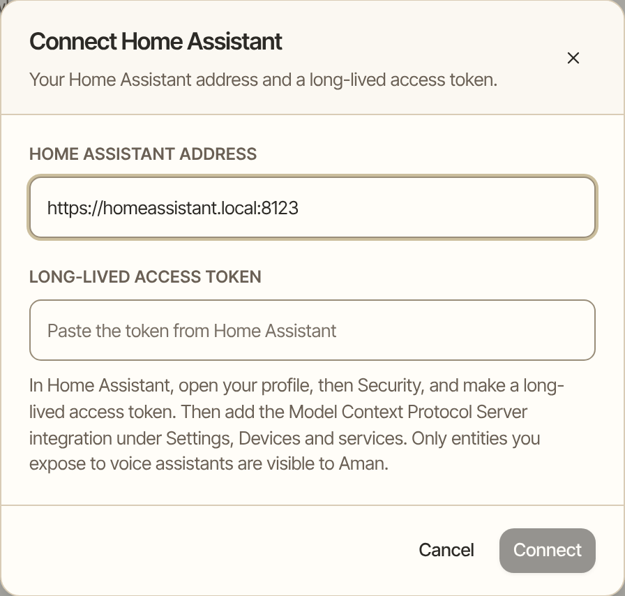
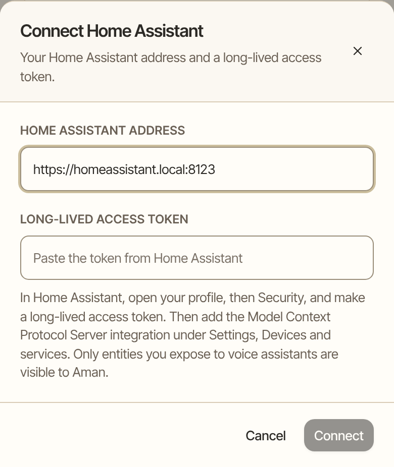

Connect your Home Assistant so Aman can tell you what's going on at home and, after you say yes, turn things on and off. Aman sees only the devices you choose to share. Locks, alarms and garage doors are never controlled.

How to get there: Click **More** in the left bar, then **Settings**, then **Connectors**, then find **home-assistant**.

=== "Computer"

    

=== "Phone"

    

!!! note "Before you start"

    You need a Home Assistant that you can open in a browser, and about five minutes. You do the first two steps in Home Assistant and the last one in Aman.

## Step 1: Make a token in Home Assistant

A token is a long code that lets Aman sign in to your Home Assistant without your password.

1. Open your Home Assistant and click your profile picture.
2. Click **Security**.
3. Under **Long-lived access tokens**, click **Create token**. Name it Aman.
4. Copy the token. Home Assistant shows it only once.

## Step 2: Add the MCP server in Home Assistant

This built-in integration is how Home Assistant talks to assistants like Aman.

1. In Home Assistant, click **Settings**, then **Devices and services**.
2. Click **Add integration** and choose **Model Context Protocol Server**.
3. Click **Submit**.

## Step 3: Connect in Aman

1. In Aman, click **More**, then **Settings**, then **Connectors**.
2. Find **home-assistant** and click **Connect**.
3. In **Home Assistant address**, type your Home Assistant address, such as `https://homeassistant.local:8123`.
4. In **Long-lived access token**, paste the token.
5. Click **Connect**.

Aman checks the connection. It says how many tools and shared devices it found, or the one thing to fix.

## Step 4: Choose what Aman can see

Aman sees only the devices you expose, which means share, in Home Assistant.

1. In Home Assistant, click **Settings**, then **Voice assistants**, then **Expose**.
2. Expose each device Aman may see or control.

!!! tip "Which address to use"

    The address must start with https, unless it's on your home network. An address on your own network may use http, because Home Assistant at home usually does. A Nabu Casa address, or the https address Tailscale gives your Home Assistant, also works.

## What Aman can and can't do

Aman works only with the devices you exposed. It can't see or touch anything else in your home. It can't change Home Assistant itself: no automations, no settings and no new devices.

| What Aman wants to do                                                                                             | What happens                                               |
| ----------------------------------------------------------------------------------------------------------------- | ---------------------------------------------------------- |
| Check on your home: what's on, one device's state, the list of shared devices                                     | Runs without asking                                        |
| Turn something on or off, set the temperature, brightness or position, run a script, start a scene, control media | Asks first, with a card that names the device              |
| The same change, for a device or a kind of device you allowed for good                                            | Runs without asking                                        |
| Unlock or lock a door, arm or disarm an alarm, open a garage door or a cover that leads outside                   | Refused. Aman never does these, and no setting allows them |

A refused request says: "Aman does not control locks, alarms or garage doors. Do that in Home Assistant."

If something Aman read, such as an email, asks for a change to your home, the change is refused. Only you can ask for a change.

### Allow a kind of device for good

When a card asks about a change, click **Always allow everywhere** to stop being asked. Aman then remembers your answer for that kind of device (all lights, all switches, all heating or all media players) or for that one device. It works the way mail remembers an address.

To see what you allowed, or take it back:

1. Click **More**, then **Settings**, then **Connectors**.
2. Click the **home-assistant** connector.
3. Under **Always allowed**, click **Revoke** next to the one you want to take back.

## Example

> **You:** Is the garage door closed?
>
> **Aman:** Yes. The garage door is closed, the front door is locked, and the heating is set to 22 degrees.
>
> **You:** Turn the heating down to 19 for the night.

Aman shows a card: "Set Hallway thermostat to 19 degrees", with **Allow**, **Always allow everywhere** and **Not now**. You click **Allow**.

> **Aman:** Done. The hallway thermostat is set to 19 degrees.
>
> **You:** Unlock the front door for the cleaner.
>
> **Aman:** Aman does not control locks, alarms or garage doors. Do that in Home Assistant.

## If the check says it couldn't connect

- **Nothing answered at that address.** Check the address, and check that Home Assistant is running.
- **Home Assistant refused the token.** Make a new long-lived access token and paste it in again.
- **The integration isn't installed.** Add the Model Context Protocol Server integration in Home Assistant, under **Settings**, **Devices and services**.
- **The certificate can't be checked.** The address probably uses a certificate Home Assistant made for itself. Use the http address on your home network, or the https address Tailscale gives your Home Assistant.

## Good to know

- The token is saved with the connector and never shown again. If you lose it, make a new one in Home Assistant, then click **Edit** on the connector in Aman and replace it.
- Checking on your home is quiet, so Aman can fold "the heating is set to 22 while you're out" into your morning brief.

## Related

- [Other connectors](../mcp-servers.mdx): adding and testing any connector.
- [Connect email and calendar](../../packages/trueforge/guide/topics/connect-mail-calendar.md)
