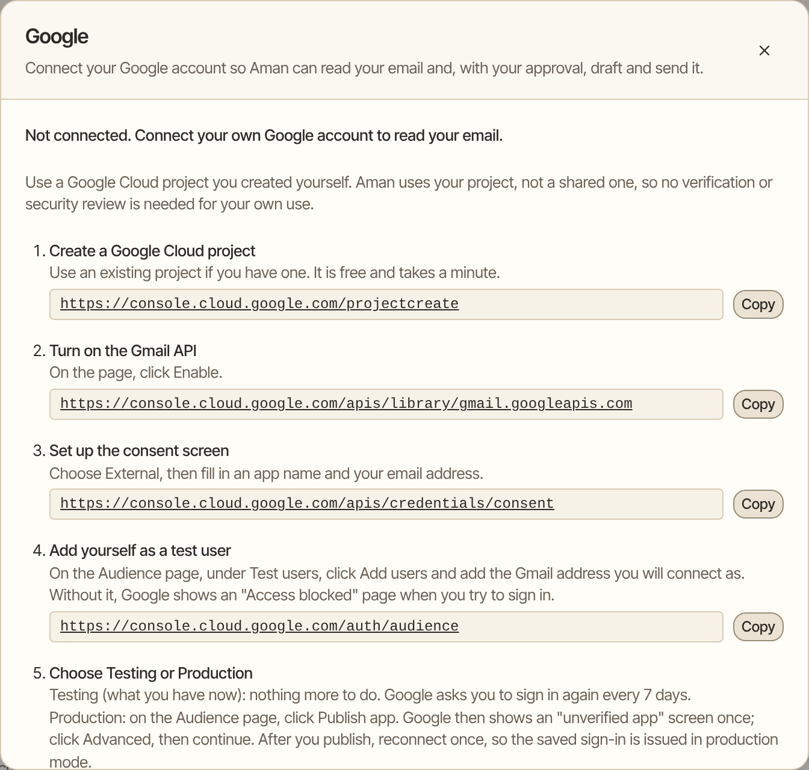
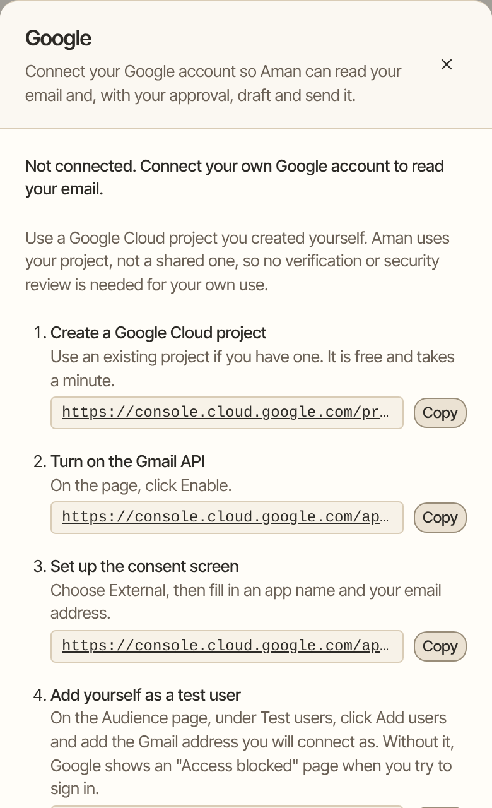

Connect your Google account so Aman can read and search your Gmail and look at your Google Calendar. If you allow it, Aman can also save drafts, send email, add events and work with some of your Google Drive files.

How to get there: Click **More** in the left bar, then **Settings**, then **Connectors**, then **Connect** on the **Google** card.

=== "Computer"

    

=== "Phone"

    

## What Aman can do

| Part     | Reads on its own                                                | Asks you first                         |
| -------- | --------------------------------------------------------------- | -------------------------------------- |
| Gmail    | Reads and searches your mail                                    | Every draft and every send             |
| Calendar | Reads your events                                               | Every new or changed event             |
| Drive    | Reads the files it created, or files you opened with Aman       | Every new Doc, every set of rows added to a Sheet |

The approval card shows exactly what will be sent or saved.

!!! tip "Only need your calendar?"

    The **Calendar** card connects Google Calendar with an app password, without a Google Cloud project. See [Connect your calendar with an app password](#connect-google-calendar-with-an-app-password).

## Before you start

!!! note "Why you make your own Google project"

    Aman connects through a Google Cloud project that you make yourself, in your own Google account. Aman doesn't use a shared project. So Google doesn't need to check or review anything for your own use.

    It's free and takes about ten minutes, once.

You need:

- the Google account you want to connect
- a computer with a browser, because the Google Cloud pages are hard to use on a phone

If Aman is in offline mode, turn it off first. Click **More**, then **Settings**, then **Permissions**, and turn off **Offline mode**.

## Connect Gmail

The Google panel in Aman lists these steps, each with a link you can copy. Keep the panel open in one tab and do each step in another.

1.  **Make a Google Cloud project.**
    Open the project link in the panel. Use a project you already have, if you like.

2.  **Turn on the Gmail API.**
    Open the Gmail API link and click Enable.

3.  **Set up the consent screen.**
    Open the consent screen link. Choose External, then type an app name and your email address.

4.  **Add yourself as a test user.**
    Open the Audience page link. Under Test users, click Add users and add the Gmail address you will connect.

    !!! warning "Don't skip this step"

        Without it, Google shows an "Access blocked" page when you sign in.

5.  **Choose Testing or Production.** See [Testing or Production](#testing-or-production) below. If you're not sure, leave it on Testing for now.

6.  **Make the client.**
    Open the credentials link and make a client. For the application type, choose the one the panel names: Desktop app on most installs.

    ??? note "If the panel says Web application"

        An install with a public address uses Web application. The panel then shows a Redirect URI. Add that exact address under authorized redirect URIs.

    Click Create, then Download JSON.

7.  **Give the client to Aman.**
    Drop the downloaded file onto the panel, or choose it with the file picker. Or type the **Client ID** and **Client secret** yourself.

    The file is read in your browser. Your client secret goes to Aman once, to start sign-in, and is never shown again.

8.  **Click Check my client.**
    It catches common mistakes before you sign in. Fix anything it lists. When it says "No problems found with this client", go on.

9.  **Choose what Aman may do.**
    By default Aman only reads your email. To let Aman save drafts and send email, tick the box about drafts and sending. Every draft and every send still asks you first.

10. **Click Connect Google.**
    A Google window opens. If nothing opens, allow pop-ups for this site, or click the "open Google sign-in here" link in the panel.

11. **Allow access on Google's screen.**
    Google says it hasn't verified the app. That's because you made the app yourself. Click Advanced, then Go to your app, then Continue, and allow access.

The panel then says "Google is connected" and shows your Google address.

### If the page "can't be reached"

On some installs, Google sends your browser back to a page that won't load, such as "This site can't be reached". That's expected. The address of that page finishes the sign-in.

1. Copy the whole address from the address bar of that page.
2. Paste it into **Address from the address bar** in the panel.
3. Click **Finish connecting**.

=== "Safari on a Mac"

    Click the address bar, then choose Select All (++cmd+a++) and Copy (++cmd+c++). Safari hides the start of the address, so this makes sure you copy all of it.

=== "iPhone or iPad"

    Tap the address bar, choose Select All, then Copy, so you get the whole address.

The address works once, for this sign-in only.

## Testing or Production

A new Google project starts in Testing. You can keep it there or publish it.

=== "Testing"

    Nothing more to do. Google signs you out every 7 days, so you reconnect once a week.

=== "Production"

    1. In Google Cloud, open the Audience page and click Publish app.
    2. Google shows the "unverified app" screen once. Click Advanced, then continue.
    3. Back in Aman, reconnect once, so the saved sign-in is issued in production mode.

    Google then keeps you signed in.

## Connect your calendar

Calendar is separate from mail, and stays off until you connect it. Finish the Gmail steps first.

1. In the Google panel, find the Calendar part.
2. Open the Calendar API link and click Enable. Without this, Aman says the Google Calendar API isn't turned on.
3. Click **Connect Calendar**. On Google's screen, leave the calendar box ticked and continue.

Aman reuses the client you already saved, so there's nothing to type again.

Once it's on, ask things like "Any birthdays coming up?" or "What's on my calendar Thursday?"

### Let Aman add events

When an email or a chat mentions something like a dentist appointment, Aman can put it on your calendar. It doesn't hand you a file to download.

This is off until you turn it on. In the Calendar part of the Google panel, click the button that starts with "Allow" and ends with "to add events", and allow it on Google's screen. Aman only gets permission to work with events, not your calendar settings or sharing.

### Connect Google Calendar with an app password

This is the simpler way to connect Google Calendar only. It doesn't connect Gmail, and needs no Google Cloud project.

1. Turn on 2-Step Verification for your Google account, if it's not on yet. Google only offers app passwords after that.
2. Open myaccount.google.com/apppasswords, type a name such as Aman, and select Create.
3. Copy the 16-letter password Google shows. Google shows it only once.
4. In Aman, open **Settings**, then **Connectors**. Find **Calendar** and click **Connect**.
5. Pick Google, type your Gmail address (for example, yourusername@gmail.com), and leave the login name empty.
6. Paste the app password and click **Connect**.

Aman fills in the calendar address from your email address: `https://calendar.google.com/calendar/dav/yourusername%40gmail.com/`.

If a Google Workspace admin has turned app passwords off for your account, use the Google panel instead.

## Connect Google Drive

Drive is separate from mail and calendar, and stays off until you connect it. Finish the Gmail steps first.

1. In the Google panel, find the Drive part.
2. Open the Drive API, Docs API and Sheets API links, and click Enable on each page. All three are needed:
    - The Drive API lists your files.
    - The Docs API reads a Doc.
    - The Sheets API reads a Sheet and adds rows to it.
3. Click **Connect Google Drive**. On Google's screen, leave the Drive box ticked and continue.

Without those APIs, Aman says the API isn't turned on and points you back to these links. Aman reuses the client you already saved, so there's nothing to type again.

## Check, reconnect or disconnect

- **Check it:** click **Test connection**. It checks both mail and calendar. If mail works but Calendar doesn't, the panel says so and points back to the Calendar API link.
- **Allow drafts later:** click **Allow drafts and sending**.
- **Reconnect:** if Google no longer accepts the saved sign-in, the panel says "Reconnect needed". Mail, calendar and Drive files pause, and everything else in Aman keeps working. Click **Reconnect** and sign in again. There's nothing to type again.
- **Disconnect:** click **Disconnect**, then **Disconnect Google**. This turns off mail, calendar and Drive.

When you disconnect, Aman asks Google to take back its access and deletes the saved sign-in. If Google doesn't confirm, Aman still removes the connection and tells you. You can also remove access in your Google account settings. Emails already sent stay in Gmail.

## Good to know

### Email

- Email is treated as untrusted. Text inside a message can't change what Aman does or skip an approval.
- A reply stays in its conversation. Aman reads the thread from Gmail itself. The approval card says which thread it's for ("Reply in the thread", with the original subject and sender).
- A reply whose thread links don't match that thread is refused. If a send is refused, nothing is sent, and any new or changed draft asks for a new approval.
- Aman connects one Google account per person.

### Attachments

Ask Aman to open an attachment and it reads the file in the sandbox. This needs the sandbox to be on. Without it, Aman tells you attachments can't be opened. Aman can read:

- PDFs (including scanned pages) and images
- Word (`.docx`, `.doc`), Excel (`.xlsx`, `.xls`), CSV and PowerPoint (`.pptx`)
- OpenDocument (`.odt`, `.ods`, `.odp`), RTF and HTML
- forwarded emails saved as `.eml` or `.msg` (with the text of their own attachments)
- calendar invites and text files

Text from an attachment is treated as untrusted, like the email itself. See [Document attachments](sandbox.mdx#document-attachments) for how each kind is read.

### Calendar

- Aman can list events in a date range, search events by words, and open one event to see its guests, place, description and how it repeats.
- Reading never changes anything, and Aman never replies to an invite.
- With the app password, Aman reads only your own calendar. Calendars other people share with you, and holiday calendars, are left out on purpose, because other people can write into them.
- Times show in your device's time zone. If the device doesn't say, Aman uses your calendar's time zone.
- All-day events such as birthdays show as dates, without a time zone shift. A very large event is shortened, and Aman says that some details were left out.
- Anyone who invites you can write event text, including titles and descriptions. So it's treated as untrusted, like an email. Text inside an event can't change what Aman does or skip an approval.

??? note "Adding and changing events: the details"

    **What Aman can change.** Aman can add an event to your main calendar. It can also move or rename an event you made. For a repeating event it changes one date at a time, never the whole series. Aman can't delete events. It can't change an event someone else organizes, or one whose guest list Google doesn't show in full.

    **What you approve.** Nothing is saved until you approve it. The approval card shows, in plain words:

    - which calendar, the title, the day and time, the time zone, and how long it lasts
    - the place and the description, when there are any
    - every guest, and whether Google will email them
    - for a change, the event as it is now and as it will be

    **Guests.** Inviting guests means Google emails them an invitation, the same as if you sent it yourself. So the card always says whether that will happen. If the guests would also get something the card can't show, such as a video call link or attached files, Aman doesn't offer the change. Aman also refuses to email event text that contains a password or key.

    If you approve and then anything changes, nothing is saved and Aman asks again. This covers the details Aman asked to save, and the event itself in your calendar.

    **Times.** Times are read in your device's time zone, or the time zone you name. If neither is known, Aman uses your calendar's time zone. If that's unknown too, it asks you instead of guessing.

    **Record of approvals.** Every event you approve is recorded in the permissions log. When Aman then saves it, the log also says whether Google saved it, or why it wasn't saved. A change refused before that point, such as one whose details changed after you approved it, shows only your approval. That record stays on your Aman server even if you delete the chat. An approval that runs out before it's used never saves anything.

### Drive

- Google only ever shows Aman the files Aman created itself, or files you opened with Aman. Everything else in your Drive isn't listed and can't be read.
- With those files, Aman can list and search them, read a Google Doc, read the rows of a Google Sheet, create a new Doc, and add rows to a Sheet.
- Creating a Doc and adding rows to a Sheet ask you first. The card shows the whole text of the Doc, or every row that will be added.
- Aman can't delete a file, and can't change who a file is shared with.
- Anyone the file is shared with can write text inside a Doc or a Sheet. So it's treated as untrusted, like an email. Text inside a file can't change what Aman does or skip an approval.

### Scheduled runs

- Scheduled runs, such as a morning brief, can read your email, calendar and Drive files.
- They never draft or send email, and never create a Doc or add rows to a Sheet.
- A scheduled run that wants to add or change an event puts it on the **Needs your OK** list in that chat, with the same card. Nothing happens until you approve it there.

### Privacy

- After Aman reads your email, calendar, a document or an attachment in a conversation, a web search or map in that conversation runs without asking only if it doesn't copy anything from what it read. That means a sender's name, an email address, a phone number, a long number, or a run of five or more words. Line breaks and extra spaces don't hide a copy.
- Aman also checks what a command printed after such a read. The check doesn't catch a reworded copy. If it can't check a result in full, it asks you first. In a scheduled run it skips that lookup and tells you.
- Offline mode turns Gmail, Calendar and Drive off, because they need the internet.
- Your client secret and sign-in are stored on your Aman server, in its data folder. They aren't encrypted there, so keep that folder private.

## Advanced: demo instances

??? note "Running a demo instance with Google"

    On a demo instance (`DEMO_MODE=true`), Google works and Aman can read mail and calendar events and save drafts, but it can only send to addresses you list. The Google card then says the demo uses a sample Google account. Set these in the instance's `.env`, then restart:

    - `DEMO_GOOGLE_ACCOUNT`: the one Google account the demo accepts, for example `DEMO_GOOGLE_ACCOUNT=maya@example.com`. Left empty, no Google account can be connected.
    - `DEMO_SEND_ALLOWLIST`: the only addresses a demo may send to, comma-separated, for example `DEMO_SEND_ALLOWLIST=maya@example.com,friend@example.com`. Capital letters and extra spaces don't matter. Left empty, a demo sends nothing at all.

    How it behaves:

    - Connect the demo's Google account once, before visitors arrive. Sign in as the same Aman user the visitors will use.
    - Only the account named in `DEMO_GOOGLE_ACCOUNT` is accepted. The demo asks Google for every feature at once.
    - After that nobody can reconnect or disconnect it from the panel, and the panel says so. If a feature was left out when you signed in, the panel stays open so the named account can connect again and add it.
    - The send list covers To, Cc and Bcc. If any recipient isn't on it, the send is refused before an approval card appears, and again at the moment of sending.
    - Calendar guests must be the demo's own addresses too. This holds even when Google wouldn't email them, because the invite still lands on their calendar.
    - The demo refuses sends it can't fully check. Connected services other than Gmail can't be used for anything that isn't read-only.
    - An entry that isn't a plain email address stops Aman from starting.
    - Outside demo mode both settings are ignored.

    If the Google project is in Testing mode, Google signs the account out every 7 days and mail stops until it's reconnected. Publish the project to avoid this. To recover, sign in as the demo user, open **Settings**, **Connectors**, **Google**, and click **Reconnect** with the account named in `DEMO_GOOGLE_ACCOUNT`.

## Related

- [Connect email and calendar](../packages/trueforge/guide/topics/connect-mail-calendar.md): which card to pick.
- [Email](../packages/trueforge/guide/topics/email.md)
- [Calendar](../packages/trueforge/guide/topics/calendar.md)
