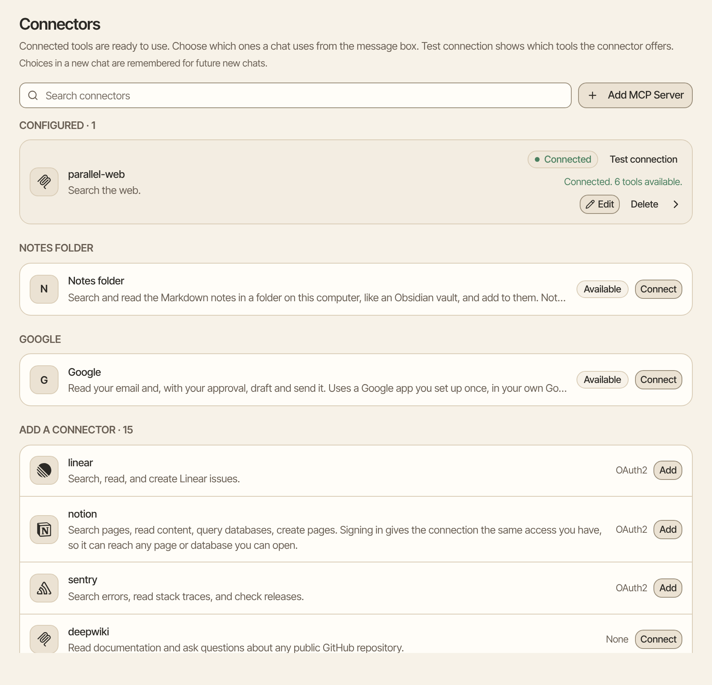
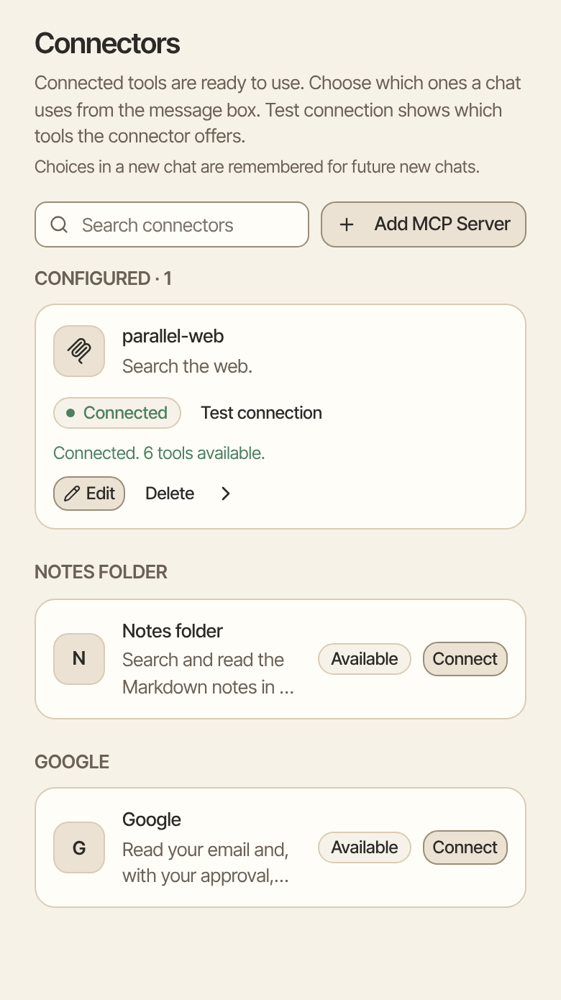

A connector links Aman to another app or service, such as Notion, GitHub or your Home Assistant. Once it's connected, Aman can use that service's tools in your chats, like searching your Notion pages or checking a pull request.

How to get there: Click **More** in the left bar, then **Settings**, then **Connectors**.

=== "Computer"

    

=== "Phone"

    

!!! note "Looking for email, calendar or notes?"

    Those have their own cards on the same page. See [Connect email and calendar](../packages/trueforge/guide/topics/connect-mail-calendar.md) and [Your notes folder](../packages/trueforge/guide/topics/notes-folder.md).

## What's on the Connectors page

- **Configured:** the connectors you already set up, with whether each one works.
- **Add a connector:** a ready-made list of services. Next to each one, a small label says how it signs in: **None**, **API Key** or **OAuth2** (a sign-in window from the service).
- **Search connectors:** a box to find a connector by name.
- **Add MCP Server:** a button to add a service that isn't on the list, by its address.

Some connectors are technically called MCP servers. MCP is the common language Aman uses to talk to these services.

## Add a connector from the list

1. Click **More** in the left bar, then **Settings**, then **Connectors**.
2. Find the service under **Add a connector**, or type its name in **Search connectors**.
3. Click **Connect** or **Add** next to it. What happens next depends on how the service signs in:

=== "API key or token"

    The button says **Connect**. A box opens.

    1. Make a key or token in the service's own settings. Give it only the access Aman needs.
    2. Paste it in **API key / token**.
    3. Click **Connect**.

=== "Sign-in window"

    The button says **Add**. The connector is added, but not signed in yet.

    1. Click the connector under **Configured** to open it.
    2. Click **Connect**.
    3. Sign in to the service in the window that opens, and allow access.

    You can also leave it for later. The first time a chat needs the connector, the chat pauses and shows a **Connect** button. Sign in, then click **Continue**, and the chat carries on.

=== "No sign-in"

    The button says **Connect**. The connector is added straight away.

### Notion

1. Find **notion** and click **Add**.
2. Click the notion connector under **Configured**, then click **Connect**.
3. Sign in to Notion in the window that opens, and pick your workspace.

Signing in gives Aman the same access you have in Notion. Aman can then reach any page or database you can open, search and read them, and make new ones.

### GitHub

1. In GitHub, open your settings, then Developer settings, then Personal access tokens. Make a fine-grained token, with only the repositories and permissions Aman needs.
2. In Aman, find **github** and click **Connect**.
3. Paste the token and click **Connect**.

Aman can then work with your issues, pull requests, repository files and CI status.

### Home Assistant

**home-assistant** connects to your own Home Assistant, with its address and a long-lived access token. See [Home Assistant](connectors/home-assistant.md) for the steps, and for what Aman may and may not do in your home.

### Slack

There's no Slack on the list, because Slack's server can't set up its own sign-in. To use Slack:

1. Make your own Slack app with MCP turned on, following Slack's MCP guide.
2. In Aman, click **Add MCP Server** and choose **OAuth (manual)**.
3. Type the server address from Slack's guide, and paste your app's **Client ID** and **Client Secret**.

Slack's tools read and post as you. Connecting Slack doesn't make Slack a way to chat with Aman.

## Add a connector by its address

Use this for a service that isn't on the list. The service gives you its address, which often ends in `/mcp`.

The address can be on the internet or on your home network. A service on the same computer as Aman can't be added here. See [Which addresses a connector may use](#which-addresses-a-connector-may-use) below.

1. Click **Add MCP Server**.
2. Type a **Name** and a short **Description**.
3. Paste the address in **URL**.
4. Under **Auth type**, choose how the service signs in. The service's own help says which one to pick:
    - **None:** the service needs no sign-in.
    - **API key:** paste the key or token from the service. **Header name** is optional. Leave it empty unless the service names one.
    - **OAuth (automatic):** you sign in through a window, and Aman sets up the rest.
    - **OAuth (manual):** paste the **Client ID** and **Client Secret** from the service. **Scopes** are optional.
5. Click **Add**.

## Test a connector

Click **Test connection** next to a connector under **Configured**. Aman checks that it can reach the service, then lists the tools it offers, or says the one thing to fix.

The label next to each connector shows how it's doing:

- **Connected:** the last test worked.
- **Connection failed:** the last test didn't work. The message under it says what to do.
- **Unverified:** it's signed in but hasn't been tested yet.
- **Added:** it isn't signed in yet.

## Use a connector in a chat

Choose which connectors a chat uses from the message box. In a new chat, your choices are remembered for future new chats.

## Change or remove a connector

- **Change it:** click **Edit** next to the connector, change the address or key, and click **Save**. Leave the key empty to keep the current one.
- **See its tools:** click the connector to open it. The page lists its tools, and the tools you allowed for good under **Always allowed**. Click **Revoke** to take one back.
- **Sign out:** open a connector that uses a sign-in window and click **Disconnect**.
- **Remove it:** click **Delete**, then **Delete** again. Chats that used it show it as unavailable until you remove it there.

## Which tools ask first

Every tool on a connector you add asks for your OK before it runs, whatever the connector says about itself. When a card asks, you can click **Allow** for this one time, or **Always allow everywhere** to stop being asked for that tool.

??? note "Advanced: the two exceptions"

    A tool that says it is read-only or closed-world can only make a call ask, never skip asking. There are two exceptions.

    **Your own memory provider.** When you save a connector as the memory provider and its address is on an origin listed in the server's `FIRST_PARTY_MCP_ORIGINS` setting (see `packages/trueforge/.env.example`), the server treats it as first-party. A tool on it that declares both `readOnlyHint: true` and `openWorldHint: false` then runs without a card, and each run is recorded in the audit log. Everything else on it still asks. A first-party connector doesn't follow redirects, so give the address that serves MCP directly. Only whoever runs the server can list an origin: nothing in Settings, the API or a chat can make a connector first-party. An empty list, which is the default, means none is.

    **The Email and Calendar connectors.** They are first-party only at the exact address the server was set up with for that connector. The server adds that address's origin to the first-party list itself, so there's nothing to list. A mark stored on the record neither grants nor removes this, and if the server isn't set up with an address, neither connector is first-party. Reading mail and looking at the calendar then run without a card. Sending mail and changing the calendar still ask, and **Always allow everywhere** never covers a send or a calendar change. An import leaves out an Email or Calendar connector that isn't at the address this server was set up with, and lists it in the import summary. Set those up from Settings. A connector that only has one of those names, at any other address, asks like any other.

## Your web search provider

One connector can be your web search provider. Searches through it run without asking, in chats and in scheduled runs. Each one shows a **Searched** chip in the chat and a row in the audit log.

A new install comes with the Parallel connector already added as the search provider. It's free and needs no key, so the first search needs no setup.

To pick a different provider:

1. Click the connector under **Configured** to open it.
2. Turn on **Web search provider**.

Only one connector can be the search provider at a time.

To stop searching, remove the parallel-web connector or turn on **Offline mode**. To approve every search yourself, turn off **Web searches** under **Settings**, **Permissions**.

### Use Tavily to find places

Tavily is another search provider. It also lets Aman find places for you, such as "Find me an English-speaking doctor near me". Tavily needs a key. You can get one for free from Tavily, with 1,000 credits a month.

1. Find **Tavily** under **Add a connector** and click **Connect**.
2. Paste your key.
3. Click **Connect** again.
4. Open the Tavily connector and turn on **Web search provider**.

Aman then runs one Tavily search, then reads the two or three best pages, and drops a pin on the map for each place it finds. Each pin card shows only the details the page really states (name, address, languages, hours, price and phone), and "from <site>, <time>" with a link to the page. A detail a page doesn't state is left out, never guessed. A run uses about 3 Tavily credits: 2 for the search and 1 for reading up to 5 pages.

Placing the pins is its own step and always asks, because the addresses are sent to the map search service. A place that's already in your calendar is marked "Already in your calendar", never left out.

??? note "Advanced: how search providers work"

    **Which tools run without asking.** Only a tool the connector declares read-only runs this way, or one that the shipped preset for a known provider (Parallel, Tavily, Exa) lists as a search tool. Every other tool on the connector, and the same tool on any other connector, still asks. So picking a connector that can write doesn't let its write tools run silently.

    **Parallel by default.** An existing install that has no search provider gets Parallel once, the first time it starts after an update. It's added only once: if you remove the connector, it stays removed, and a provider you chose, or one you turned off, is never replaced. If you added Parallel before you could pick a search provider, it's now your search provider, unless you already picked one or turned it off.

    **Tavily at startup.** An instance can be set to Tavily at startup: set `SEARCH_PROVIDER=tavily` and `TAVILY_API_KEY` in the instance `.env` file, then restart. The installer doesn't ask for either value, so set them by hand. Startup then writes the Tavily connector and makes it the one search provider, replacing any other provider, so changes made in Settings are overwritten on each start.

    **What the provider sees.** Searches go to the search provider the card names (Parallel by default, or Tavily), which sees the search words and this instance's internet address. Tavily calls go to `api.tavily.com`. When one asks, the card shows the exact words or links, where they're sent and how many credits it will use. Pages are treated as untrusted text: Aman reads them for facts and never follows instructions found inside them.

    **Checks before a search.** Before a search leaves the server, a fixed check looks for secrets in the query: any key, token or password the server holds, private keys, API keys, long encoded strings, password labels and card numbers. Short extra details a known provider adds to each search, such as Parallel's session id and model name, are shown with the search. One longer than 40 characters asks first, and an unusual one is checked like your query. The check reads the query after normalizing look-alike characters and decoding percent escapes, and it also reads the turn's earlier searches, so a secret split over two searches is still caught. A query that trips the check asks, with the exact query on the card. In a scheduled run it's held for you instead: the run carries on without it, and the search waits under **Needs your OK** with the exact query until you approve or deny it.

    **What runs without asking.** What you tell Aman, and what it knows about you, is yours to search with: a search that names your city, a person from your mail or a link you pasted runs without asking. Opening a page runs too, whether you typed the link, a search returned it, or Aman chose it for your request. One kind of page is held: a link that only a page or someone else's email gave, when Aman would add anything to it, such as your email address. In a scheduled run that page is skipped instead, and the run tells you so. After 20 lookups in one reply, Aman stops looking things up and tells you in one line, with no card.

## Advanced: for people who run Aman

??? note "Sign-in windows and your public address"

    For a sign-in window to work, the service must send you back to your Aman, so Aman needs to know its own public address. That is the `PUBLIC_BASE_URL` setting. It defaults to `http://localhost:<port>`, which is fine on your own computer. Set it whenever Aman is reached at a different address, such as a domain, a reverse proxy or another computer. Set it as an environment variable for `npx`, in `packages/trueforge/.env` for Docker Compose, or as `server.publicBaseUrl` for Helm. See the [Quickstart FAQ](quickstart.mdx#faq).

    Finish signing in in the same browser session, signed in to Aman as the same person who started it. If that session is missing or belongs to someone else, the server refuses to save the sign-in.

??? note "How sign-in types work"

    - **None:** for public services, or services only your own network can reach.
    - **API key (header):** a fixed key or token sent with every request, in the `Authorization` header unless you name another.
    - **OAuth (automatic, Dynamic Client Registration):** Aman registers itself with the service, runs the sign-in, and stores and refreshes the tokens. Nobody pastes tokens into a chat.
    - **OAuth (manual):** the same, with a client you registered with the service yourself.

    Keys and sign-ins are stored with the connector, never in an agent. Agents attach connectors by name.

??? note "Which addresses a connector may use"

    Aman checks a connector's address when you save it, and again each time the connector connects.

    - An address on the internet or on your home network works.
    - These are refused: an address of the computer Aman runs on, a link-local or cloud metadata address, and an address with a name and password in it.
    - When Aman runs in a container, every address on the container networks it sits on is refused too. The other members of those networks are Aman's own parts.
    - The check looks at the addresses a name points to, not just the name. A name that points to a refused address is refused.
    - A name that can't be looked up when the connector connects is refused, because it can't be checked.
    - For OAuth sign-in, the addresses the service names for sign-in are checked the same way before Aman connects to them. That includes every address a sign-in answer redirects to.

    Whoever runs Aman can still allow one exact service on the same computer. List its origin in the `FIRST_PARTY_MCP_ORIGINS` setting (see `packages/trueforge/.env.example`). That marks it as the operator's own service, and the check doesn't second-guess it.

??? note "Where the list of connectors comes from"

    The list under **Add a connector** comes from the catalog that ships with Aman. See [Initial setup](harness/initial-setup.mdx#what-is-supported-out-of-the-box) for how the catalog works and how to change what the app offers.

    A connector is then available when you [create an agent](create-agent/overview.mdx). You can choose which tools need approval through the API ([what's in an agent](create-agent/overview.mdx#whats-in-an-agent)), and keep tool lists lean with [deferred tool loading](key-features/deferred-tool-loading.mdx).

## Related

- [Connect email and calendar](../packages/trueforge/guide/topics/connect-mail-calendar.md)
- [Home Assistant](connectors/home-assistant.md)
- [Search the web](../packages/trueforge/guide/topics/web.md)
