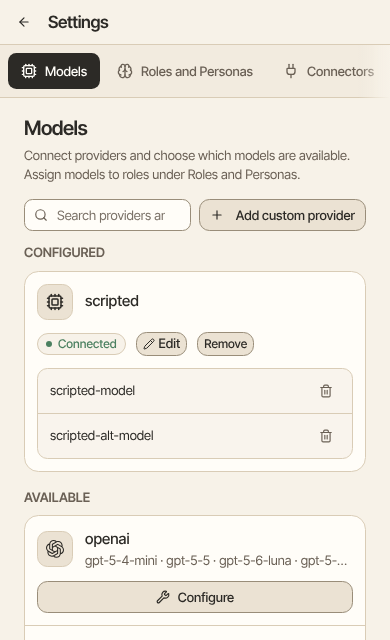

Aman works with the major model providers and any OpenAI-compatible endpoint. Configure credentials once under **Settings → Models**. Agents reference models by name — agent definitions never contain API keys.

How to get there: Click **More** in the left bar, then **Settings**, then **Models**.

## Supported providers

| Provider type   | Notes                                                                  |
| --------------- | ---------------------------------------------------------------------- |
| `openai`        | OpenAI                                                                 |
| `anthropic`     | Anthropic                                                              |
| `google-gemini` | Google Gemini                                                          |
| `fireworks`     | Fireworks AI                                                           |
| `together`      | Together AI                                                            |
| `moonshot`      | Moonshot AI (Kimi)                                                     |
| `zai`           | Z.ai (GLM)                                                             |
| `alibaba`       | Alibaba (Qwen)                                                         |
| `custom`        | Any OpenAI-compatible endpoint — self-hosted models, gateways, proxies |

## Configuring a standard provider

Open **Settings → Models**, pick a provider, and paste your API key. Models from that provider become available immediately in the agent model selector.

The provider list comes from the shipped model catalog — see [Initial Setup](/harness/initial-setup#what-is-supported-out-of-the-box) for how catalogs work and how to change what the UI offers.

## Adding a custom provider

Use the `custom` provider type for vLLM, Ollama, a corporate gateway, or any other OpenAI-compatible API. Custom providers are not in the catalog — you add them yourself with a base URL, API key, and the model IDs you want exposed.

## Assigning models to jobs

This page is inventory: which providers are connected and which models exist. Which model does which
job (main chat, sub-agents, compaction, and named personas) lives under **Settings → Roles and Personas**.
See [Roles and Personas](/model-roles).

<Note>
  **Planned:** automatic model selection for different turns or subagents. Today every model choice is one
  you made explicitly, per role or per persona. In the future, Aman will be able to pick among a set
  of models per turn or subagent based on task complexity, latency, and cost.
</Note>

## Stalled model streams

### How long Aman waits

Aman waits 90 seconds for a model's first output. After that it waits 60 seconds between chunks. While the model is writing out a tool call, it waits 3 minutes between chunks.

The first-output wait starts when the request is sent. So it also covers the wait for the provider to start answering.

Nonempty reasoning and tool-argument chunks count as progress. Empty transport heartbeats do not.

There is no overall answer-duration ceiling, and thinking remains enabled where configured.

### Changing the waits

Set `MODEL_FIRST_RESPONSE_TIMEOUT_MS`, `MODEL_STREAM_IDLE_TIMEOUT_MS` and `MODEL_STREAM_TOOL_CALL_IDLE_TIMEOUT_MS` to change them.

A provider's `stream_timeout` can only shorten them for that provider.

To give a local model that takes long to load more time, raise `MODEL_FIRST_RESPONSE_TIMEOUT_MS`.

Embedders of the core library can supply `VercelAILLMConfig.streamTimeout` with positive `firstChunkMs` and `chunkMs` values within the runtime timer range (at most 2,147,483,647 milliseconds). Without it the defaults are five minutes and sixty seconds.

These are host settings, not model request parameters. Standalone embedders must supply their own overall cancellation signal.

### When a timeout happens

A timeout fails the turn with its recorded cause.

An unfinished tool proposal is never approved or executed, and is not automatically retried.

Results from earlier completed tool calls remain in the audit history.
