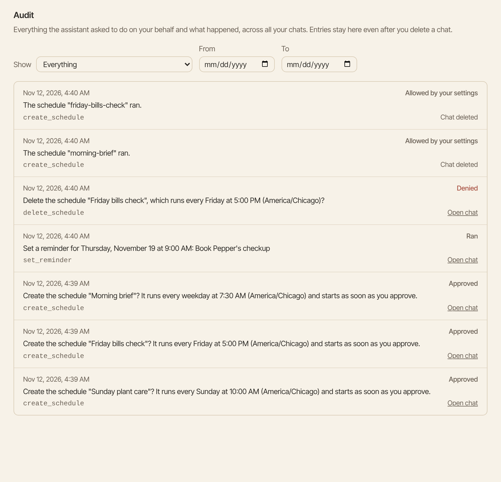
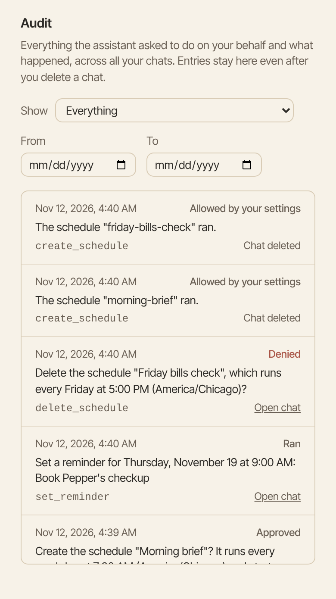

The activity log lists everything Aman did or asked to do for you, across all your chats. Use it to check what happened and what you decided.

How to get there: Click **More** in the left bar, then **Settings**, then **Audit**.

=== "Computer"

    

=== "Phone"

    

## Look through the log

1. Click **More** in the left bar, click **Settings**, then click **Audit**.
2. Read the list. The newest action is at the top. Each line shows when it happened, what Aman did in plain words, such as "Sent an email", and what came of it.
3. Click **Open chat** on a line to go to the chat it came from.
4. Click **Load more** at the bottom to see older actions.

## Find one action

1. Pick what to **Show**, such as **Approved** or **Denied**. Pick **Everything** to see all of them again.
2. To see certain days, pick a **From** day and a **To** day. Days follow your own clock, and both days are included.
3. Click **Clear dates** to see every day again.

## What each outcome means

| Outcome                      | What it means                                                |
| ---------------------------- | ------------------------------------------------------------ |
| **Allowed by your settings** | It ran without a card, because your settings allow it.       |
| **Waiting for you**          | A card is waiting for your answer.                           |
| **Ran**                      | It ran.                                                      |
| **Approved**                 | You answered the card with yes.                              |
| **Denied**                   | You said no, so it didn't run.                               |
| **Refused**                  | Aman refused it without a card, for example in offline mode. |

## Good to know

- The log stays when you delete a chat. Those lines say "Chat deleted" instead of a link.
- The log only shows what happened. You can't change or delete lines here.
- Each change a scheduled run makes to a space is a line in the log too.
- The log keeps a short line about each action, even from an incognito chat. That line can repeat words from the action, such as the address an email went to.

## Related

- [Approval cards](approvals.md)
- [Permissions and offline mode](permissions.md)
- [Your privacy](privacy.md)
