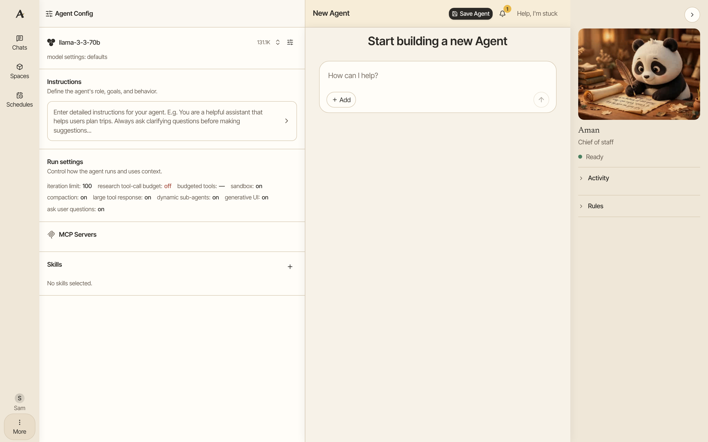
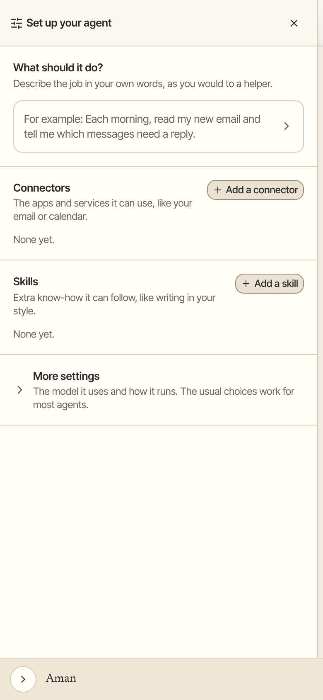

An agent is a saved setup for one job: a model, instructions, and the connectors and skills it may use. Build it once, then try it whenever you like or have it run on a schedule, such as a weekly summary every Monday.

How to get there: Click **More** in the left bar, then **Build agent**.

=== "Computer"

    

=== "Phone"

    

!!! note "Agent or persona?"

    An agent does a job you set up ahead of time, and it is what runs your [schedules](schedules.md). A [persona](personas.md) is a helper that chats with you in your everyday chats. If you want someone to talk to, make a persona instead.

## Build an agent

1. Click **More** in the left bar, then **Build agent**. A new chat opens with the **Agent Config** panel beside it.
2. Click **Edit Model** and choose a model.
3. Click **Edit Instructions** and write what the agent should do, such as "Every week, sum up my unpaid bills in a short list."
4. Add any connectors and skills the agent needs in the same panel.
5. Try it out in the chat until it does what you want.
6. Click **Save Agent**.
7. Type an **Agent name** and a **Description**. You need both.
8. Click **Save changes**.

## Use an agent

1. Click **More** in the left bar, then **Agents**.
2. Click **Try** on your agent's row. A chat opens with that agent.

To run it on a schedule, point at its row and click **Schedule**. See [Schedules](schedules.md).

When you make a schedule by asking in a chat, Aman saves an agent for it, named after the schedule. It shows up here, and you can change its tools, instructions or model. Deleting the schedule leaves the agent in place.

## Change, copy or delete an agent

Open **Agents**, then click the menu at the end of the agent's row:

- **Edit** opens the agent so you can change it. Click **Update Agent** to save.
- **Clone** makes a copy you can change without touching the original.
- **Manage Schedules** shows the schedules that use it.
- **Delete** removes it. Aman asks first.

## Choose when an agent summarizes a long chat

A model can only read so much of a chat at once. When a chat gets long, Aman summarizes its oldest part so the model can keep going.

1. In the **Agent Config** panel, click the edit button on **Run settings**.
2. Find **When to summarize long chats**.
3. Pick **Automatic (recommended)** to let Aman decide from the model's size limit. If that limit isn't known, Aman uses a safe default.
4. Or pick **At a set size** and type the chat size to summarize at. It starts near the size Automatic would use for that model.
5. Close the panel, then click **Save Agent**.

## Good to know

- An agent follows the same approval rules as Aman. Sending, deleting and installing still wait for your OK.
- For every option an agent has, see [Create an agent](../../../../docs/create-agent/overview.mdx).

## Related

- [Personas](personas.md)
- [Schedules](schedules.md)
- [Skills](skills.md)
