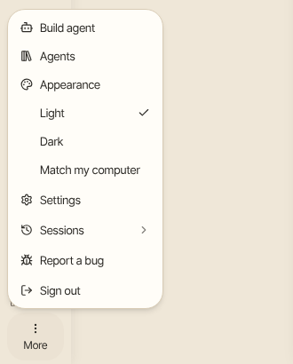
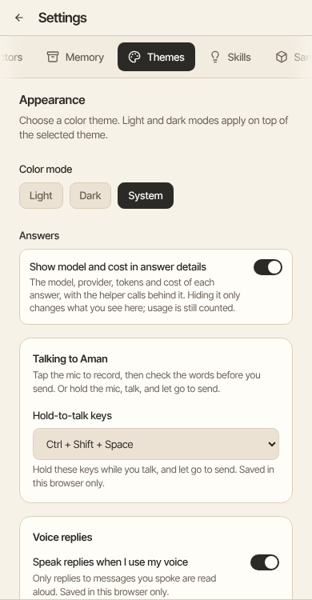

## Switch between light and dark quickly

Click **More** at the bottom of the left bar. Under **Appearance**, click **Light**, **Dark** or **Match my computer**. A check shows the one you use now.

## Choose a colour theme

How to get there: Click **More** in the left bar, then **Settings**, then **Themes**.

1. Click **More** in the left bar, then click **Settings**.
2. Click **Themes**. The page is called **Appearance**.
3. Under Color mode, click **Light**, **Dark** or **System**. **System** follows your computer.
4. Under Theme, click **Paper**, **Forest**, **Midnight** or **High contrast**.

**High contrast** gives the clearest text. Your choice stays until you change it.
