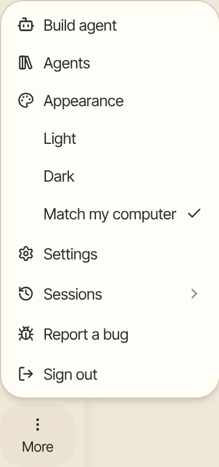
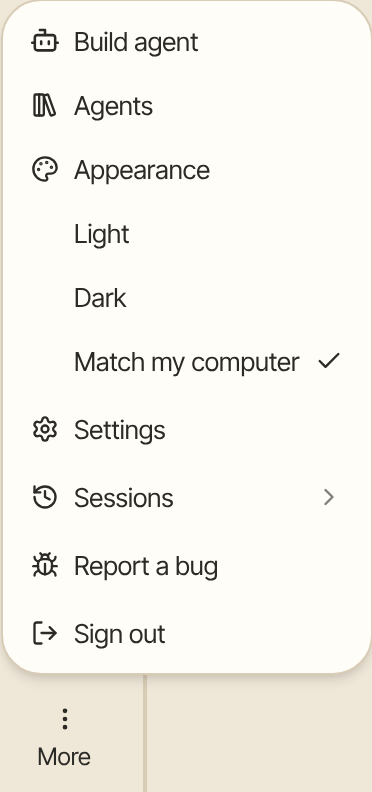

Make Aman easier on your eyes. Switch between light and dark in two clicks, or pick a color theme that suits you.

How to get there: Click **More** in the left bar, then **Settings**, then **Themes**.

=== "Computer"

    

=== "Phone"

    

## Switch between light and dark

1. Click **More** at the bottom of the left bar.
2. Under **Appearance**, click **Light**, **Dark** or **Match my computer**.

A check shows the one you use now. **Match my computer** follows your computer's own light or dark setting.

=== "Computer"

    

=== "Phone"

    

## Choose a color theme

1. Click **More** in the left bar, then **Settings**, then **Themes**. The page is called **Appearance**.
2. Under **Theme**, click **Paper**, **Forest**, **Midnight** or **High contrast**. The theme you use now is marked **Active**.
3. Under **Color mode**, click **Light**, **Dark** or **System**. **System** follows your computer, like **Match my computer** does.

Light and dark work with every theme. **High contrast** gives the clearest text.

## Make the words in your chats bigger or smaller

1. Click **More** in the left bar, then **Settings**, then **Themes**.
2. Under **Chat text size**, click **Smaller**, **Default**, **Larger** or **Largest**.

Only your chats and the message box change size. The rest of the app stays as it was. Your choice stays until you change it.

## Hide model and cost details

Under **Answers**, turn off **Show model and cost in answer details** to hide which model answered and what it cost. Aman still keeps count; it only stops showing it.

## Good to know

- Your choice stays until you change it.
- To pick which model answers you, see [A model for each job](../../../../docs/model-roles.mdx).

## Related

- [Personalization](personalization.md)
- [Costs](costs.md)
