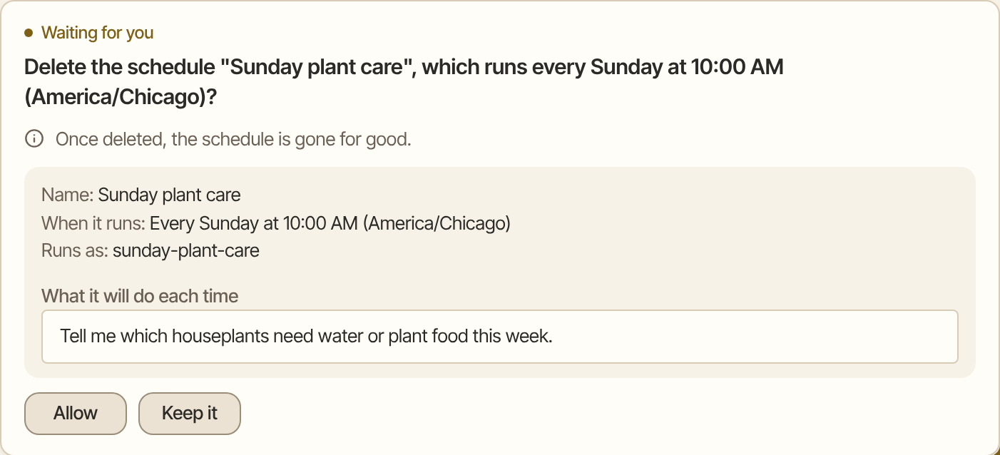
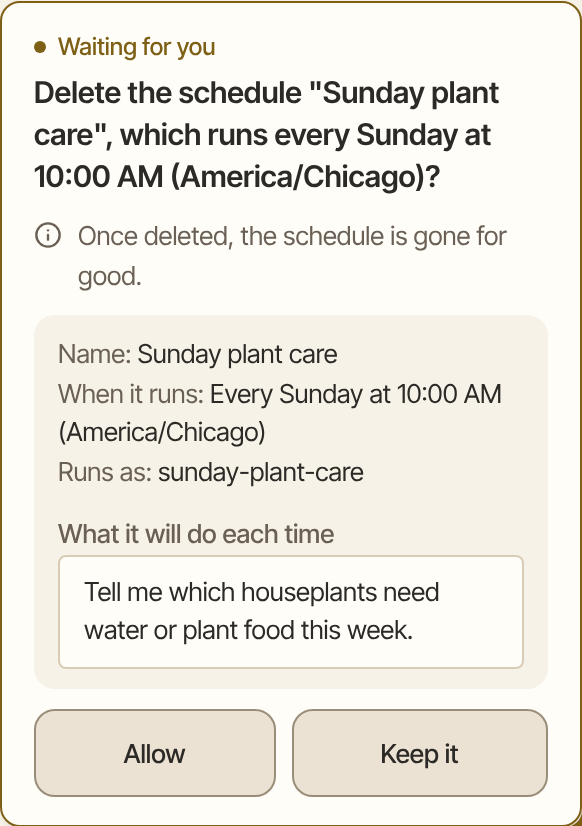

Before Aman does something that matters, such as sending an email or changing a file, it shows you an approval card. Nothing happens until you answer it.

How to get there: Approval cards show up in the chat, right where Aman is working. A scheduled run collects its cards in a **Needs your OK** list at the end of its chat.

=== "Computer"

    

=== "Phone"

    

Reading is free. Aman doesn't ask before it reads your mail, searches the web or opens a page. It asks before it sends, saves, deletes or changes something.

## Read a card

The first line says what will happen, in words you would use. An event is named by its title and time. A mail is named by who it goes to.

When something follows from saying yes, a second line says what it is. Guests get a cancellation. A file is replaced. Money leaves your account.

When there is a reason this one needs your answer, a quiet line under the question says it.

If Aman cannot say what an action does, it shows no card. It refuses, says why, and tells you the one thing to do next.

## Answer a card

1. Read the card. It says what Aman wants to do, where it goes and why.
2. Click **Allow** to let this one thing happen.
3. Or click **Change it** to ask for a change first. Type what should change in **What should change?**, then click **Send**. Nothing runs until Aman shows you a new card.
4. Or click **Not now**. Aman doesn't do it.

A card stays on the screen until you answer it. If you don't want what it asks, click **Not now** and the card closes.

**Allow** is always the first button, and all the buttons look the same. Each button keeps the same place on every card. On a card where the action cannot be undone, or where it reaches other people, the last button uses safe words instead of **Not now**. On a delete it says **Keep it**. On a mail send it says **Don't send**.

## Stop the same question coming back

Some cards offer a lasting answer, so you don't have to click **Allow** every time.

**Always allow in this chat**
: Aman stops asking about this kind of action, to this same person or place, for the rest of this chat. In any other chat it asks again. Only a card that names who or where the action goes shows this button.

**Always allow this site**
: Aman stops asking about opening pages on this one site for the rest of this chat. Only some cards that open a page show this button. See [Cards that open a page](#cards-that-open-a-page).

**Always allow everywhere**
: Aman runs this one tool of a connector without asking, in every chat. A connector is an app or service you linked to Aman. On a chat card, this button is inside **Details**. Aman asks you to **Confirm** first.

A few things to know about these answers:

- On a change to your own calendar that invites no guests, **Always allow in this chat** covers every later change to your calendar in that chat. A calendar card has no other lasting answer, so Aman asks again in a new chat.
- Saving a mail draft asks every time. So does making a schedule or a persona.
- Even a tool you always allow asks first when a call would send something that looks like a password, a key or a card number, or a lot of text.

## Take an always-allow back

1. Click **More** in the left bar, click **Settings**, then click **Connectors**.
2. Click the connector you allowed the tool on.
3. Find the tool in the "Always allowed" list and click **Revoke**.

From then on, Aman asks before it uses that tool again.

## Mail cards

Sending mail takes two cards, and you answer each one.

1. The draft card asks "Save this draft?" It shows the account the mail goes from, who it goes to, the subject and the full text.
   - Click **Allow** to save it in your Drafts folder. Nothing is sent.
   - Click **Change it** to ask Aman to change it first.
   - Click **Not now** to stop it. Nothing is saved.
2. When you tell Aman to send it, the send card asks "Send this email?" It shows the same mail again.
   - Click **Allow** to send it.
   - Click **Change it** to go back to the draft step.
   - Click **Don't send** to stop it. The draft stays in your Drafts folder.

Aman can't send mail you have not approved as a draft. If the mail differs from the draft you approved, the send is refused.

If the draft goes to an address that isn't on your Email list, the buttons change:

- **Add and save draft** puts those addresses on your list, then saves the draft.
- **Don't save** stops it, and nothing is added to your list.

If your list changed after you approved the draft, the send card says so too. Its buttons read **Add and send** and **Don't send**.

Saving a draft and sending both always ask. No button on a mail card lets you skip that question next time. [Email](email.md) has the details.

## Cards that open a page

A card that opens a page names the site in its first line. The card also shows the full address.

If a page Aman read named the address, the card says so. When Aman knows the site of that page, the card names it too. That card has no **Always allow this site**. An address that came from something Aman read always asks, even on a site you allowed.

If you didn't give the address, the card can offer **Always allow this site**. That covers every page on that site for the rest of this chat. A site means the exact name in the address. A page on a longer name, such as shop.example.com when you allowed example.com, asks again. A new chat asks again too.

Each page on an allowed site is still checked on its own. A later page asks if it would carry one of your private details. It also asks if its link adds details to a site only Aman brought up in a reply, or if a page Aman read named its address. Those cards have no **Always allow this site**.

If you click **Not now** on one of these cards, that no lasts for the rest of the chat. Aman doesn't ask again about the same kind of open on that site. It refuses the open instead. A no on a card for a click on a page lasts the same way. A new chat asks again.

## Cards from a scheduled run

A scheduled run has nobody watching it, so it never acts on its own. It holds each action for you instead. When the run finishes, its chat ends with a **Needs your OK** list.

1. Open the chat of the scheduled run.
2. Read each item in the **Needs your OK** list.
3. Click **Allow** to do it, or **Deny** to drop it. Some items also offer **Always allow everywhere** or **Change it**.

Held actions expire after 24 hours. [Schedules](schedules.md) explains how runs work.

## Good to know

- When several actions wait at the same moment, a card may show **Allow all**. It allows all of them together. Some actions never join it, so they still need their own answer.
- Some cards say "Part of this is not shown in full. Check it before you approve." Open the card and read all of it before you answer.
- In voice mode, Aman reads an email, calendar or schedule card out loud. It waits for you to say exactly "yes, send it", "yes, approve", "yes, delete it" or "no". Say the whole phrase in one go. Anything else leaves the card waiting.
- Aman only reads out a card it can say in full: a plain email, a new calendar event with no guests, or deleting a scheduled task. Cards with web links, code, words that are not plain English letters, commands, payments or new addresses stay on the screen. So does a card Aman could not read all the way through.
- To choose what Aman may do without asking at all, see [Permissions and offline mode](permissions.md).

## Related

- [Permissions and offline mode](permissions.md)
- [Activity log](activity-log.md)
- [Safety rules in detail](../../../../docs/safety.md)
