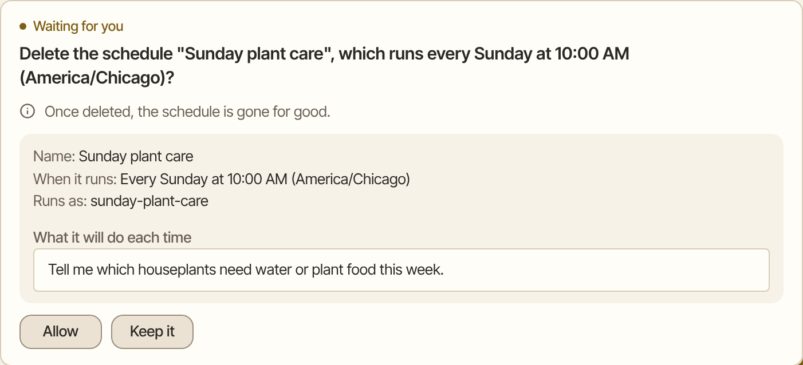
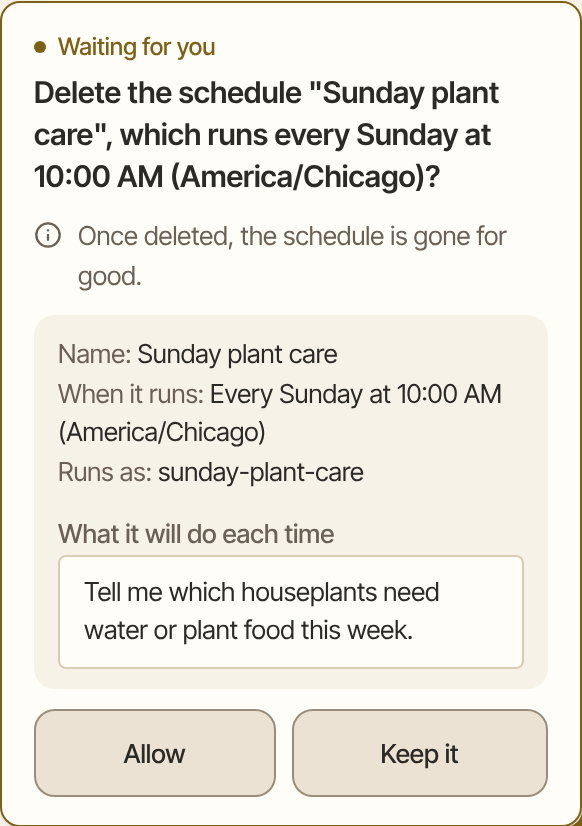

Before Aman does something that matters, such as sending an email or changing a file, it shows you an approval card. Nothing happens until you answer it.

How to get there: Approval cards show up in the chat, right where Aman is working. A scheduled run collects its cards in a **Needs your OK** list at the end of its chat.

=== "Computer"

    

=== "Phone"

    

Reading is free. Aman doesn't ask before it reads your mail, searches the web or opens a page. It asks before it sends, saves, deletes or changes something.

## Read a card

The first line says what will happen, in words you would use. An event is named by its title and time. A mail is named by who it goes to.

When something follows from saying yes, a second line says what it is. Guests get a cancellation. A file is replaced. Money leaves your account.

The (i) on the card opens **Why I'm asking**. It says why this one needs your answer.

If Aman cannot say what an action does, it shows no card. It refuses, says why, and tells you the one thing to do next.

## Answer a card

1. Read the card. It says what Aman wants to do, where it goes and why.
2. Click **Allow** to let this one thing happen.
3. Or click **Change it** to ask for a change first. Type what should change in **What should change?**, then click **Send**. Nothing runs until Aman shows you a new card.
4. Or click **Not now**. Aman doesn't do it.

A card stays on the screen until you answer it. If you don't want what it asks, click **Not now** and the card closes.

On a card where the action cannot be undone, or where it reaches other people, the safe choice comes first and is the main button. On a delete it says **Keep it**. On a mail send it says **Don't send**. The button that does the thing comes after it.

## Stop the same question coming back

Some cards offer a lasting answer, so you don't have to click **Allow** every time.

**Always allow in this chat**
: Aman stops asking about this kind of action, to this same person or place, for the rest of this chat. In any other chat it asks again. Only a card that names who or where the action goes shows this button.

**Always allow everywhere**
: Aman runs this one tool of a connector without asking, in every chat. A connector is an app or service you linked to Aman. On a chat card, this button is inside **Details**. Aman asks you to **Confirm** first.

A few things to know about these answers:

- On a change to your own calendar that invites no guests, **Always allow in this chat** covers every later change to your calendar in that chat. A calendar card has no other lasting answer, so Aman asks again in a new chat.
- Saving a mail draft asks every time. So does making a schedule or a persona.
- Even a tool you always allow asks first when a call would send something that looks like a password, a key or a card number, or a lot of text.

## Take an always-allow back

1. Click **More** in the left bar, click **Settings**, then click **Connectors**.
2. Click the connector you allowed the tool on.
3. Find the tool in the "Always allowed" list and click **Revoke**.

From then on, Aman asks before it uses that tool again.

## Mail cards

A mail card shows who the mail goes to and its full text. The safe choice, **Don't send**, comes first as the main button.

- Click **Allow** to send it.
- Click **Save as draft** to keep it in your drafts without sending.
- Click **Edit** to ask Aman to change it first.
- Click **Not now** to stop it.

If the mail goes to an address that isn't on your Email list, the buttons change. The safe choice still comes first:

- **Don't send** stops it, and nothing is added to your list.
- **Add and send** puts those addresses on your list, then sends.

When the card saves a draft instead, they read **Add and save draft** and **Don't save**.

Sending always asks. No button on a mail card lets you skip that question next time.

## Cards from a scheduled run

A scheduled run has nobody watching it, so it never acts on its own. It holds each action for you instead. When the run finishes, its chat ends with a **Needs your OK** list.

1. Open the chat of the scheduled run.
2. Read each item in the **Needs your OK** list.
3. Click **Approve** to do it, or **Deny** to drop it. Some items also offer **Always allow everywhere** or **Change it**.

Held actions expire after 24 hours. [Schedules](schedules.md) explains how runs work.

## Good to know

- When several actions wait at the same moment, a card may show **Approve all**. It allows all of them together. Some actions never join it, so they still need their own answer.
- Some cards say "Part of this is not shown in full. Check it before you approve." Open the card and read all of it before you answer.
- In voice mode, Aman reads an email, calendar or schedule card out loud. It waits for you to say exactly "yes, send it", "yes, approve", "yes, delete it" or "no". Say the whole phrase in one go. Anything else leaves the card waiting.
- Aman only reads out a card it can say in full: a plain email, a new calendar event with no guests, or deleting a scheduled task. Cards with web links, code, words that are not plain English letters, commands, payments or new addresses stay on the screen. So does a card Aman could not read all the way through.
- To choose what Aman may do without asking at all, see [Permissions and offline mode](permissions.md).

## Related

- [Permissions and offline mode](permissions.md)
- [Activity log](activity-log.md)
- [Safety rules in detail](../../../../docs/safety.md)
