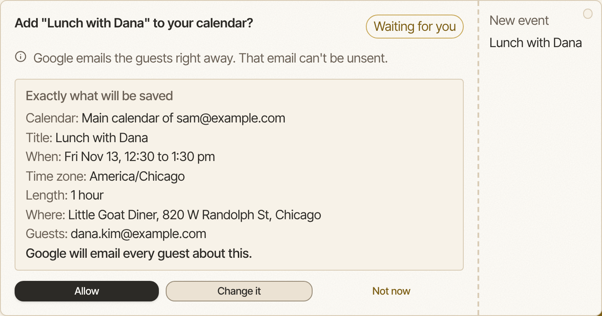
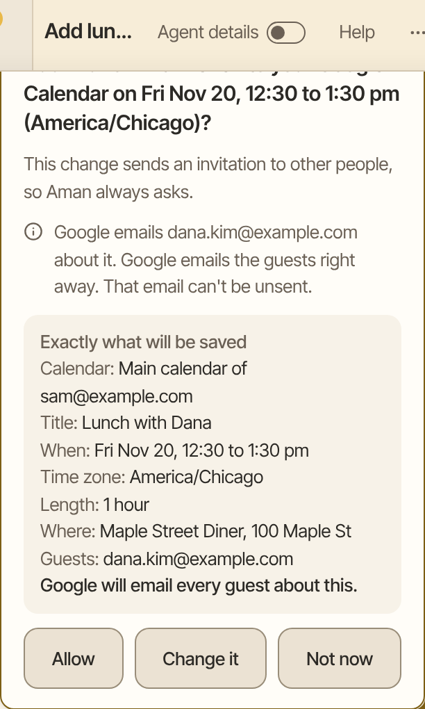

Aman can read your calendar and keep it up to date. Ask what is coming up, or ask it to add or move an event. Before anything is saved, a card shows you exactly what will change.

How to get there: Click **Chats** in the left bar, then **New chat**, and ask about your calendar.

!!! note "Before you start"

    Connect your calendar first. You can connect Google Calendar, or another calendar with an app password. See [Connect email and calendar](connect-mail-calendar.md).

## See your day or your week

1. Click **Chats** in the left bar, then click **New chat**.
2. Ask, such as "What is on my calendar this week?"
3. Aman reads your events and tells you what is coming up.

A few cards on the new chat screen help too:

- **Just tell me what matters today** names the three things that matter today and your free stretch.
- **Get me ready for the next one** tells you who is in your next meeting, what it is about, and three things to say.
- **This week at a glance** gives you the week ahead.

Reading your calendar runs without asking.

If you connected more than one calendar account, reads span every account, and answers say which account each calendar and event belongs to. Ask for one account by name to hear only about that one.

## Add or change an event

1. Ask, such as "Add lunch with Sam on Friday at 12:30 for an hour".
2. A card asks "Add "Lunch with Sam" to your calendar?" and shows exactly what will be saved: the calendar and the account it belongs to, title, time, time zone, length, place and guests.
3. For a change, the card shows the event as it is now, and how it will look after the change.
4. Click **Allow** to save it. Click **Change it** to ask Aman to fix something first. Click **Not now** to leave your calendar as it is.

=== "Computer"

    

=== "Phone"

    

## Invite people

You can ask Aman to add guests to a new event, such as "Invite dana@example.org". The card lists every guest. It also says whether Google will email them about it, so you know before anyone hears from you.

With a calendar connected with an app password, Aman can also answer an invitation for you: accept, tentatively accept, or decline. The card names the organizer, who is told your answer. That reply can't be unsent.

## Good to know

- With Google Calendar, Aman adds events to your main calendar. It can't delete events.
- With Google Calendar, changing one event of a repeating series changes only that one event.
- Aman doesn't clear an event's place or description. It can only replace them with new text.
- With a calendar connected with an app password, Aman can also delete an event. Deleting, and changing an event that already exists, always ask, because Aman can't check who else is on it.
- A change to your own calendar with no guests offers **Always allow in this chat**. That covers later changes like it in the same chat only. A new chat asks again.
- See [Approval cards](approvals.md) for every button on a card.

## Related

- [Connect email and calendar](connect-mail-calendar.md)
- [Your morning brief](daily-brief.md)
- [Reminders](reminders.md)
