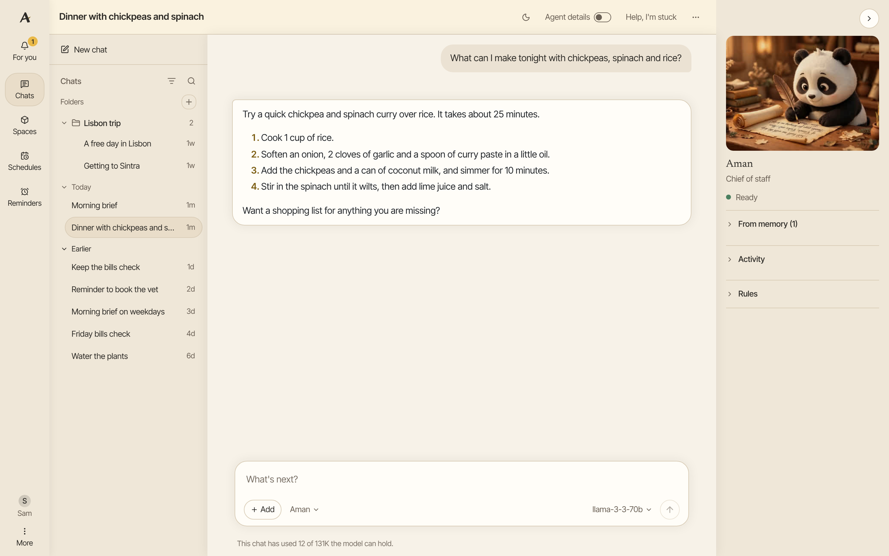
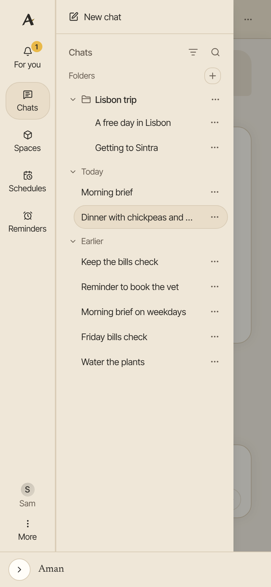

Each conversation with Aman is a chat. Aman keeps your chats in a list, so you can come back to one, search for it or sort it into a folder.

How to get there: Click **Chats** in the left bar. On a phone, tap the menu button at the top left first.

=== "Computer"

    

=== "Phone"

    

## Start a chat

1. Click **New chat** at the top of the chat list.
2. Type your message in the message box.
3. Press ++enter++ or click **Send message**, the arrow at the end of the box.

To start a new line without sending, press ++shift+enter++. To stop an answer part way, click the square button where the arrow was, or press ++esc++.

## The message box

The row under the message box holds everything you can add to a message:

- **Add** attaches files and pictures, pastes from your clipboard and turns add-ons on or off. See [Files and pictures](files.md).
- The name beside **Add** says who answers this chat. It shows once you have made a persona. See [Personas](personas.md).
- **Start incognito chat** shows only on a new chat, before your first message. See [Incognito chat](incognito.md).
- The model name at the right end says which model answers. See "Pick the model" below.
- The microphone and the sound-wave button let you talk instead of type. See [Talk to Aman](voice.md).

## Pick the model

1. Click the model name at the right end of the message box. Its tip says "Select model".
2. Type in the search box to find a model, or scroll the list.
3. Click the model you want.

Some models also show "Reasoning effort" at the bottom of the list. Pick a higher effort for a harder question; the answer takes longer.

The model name is hidden while Aman is answering. A new chat starts with the model you picked last in this browser. If the list is empty, add a model first. See [Set up Aman](first-steps.md).

## Find a chat

The newest chats are at the top, under "Today" and "Earlier". Click **Show more** to see older ones. A chat with something new for you, such as a reminder, shows in bold until you open it.

To search:

1. Click the magnifying glass next to **Chats** at the top of the list. Its tip says "Search chats".
2. Type a few words.
3. Chats whose titles match show first. Under "In messages", Aman lists other chats with all your words in their messages.
4. Click a chat to open it.

Searching inside messages needs past-chat search. To turn it on, click **More** in the left bar, then **Settings**, then **Memory**, and turn on "Let Aman search your past chats when you ask".

## Rename a chat

1. Click the chat's title at the top of the open chat.
2. Type the new title.
3. Press ++enter++ to save, or ++esc++ to keep the old one.

You can also point at the chat in the list, click the three dots next to it, then click **Rename**.

## Put chats in folders

1. Click the plus next to "Folders" at the top of the chat list. Its tip says "New folder".
2. Type a name for the folder.
3. Click **Create**.
4. To file a chat, point at it in the list, click the three dots next to it, then click **Move to folder**.
5. Click the folder.

The **Move to folder** box can also make a new folder on the spot. To take a chat out of its folder, choose **No folder**.

To rename or remove a folder, point at it and click its three dots. Change the name and click **Rename**, or click **Delete folder**. Deleting a folder keeps every chat that was in it.

## Delete a chat

1. Point at the chat in the list and click the three dots next to it.
2. Click **Delete**.
3. Click **Delete** again to confirm, or **Keep** to change your mind.

!!! warning

    A deleted chat is gone for good, with every message, picture and file in it. It cannot be brought back.

## Clear a chat

To start over with the same model and add-ons, click the three dots at the top right of the chat, then **Clear chat**. You get an empty chat. The old one stays in your list.

## Agent details

The **Agent details** switch at the top of a chat shows or hides how Aman worked on each answer. On a small phone it says "Details".

- On: each answer shows its steps, the tools it used, the helpers it called, and the model and cost.
- Off: you see your message, the answer, and anything that needs you, such as an approval card. One line says what Aman is doing while it works.

If a step failed, one plain line under the answer says so, even with the switch off. Aman remembers the choice for each chat. The switch shows once a chat has its first message.

## The panel on the right

On a computer, a panel on the right shows how Aman is doing, and what is coming up or waiting for you.

- The line under Aman's picture says "Ready", "Waiting for you" when a card needs your answer, or that the connection has a problem. When the connection drops, click **Retry**.
- "Answering" shows the persona that answers this chat, when it is not Aman.
- On the new chat screen, **Today** lists your calendar for the day and when you are free. **Due** lists today's reminders that have not gone off yet. **Needs your OK** lists actions that wait for your answer. Click a reminder or an action to open its chat.
- In a chat, **Using** lists what Aman remembered for this chat. The × takes a fact out of this chat only. **Forget everywhere** opens your memory settings.
- **Activity** lists what Aman did in this chat. Click **Audits** to see the full list in Settings.
- **Rules** says what Aman may do here without asking, such as web searches, and whether Offline mode is on.

Click the arrow at the top of the panel to fold it away, and again to bring it back. On a phone, or in a narrow window, the panel is a strip at the bottom. Open, it shows Aman's name and the same lists, such as **Due** and **Needs your OK**. Scroll the strip to see them all. Folded, it shows only Aman's picture.

When a reminder goes off, it leaves **Due** and shows under the **For you** bell instead.

## See which chats have new answers

In the list of chats, a dot and a bold title mark a chat with an answer you haven't opened yet. Open the chat and the mark goes away.

Each browser keeps its own marks, so reading a chat on your phone doesn't clear its mark on your laptop.

## Good to know

- Your chats are kept on your computer. See [Your privacy](privacy.md).
- An incognito chat is never found by a search, and it cannot go in a folder.
- You choose these rules in Settings, under **Permissions**. See [Approval cards](approvals.md).

## Related

- [Files and pictures](files.md)
- [Talk to Aman](voice.md)
- [Incognito chat](incognito.md)
