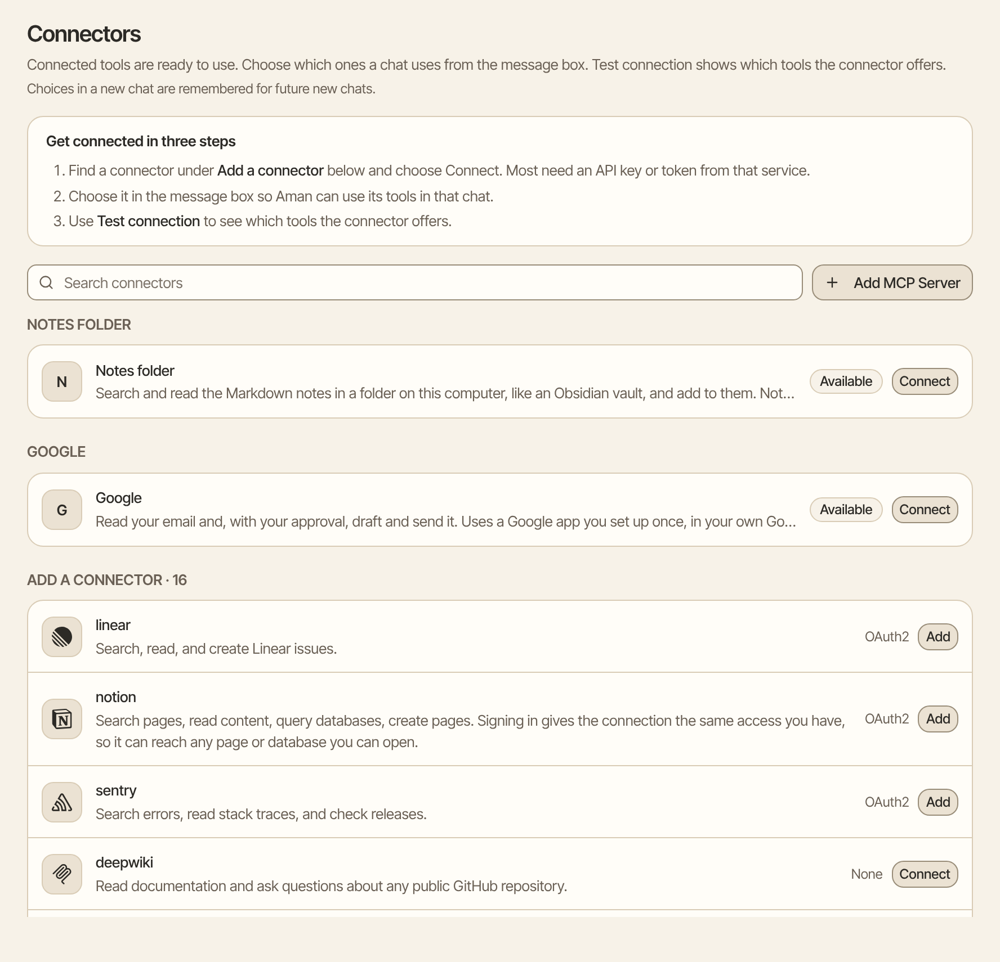
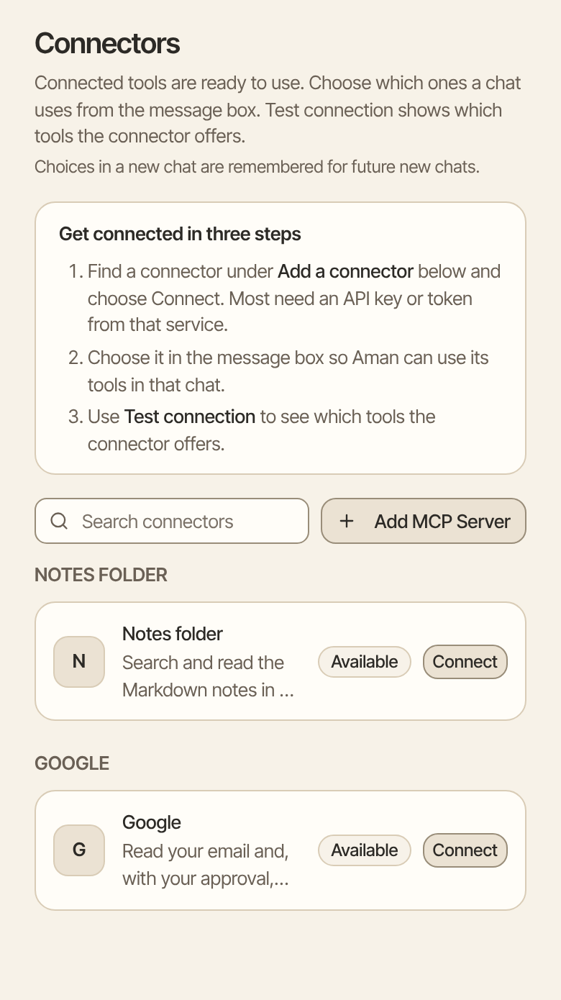

Connect your email and calendar so Aman can read your mail, look at your calendar and, after you say yes, write and send for you. You set it all up in Settings. You don't need the terminal.

How to get there: Click **More** in the left bar, then **Settings**, then **Connectors**.

=== "Computer"

    

=== "Phone"

    

!!! note "Before you start"

    If Aman is in offline mode, turn it off first. Email and calendar need the internet. Click **More**, then **Settings**, then **Permissions**, and turn off **Offline mode**.

## Pick the right card

There are three cards for mail and calendar on the Connectors page. Most people only need one or two.

| Card         | What it connects                                                          | What you need                                                       | Time       |
| ------------ | ------------------------------------------------------------------------- | ------------------------------------------------------------------- | ---------- |
| **Email**    | Gmail, iCloud, Yahoo, AOL, Fastmail, Zoho, GMX, web.de or another account | An app password from your email provider                            | 5 minutes  |
| **Calendar** | Google, Fastmail, Yahoo, GMX, web.de or another calendar                  | An app password from your calendar provider                         | 5 minutes  |
| **Google**   | Gmail, Google Calendar and Google Drive together                          | A free Google Cloud project that you make once, in your own account | 10 minutes |

An app password is a separate password that your provider makes for apps like Aman. It is not your usual password, and you can delete it at your provider at any time.

- The quick way: use the **Email** card for mail and the **Calendar** card for your calendar.
- For Google Drive, or when your work account doesn't allow app passwords, use the **Google** card.

If you don't see the **Email** or **Calendar** card, your install of Aman doesn't include it. Use the **Google** card instead, or ask the person who set up Aman.

## Connect your email with an app password

1. Click **More** in the left bar, then **Settings**, then **Connectors**.
2. Find **Email** and click **Connect**.
3. Pick your provider in **Email provider**.
4. Make an app password at your provider. The panel shows a short note for your provider, with a link called **How to get an app password**. The tabs below say the same.
5. Type your **Email address**.
6. Paste the app password in **App password**.
7. Click **Connect**.

Aman signs in to your email once before it saves anything. If the sign-in fails, nothing is saved, and the panel says what to fix.

=== "Gmail"

    Turn on 2-Step Verification, then make an app password under Security, App passwords.

=== "iCloud"

    Make an app-specific password at account.apple.com, under Sign-In and Security.

=== "Yahoo"

    Make an app password under Account Security, Generate app password.

=== "AOL"

    Make an app password under Account Security, Generate app password.

=== "Fastmail"

    Make an app password in your Fastmail settings, under Privacy & Security, then Manage app passwords.

=== "Zoho"

    Turn on two-factor authentication, then make an app password under Security, App passwords.

=== "GMX and web.de"

    Turn on two-factor authentication, then make an application-specific password under Security Options.

=== "Other"

    Pick **Other**. Then type your provider's **Incoming server (IMAP)**, **Incoming port**, **Outgoing server (SMTP)** and **Outgoing port**. Your provider's help pages list them. The ports start as 993 and 465, which most providers use.

## Connect your calendar with an app password

1. Click **More** in the left bar, then **Settings**, then **Connectors**.
2. Find **Calendar** and click **Connect**.
3. Pick your provider in **Calendar provider**.
4. Make an app password at your provider. The panel shows a short note for your provider. For most providers it also shows a link called **How to make an app password**.
5. Type your **Email address**. If you sign in to the calendar with a different name, type that name in the login name box. Otherwise, leave it empty.
6. Paste the app password in **App password**.
7. Click **Connect**.

Aman signs in to your calendar once before it saves anything. If the sign-in fails, nothing is saved, and the panel says what to fix.

=== "Google"

    1. Turn on 2-Step Verification for your Google account, if it's not on yet. Google only offers app passwords after that.
    2. Open myaccount.google.com/apppasswords, type a name such as Aman, and select Create.
    3. Copy the 16-letter password Google shows. Google shows it only once.
    4. In Aman, type your Gmail address and paste the app password. Leave the login name empty.

    Aman fills in the calendar address for you. If a Google Workspace admin has turned off app passwords for your account, use the **Google** card instead.

=== "Fastmail"

    Make an app password in your Fastmail settings, under Privacy & Security, then Manage app passwords, and allow calendar access.

=== "Yahoo"

    Make an app password under Account Security, Generate app password.

=== "GMX and web.de"

    Turn on two-factor authentication, then make an application-specific password under Security Options.

=== "Other"

    Pick **Other**, then type the **Calendar address**. Your provider's help pages give it. It must start with https://. It can be on the internet or on your home or office network.

## Connect Google

The **Google** card connects Gmail first. Calendar and Google Drive are extra steps on the same panel. Each step comes with a link you can copy.

1. Click **More** in the left bar, then **Settings**, then **Connectors**.
2. Find **Google** and click **Connect**.
3. Follow the steps in the panel, in order. They make a free Google Cloud project, turn on Gmail, and give you a client file.
4. Drop the file into the panel, or type the **Client ID** and **Client secret**.
5. Click **Check my client**, and fix anything it lists.
6. To let Aman save drafts and send email, tick the box about drafts and sending. Every draft and every send still asks you first.
7. Click **Connect Google**, and allow access in the Google window.

[Connect Google](../../../../docs/google.mdx) walks through every step, with what to click on Google's pages.

To add your calendar, click **Manage** on the **Google** card, turn on the Calendar API with the link in the Calendar part, then click **Connect Calendar**. To add Google Drive, turn on the three links in the Drive part, then click **Connect Google Drive**.

## Change or remove a connection

=== "Email or Calendar card"

    - Change it: click **Manage**, then "Change account" on the Email card or "Change calendar" on the Calendar card. Type the details again and click **Connect**. Aman checks the new sign-in before it replaces the old one.
    - Remove it: click **Manage**, then **Remove**, then "Remove account" or "Remove calendar". This deletes the saved app password for good. Click **Keep it** if you change your mind.
    - If the card says "Sign-in stopped working": make a new app password at your provider, then click **Manage** and save it again.
    - If the card says "Not working right now": check your internet connection, then click **Manage**. You can type the details again, click **Cancel**, or click **Remove**.

=== "Google card"

    - Test it: click **Manage**, then **Test connection**.
    - Allow drafts later: click **Manage**, then **Allow drafts and sending**.
    - If it says "Reconnect needed": click **Reconnect** and sign in again. A Google project in Testing mode signs you out every 7 days. To stop that, open Audience in Google Cloud, click Publish app, then reconnect once.
    - Turn it off: click **Manage**, then **Disconnect**, then **Disconnect Google**. This turns off email, calendar and Google Drive.

## Good to know

- Reading is quiet. Every draft, every send and every new or changed event asks you first, on a card that shows exactly what will happen.
- An app password is saved only on this computer, in the email or calendar connector. It is never shown again, and the assistant never sees it.
- Never paste a password into a chat. A chat can't connect an account. Use Settings.
- Aman reads only your own calendar. Calendars other people share with you, and holiday calendars, are left out on purpose.
- Aman can't delete calendar events.

## Other connectors

The same Connectors page has more connectors, such as your notes folder, Home Assistant, Notion and GitHub.

- Notes folder: see [Your notes folder](notes-folder.md).
- Home Assistant: click **Connect**, type your Home Assistant address and paste a long-lived access token, then click **Connect**. Only the devices you expose in Home Assistant are visible. A change, such as turning off a lamp, asks you first, unless you allow that kind of device for good on the card. Aman never controls locks, alarms or garage doors. [Home Assistant](../../../../docs/connectors/home-assistant.md) has the full steps.
- Notion: click **Add**, open the notion connector, click **Connect**, and sign in to Notion in the window that opens. Aman can then reach any page or database you can open. Every Notion tool asks you first.
- GitHub: make a fine-grained personal access token in your GitHub settings, under Developer settings. Give it only the repositories and permissions Aman needs. Then click **Connect** on github, paste the token, and click **Connect**. Every GitHub tool asks you first.

[Other connectors](../../../../docs/mcp-servers.mdx) explains adding any connector, signing in and testing it.

## Related

- [Connect Google](../../../../docs/google.mdx)
- [Email](email.md)
- [Calendar](calendar.md)
