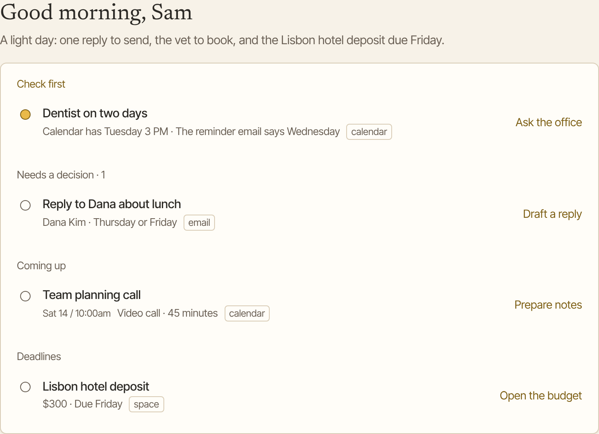
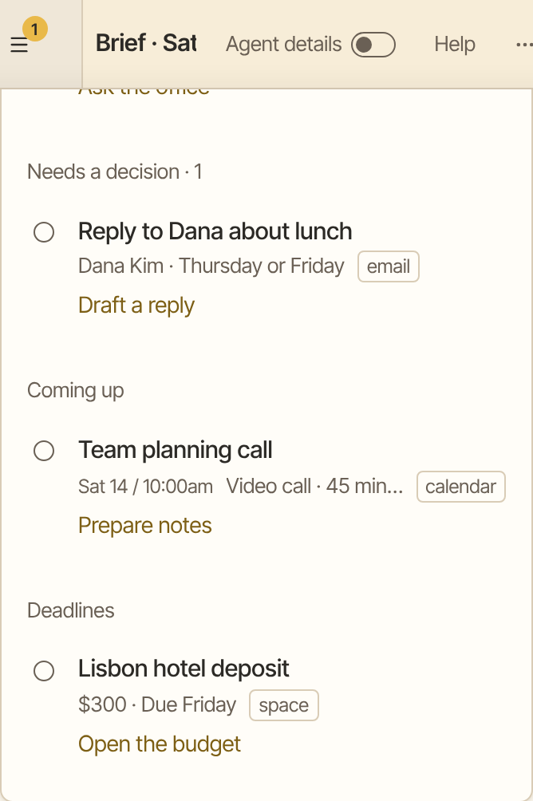

Your morning brief is one short list of what needs you today. Aman reads your email, your calendar, your saved lists and what it remembers about you, then puts the most urgent things first.

How to get there: Click **Chats** in the left bar, then **New chat**, then click the **Your morning brief** card.

=== "Computer"

    

=== "Phone"

    

!!! note "Before you start"

    The brief works from what you have connected. Connect your email or your calendar first, so Aman has something to read. See [Connect email and calendar](connect-mail-calendar.md). The **Your morning brief** card shows only once one of them is connected.

## Get your brief now

1. Click **Chats** in the left bar, then click **New chat**.
2. Click the **Your morning brief** card. Or type "Give me my morning brief".
3. Aman reads what is new since your last brief, or from the last day. It also looks at your calendar for today and the next seven days.
4. Read the list. It starts with one sentence that sums up your morning.

For a shorter version, click **Just tell me what matters today**. Aman names the three things that matter most today, your free stretch of time, and anything to bring.

## Read your brief

The brief sorts what it found into sections:

Check first
: Something that may be wrong, such as two events at the same time, a likely typo, or a date that doesn't match.

Needs a decision
: Replies and choices waiting on you. The heading shows how many there are.

Coming up
: Events from your calendar, with their start time.

Deadlines
: Things with a due date.

Each item has one button with a next step, such as drafting a reply. Click it and Aman starts on that step in the chat.

The brief shows six items at first. Click the line that says how many more items there are, such as "+ 3 more items", to see the rest. Click **Show fewer** to fold them away again.

At the bottom, one line says how much Aman read and whether anything was sent. When it says "Nothing was sent", nothing left your computer on your behalf. On a very busy day the line is left out, because Aman can only say that when it has checked everything.

!!! note

    A brief from your daily schedule always shows as this list. A brief you ask for yourself may come back as ordinary text instead.

## Mark an item done

1. Point at the circle next to an item and click it. The item fades away.
2. Changed your mind? Click **Undo** while it shows.

A done item stays out of your briefs for the next seven days. Items under **Check first** have a dot instead of a circle, because they are things to look at, not to tick off.

## Get it every morning

1. Click **Chats** in the left bar, then click **New chat**.
2. Type when you want it, such as "Every weekday at 7:30, send me my morning brief".
3. A card shows when it runs and what it does each time. Check it.
4. Click **Allow**.

Each morning the brief arrives as a new chat. Open it when you are ready: a scheduled brief sends no notice.

Once you have a brief schedule, a **Run my daily brief** card shows on the new chat screen. Click it to run your brief right now, with the same instructions your schedule uses.

To change the time, pause it or stop it, see [Schedules](schedules.md).

## Plan your day

Ask Aman to plan your day, such as "Plan my day around my meetings". It works from your calendar and anything you tell it, puts your tasks in a sensible order, and suggests times.

If your calendar isn't connected, tell Aman what is on your day.

## Good to know

- If some items, or the whole brief, couldn't be shown, a line under it says so. Ask for your brief again.
- The brief only reads. It offers next steps, but it never sends or saves anything without asking you first.
- Web addresses in a brief show as a site name only, not as a link. A brief is written from mail anyone can send you.
- If Aman could not read something, the first sentence says so. It doesn't guess.
- In an incognito chat, you can't mark brief items done, because that chat keeps nothing.
- How a scheduled brief runs, and what it holds for your OK, is on [How schedules hold actions](../../../../docs/schedules.md).

## Related

- [Email](email.md)
- [Calendar](calendar.md)
- [Schedules](schedules.md)
