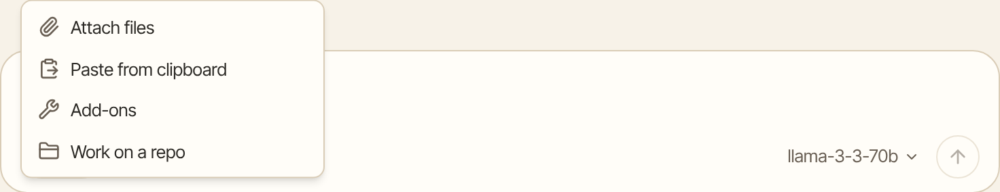
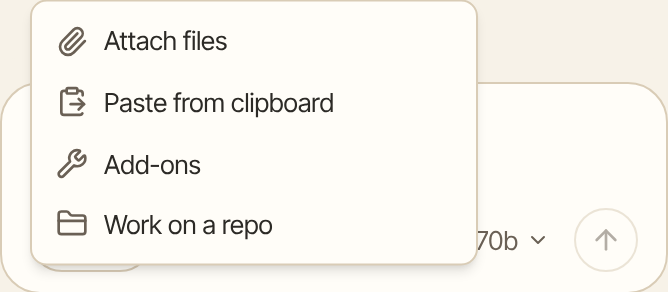

You can give Aman a file or a picture in a chat and ask about it. For example, attach a letter and ask what it means, or a photo of a receipt and ask Aman to add it to your budget.

How to get there: Click **Add** under the message box, then "Attach files".

=== "Computer"

    

=== "Phone"

    

!!! note "Before you start"

    Aman reads documents in its sandbox, a small separate space on your computer. Set the sandbox up first. See [Run code](code.md).

## Attach a file or picture

1. Click **Add** under the message box.
2. Click "Attach files".
3. Pick one or more files on your computer.
4. Type your question and send it.

You can also drag files from your computer and drop them on the message box. Each file shows as a small card above the message. Click a picture's card to see it larger. To take a file off, click the x on its card.

While Aman reads a long document, a line under your message says "Reading" and the file's name.

## What Aman can read

- Documents: PDF, Word, Excel, PowerPoint, OpenDocument, RTF and CSV files, emails saved as .eml or .msg, web pages and plain text.
- Pictures: photos and screenshots, such as PNG, JPEG, GIF and WebP. Aman can read the words in a picture or a scanned page.

Some old formats, such as .ppt, can't be read. Aman tells you which newer format to save the file as.

## Limits

- Up to 32 files in one message, and 100 MB in all.
- For a long document, Aman reads the start first and reads on when it needs more.
- Big photos are made smaller before they are sent. That keeps them clear enough to read and quick to send.

## Where your files go

Your files stay on your computer. Aman puts a copy in the chat's own sandbox space, so it can read the file and use it, for example in a chart. The file stays with the chat.

When you delete the chat, its files are deleted too. In an incognito chat they are deleted when you close the chat. See [Incognito chat](incognito.md).

If the model you chose runs at a hosted company, the words Aman reads from the file, or the picture, go to that model with your message. A model on your own computer keeps them on your computer.

## Good to know

- Some models can look at a picture themselves. With other models, Aman reads the words in the picture in the sandbox first.
- If the sandbox is off, Aman can still look at pictures with a model that sees them, but it can't read documents. Aman says it needs the sandbox.
- "Paste from clipboard" in the same **Add** menu adds copied text to your message.

## Related

- [Run code](code.md)
- [Chats](chats.md)
- [Your privacy](privacy.md)
