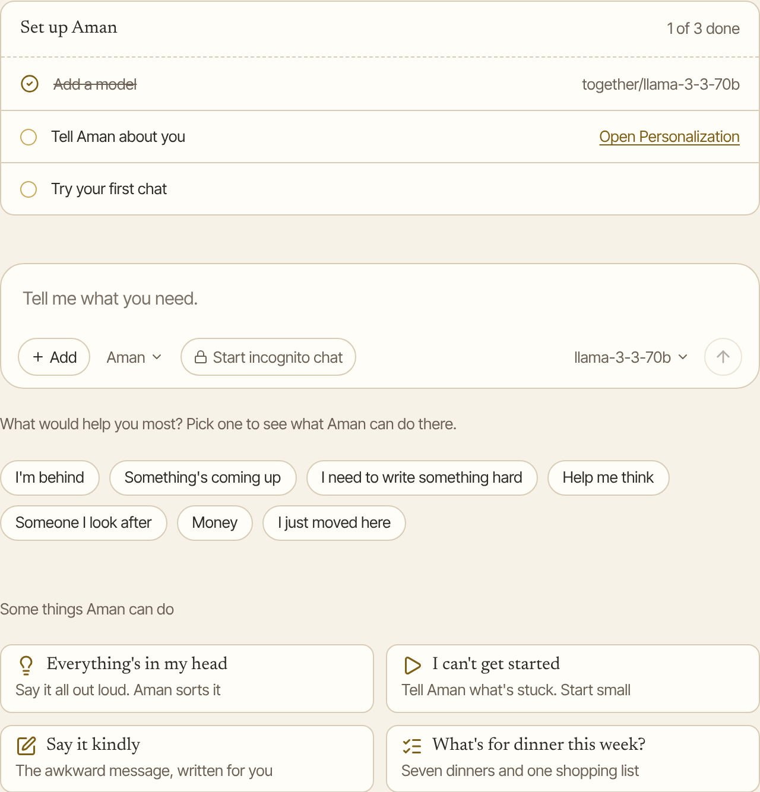
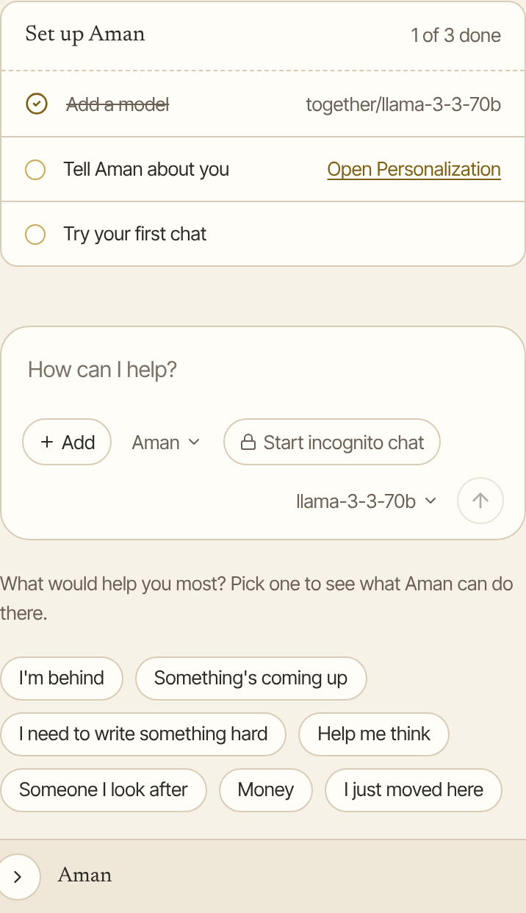
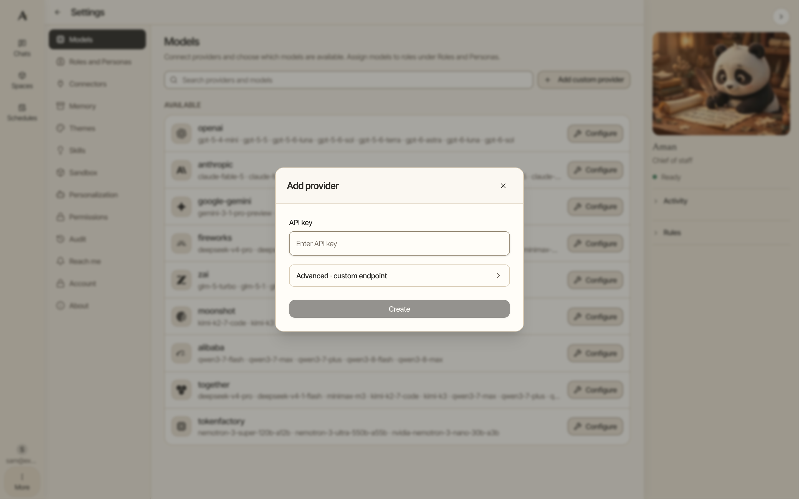
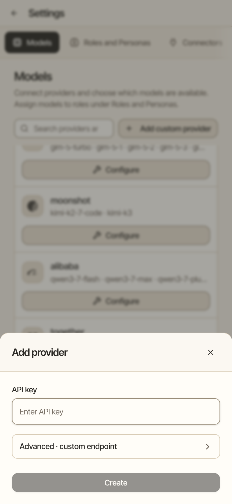

Once Aman is installed, three short steps get it ready: add an AI model, tell Aman about you, and start your first chat. It takes about five minutes.

!!! note "Before you start"

    You need an API key for an AI model, from Together AI, OpenAI, Anthropic or Google Gemini. An API key is a long password that lets Aman use your account at that company. You make it on the company's website.

## Open Aman and sign in

=== "Mac"

    1. Open a browser on the Mac where you installed Aman.
    2. Go to `http://localhost:8791`.
    3. Click **Sign in**.
    4. Type the email and the password you chose during the install.

    On a Mac, Aman opens on that Mac only. Phones and other computers can't reach it.

=== "Linux"

    1. Open a browser on the computer where you installed Aman.
    2. Go to `http://localhost:8791`.
    3. Click **Sign in**.
    4. Type the email and the password you chose during the install.

    To open Aman from your phone or another computer at home, see [Use Aman from another device](#use-aman-from-another-device) below.

=== "Windows"

    1. Choose "Aman" in the Start menu. Aman opens in your browser.
    2. Click **Sign in**.
    3. Type the email and the password you chose in Aman Setup.

### Use Aman from another device

On Linux, you can open Aman from your phone or another computer on your home network. Each device has to trust your computer first. You do this once per device.

1. Find the line the install printed that starts "Instead, open this page once on that device and follow its steps". It has an address that ends in `/trust`.
2. Open that address on the phone, or scan the square code the install printed.
3. Follow the page. It explains, for iPhone, Android, Mac and Windows, how to make that device trust your computer.
4. Open the https address from the "Open" list the install printed. It starts with `https://` and ends in `:8443`.

An iPhone says the profile is "Not Signed". That is expected for a profile you made yourself. [Phone and other devices](phone.md) has more help.

## The "Set up Aman" checklist

A new chat shows a short checklist with three lines. Each line ticks itself off when it is done, and the checklist goes away once all three are.

=== "Computer"

    

=== "Phone"

    

Don't need it? Click **Skip the tour** under the idea cards to hide it.

## Step 1: add a model

Aman doesn't come with an AI model. It can't answer until you add one.

How to get there: Click **Choose a model** next to **Add a model** in the checklist. Or click **More** in the left bar, then **Settings**, then **Models**.

Do you run your own model on this computer, such as Ollama? Then you don't need a key. See [A model on this computer](local-model.md).

1. Under "Available", find the company you have a key for, such as Together AI, OpenAI, Anthropic or Google Gemini.
2. Click **Configure** next to it.
3. Paste your key into **API key**.
4. Click **Create**.

The company moves up to "Configured", with a green "Connected" mark. Its models now appear in the model button under the message box. Click that button in any chat to pick another model.

=== "Computer"

    

=== "Phone"

    

To change the key later, click **Edit** next to the company. To stop using it, click **Remove**.

### Check that the model works

When you add a company, or change one and save it, Aman makes one small test call to it before the save finishes. The company's card then shows one line under its name, starting "Last check". The line is one of these:

- "The model server answered the test call." The company is set up and ready to use.
- "The model server refused the API key. Check the key for this provider and save again." The server answered, but it would not accept the key you saved.
- "The model server did not answer. Check the server is running and the address is right, then save again." Nothing answered at the company's address.
- "The model server took too long to answer. It may still be starting up, or busy loading the model. Wait a moment, then save again." The server did not answer in time. A model on your own computer can need a while to load the first time.
- "The model server answered with an error. Check the provider settings and save again." The server answered, but the test call failed for another reason.

The save goes through either way. A line that names a problem means chats using this company will hit the same problem until it is fixed.

## Step 2: tell Aman about you

Aman greets you by name and speaks to you the way you ask.

How to get there: Click **Open Personalization** in the checklist. Or click **More** in the left bar, then **Settings**, then **Personalization**.

1. On the **Your Profile** tab, type your name in **Your name**.
2. If you like, fill in how Aman should address you, and a few lines about where you live, what you work on and what you care about.
3. If you like, click the **Assistant Profile** tab and give the assistant a different name.
4. Click **Save personalization**. It saves both tabs at once.

Everything you type here stays on your computer.

## Step 3: try your first chat

1. Click **New chat** in the left bar.
2. Type a question or a task, such as "Help me plan a week of dinners for two people, one vegetarian."
3. Press Enter to send it.

Not sure what to ask? Click one of the idea cards on the new chat. [Ideas to try](ideas.md) lists them all.

Here are a few more things to try:

- Run code: "Write a small Python program that prints the first 20 prime numbers, run it, and show me the output." Aman runs it in a sealed-off area on your computer. It can't reach the internet or your files.
- Search the web: "Search the web for the weather forecast this weekend in my city and sum it up." Web search is on from the start, and you don't need an account.
- Try memory: tell Aman something about yourself in one chat. Start a new chat later and ask about it. Memory is on from the start, and it stays on your computer.

## Good to know

- You can change any of these later in Settings.
- To connect your email and calendar, see [Connect email and calendar](connect-mail-calendar.md).
- Your own server endpoint, which model does which job, and how long Aman waits for a model are on the [Models and providers](../../../../docs/models.mdx) page.

## Sign out

1. Click **More** in the left bar.
2. Click **Sign out**. Aman asks first.
3. Click **Sign out** again to leave, or **Stay** to keep working.

Your chats and settings stay on the computer. They are there when you sign in again.

## Related

- [Ideas to try](ideas.md)
- [Memory](memory.md)
- [Get help](getting-help.md)
