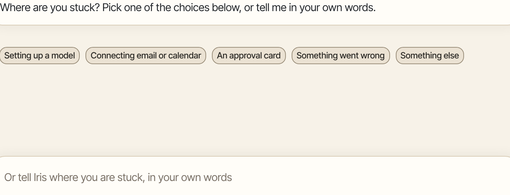
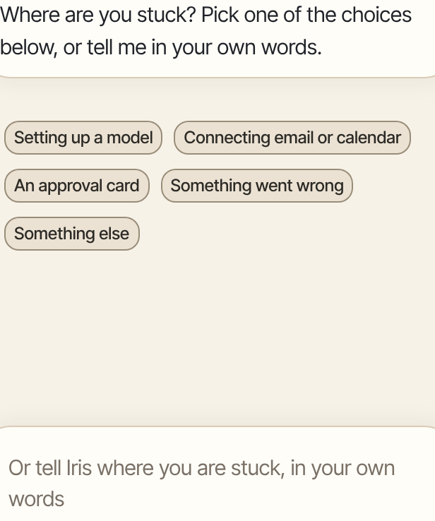

When something doesn't work, Aman's guide can look at your setup and tell you what to do. If that doesn't fix it, you can send us a bug report.

How to get there: Click **Help, I'm stuck** at the top of the screen. It shows on the main screens, not inside Settings.

=== "Computer"

    

=== "Phone"

    

## Ask the guide

1. Click **Help, I'm stuck** at the top of the screen.
2. A new chat opens. The guide checks Aman for a few seconds and tells you what it found.
   When a problem is fixed in Settings, click its next step to go straight to the right Settings page.
3. Click the choice that fits: **Setting up a model**, **Connecting email or calendar**, **An approval card**, **Something went wrong** or **Something else**.
4. Or type your question in the box, then click **Send message**.

The guide tells you the exact clicks. It can't change anything for you.

## Report a bug

1. Click **More** at the bottom of the left bar, then click **Report a bug**.
2. Under **What went wrong?**, say what you expected and what happened. You can leave this empty.
3. To add this chat's messages, tick the box for it. It's off unless you tick it.
4. Click **Generate report**.
5. Click **Copy to clipboard**, **Download (.json)** or **File on GitHub**.

The report leaves out passwords, memory and tool details. Nothing is sent until you click **File on GitHub**.

## Check your install from the computer

Some problems are outside the app, such as Docker or the sandbox. Check them on the computer where Aman is installed.

=== "Mac or Linux"

    Open a terminal and type `aman doctor`. It checks each part of your install. For each problem, it prints a "Next:" line with the command that fixes it. The box at the end lists every problem again, so you don't have to scroll back up.

=== "Windows"

    Choose "Check Aman" in the Start menu. It checks each part of your install.

[Troubleshooting](../../../../docs/troubleshooting.md) lists common problems and their fixes.

## Other things you do on the computer

Settings has no button for these. On a Mac or Linux, type them in a terminal:

- `aman backup` backs up your data now.
- `aman restore` goes back to a backup. It asks which one, and waits for you to type yes. The password goes back to the one you had then, and devices may need to sign in again.
- `aman upgrade` updates Aman. Get the newest release first, as [The aman command](../../../../docs/commands.md#update-aman) shows. It downloads Aman's parts ready-made when they match your version. When they don't, it builds them on this computer, which takes longer.
- `aman password` sets a new password.

On Windows, the Start menu has entries for the common ones, so you don't need a terminal:

- "Aman" opens Aman in your browser.
- "Check Aman" checks each part of your install.
- "Update Aman" updates Aman.
- "Backups" opens the folder with your backups.
- "Remove Aman" removes Aman from this computer, the same as typing `aman uninstall`. It asks before it deletes your data. It keeps your backups unless you say otherwise, and leaves Docker Desktop installed.

When one of these opens a window, the window stays open until you press Enter, so you can read what it says. The one exception is "Aman". Its window closes by itself once your browser opens.

## Good to know

- Backups happen every night on their own. [Back up and restore](../../../../docs/backup.md) shows where they are and how to make one now.
- On Windows, Docker Desktop asks for a restart the first time it's installed. Restart the computer. Aman Setup opens again by itself and carries on. If it doesn't, open the Aman Setup download again from your Downloads folder.
- If you also use Tailscale serve on this computer, Aman keeps off the ports it uses. When an update has to move Aman's https port for this, it prints the new port. Open Aman with that port on each device.
- When you ask for help, say what you were doing and what you saw on the screen.

## Related

- [Troubleshooting](../../../../docs/troubleshooting.md)
- [The aman command](../../../../docs/commands.md)
- [Password and sign-in](account.md)
