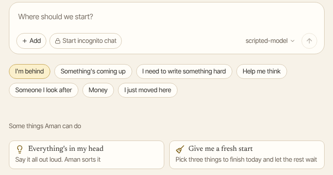

Not sure what to ask? A new chat opens on ready-made ideas. Each one is a card.

How to get there: Click **New chat** in the left bar.

## How the cards work

1. Click one of the buttons above the cards, such as **Help me think** or **Money**. The cards change to ideas on that subject.
2. Click a card. It writes the request into the message box for you.
3. Change the words if you like, then send it.

Aman asks a short question first when it needs to know more. It only saves a list, sets a reminder or sends a message after you say yes.

## I'm behind

- **What am I dropping?** Finds replies, promises, forms and RSVPs you still owe.
- **Answer the one that's waiting**: Finds the email you have been putting off, and writes a reply for you to check.
- **Forms and paperwork**: Lists anything with a deadline that you have to fill in or sign.
- **Catch me up on a thread**: Sums up a long email thread in five lines, and says what you need to do.
- **Everything's in my head**: Say everything on your mind. Aman sorts it into three lists: today, this week and later.
- **Give me a fresh start**: Picks three things to finish today, and lets the rest wait.

## Something's coming up

- **Get me ready for the next one**: Who is in your next meeting, what it is about, and three things to say.
- **This week at a glance**: Appointments, school, birthdays and bills in one list.
- **Plan a birthday or a gathering**: A to-do list and a timeline for the day.
- **A trip is coming**: What to book, pack and sort out, in the right order.
- **Don't let me forget**: Aman reminds you at the right moment.
- **Find places and routes**: Three options, with travel time and opening hours.

## I need to write something hard

- **Say it kindly**: Aman writes the awkward message for you.
- **Say no**: A clear no that keeps the relationship.
- **Ask for something**: A raise, a refund or a favor, without apologies.
- **Follow up without nagging**: A polite nudge that is easy to answer.
- **Thank someone properly**: A thank-you that sounds like you.
- **Explain this to me**: Paste a letter or a message. Aman says what it means and what to do.

## Help me think

- **Everything's in my head**: See "I'm behind" above.
- **I can't get started**: Tell Aman what is stuck. It helps you take one small first step.
- **Help me decide**: Aman compares two options and suggests one. You can ignore it.
- **Talk it through**: Aman listens and asks one good question at a time.
- **Break it into steps**: Aman splits a big task into steps of about 10 minutes, so you can tick them off.
- **Keep me company while I work**: Set a timer. Aman checks in when it ends, and nothing more.

## Someone I look after

- **Keep their care in one place**: Medicines, visits and questions, all in one place.
- **Medicine times**: A daily schedule with reminders.
- **Get ready for their appointment**: What to bring, what has changed, and what to ask. To find the appointment in your calendar and email, connect them first. See "Connecting your email and calendar".
- **School and activities this week**: Pickups, forms, events and what to send in, day by day.
- **Share the load at home**: Who does what this week, as a chart you can share.
- **A hard conversation about care**: Aman helps you find the words.

## Money

- **What am I paying for every month?** Aman looks through your email for subscriptions and renewals. It lists what you pay, how much and how often, and marks anything you may have forgotten. It needs your email connected. It never cancels anything on its own: it can write the message, and you approve it before it is sent.
- **Explain this bill**: Aman says what you owe and why.
- **Am I being overcharged?** Compares your price with what others pay.
- **Money coming up**: Bills, renewals and payments due in the next month, by date.
- **A simple budget for this month**: What comes in, what goes out, and what is left.

## I just moved here

- **What do I need to sort out first?** Papers, bank, health care and housing.
- **Explain this letter**: Aman says what it means and what to do.
- **Find a doctor near me**: Nearby family doctors that take new patients, with travel time, hours and how to register.
- **Ten minutes of the language**: Practice talking at the pharmacy or the school office.
- **What people here just know**: The everyday things nobody tells newcomers.
- **Choose a neighborhood**: Three areas compared on rent, commute and what it is like to live there.

## Before you pick a button

**Your morning brief**, **Just tell me what matters today** and **What's for dinner this week?** show when no button is chosen. "Your morning brief" has its own page. For dinners, tell Aman what is already in your fridge and cupboards and what anyone will not eat. It plans seven dinners and writes one shopping list for what is missing.
