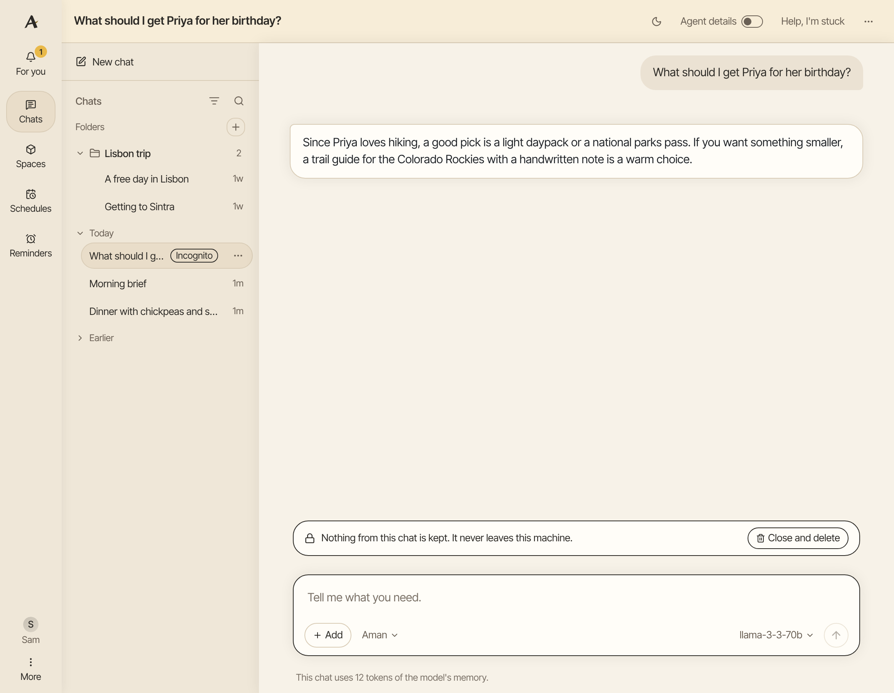
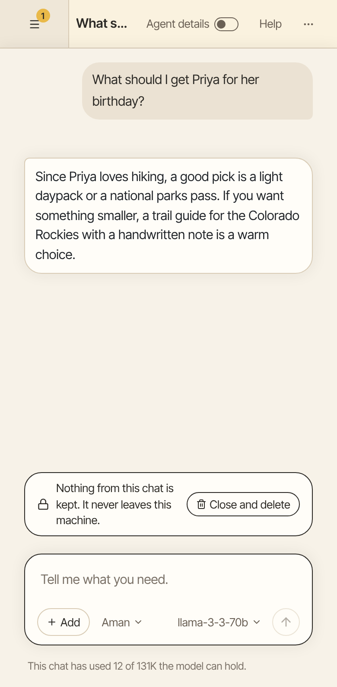

An incognito chat is a chat Aman forgets. Use one for a question you don't want kept, such as a gift for someone who shares your computer.

How to get there: Click **New chat**, then **Start incognito chat** under the message box.

=== "Computer"

    

=== "Phone"

    

## Start an incognito chat

1. Click **New chat** at the top of the chat list.
2. Click **Start incognito chat** under the message box, before you type your first message.
3. Type your message and send it.

The message box gets an outline in the same color as the text, and a line above it says the chat is not kept. A chat is incognito from the start or not at all. You can't make a normal chat incognito later, or the other way round.

## Where your words go

The line above the message box says whether your words leave your computer.

- With a model that runs on your computer, they never leave it.
- With a hosted model, they still go to that model's company, which the line names.

Aman checks this line again after each reply and when you switch persona.

## What Aman keeps and what it forgets

Aman can still read what it already knows, such as your memory, spaces, reminders and notes. It writes nothing new from an incognito chat:

- Nothing goes into memory, your persona notes or the daily brief.
- The chat never shows in a chat search or in past-chat search.
- It can't go in a folder, and a bug report never includes it.

Aman also can't make anything that would outlive the chat. It can't make or change spaces, reminders, schedules, personas or notes there, and the web browser is off. It can still switch to a persona you already have. A connector you added can only look things up. Your own email and calendar still ask first, as in any chat.

For anything you want kept, ask in a normal chat.

## End an incognito chat

1. Click **Close and delete** above the message box. On a small phone the button sits under the line about the chat.
2. Click **Delete for good** to confirm, or **Keep** to go back to the chat.

Aman opens a new chat.

!!! warning

    Every message, picture and file in the chat is deleted for good. It can't be brought back.

## Good to know

- While it is open, the chat shows in your chat list with an "Incognito" label, only in that browser tab.
- An incognito chat you leave open is deleted on its own a day after its last message.
- Some things are kept on purpose. If you approve an action, such as sending an email, the record of that approval stays, and the email was really sent.
- The activity log keeps a short line about each action, which can repeat its words.

## Related

- [Chats](chats.md)
- [Your privacy](privacy.md)
- [Approval cards](approvals.md)
