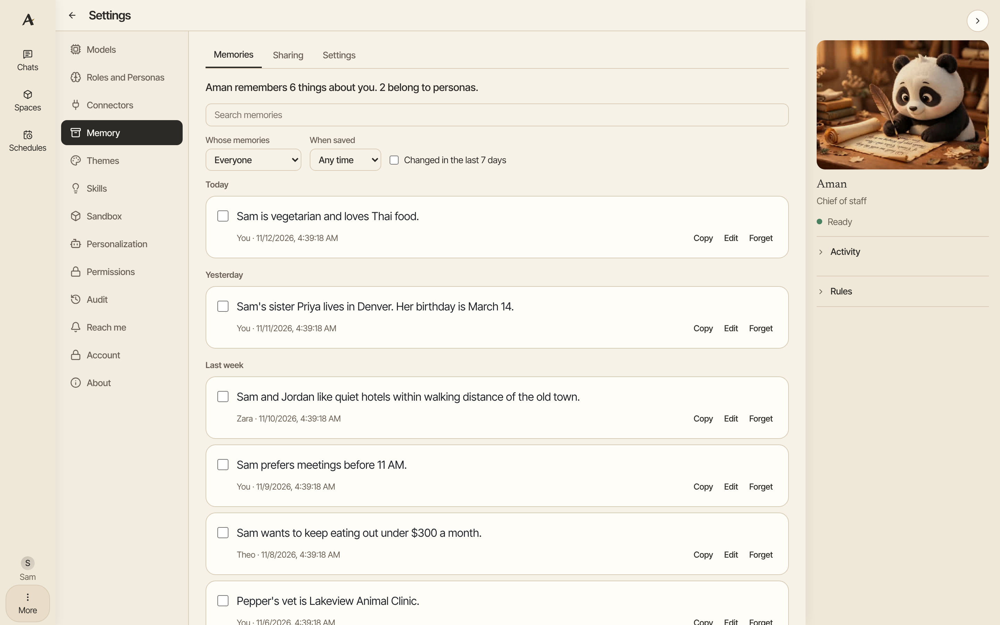
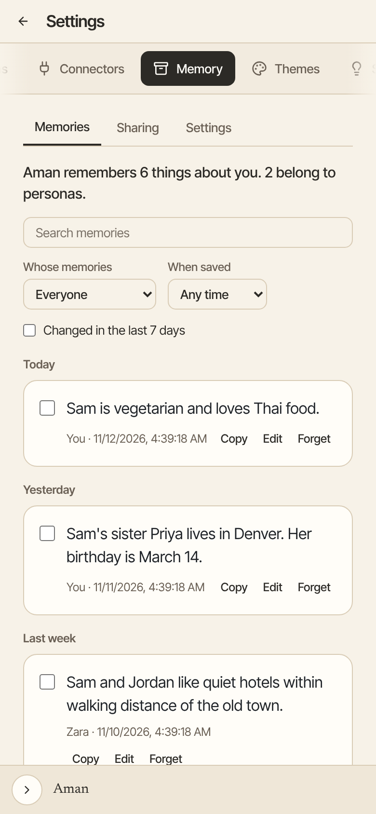

Aman remembers useful facts from your chats, such as who people are, your plans and what you prefer. Next time, you don't have to explain them again.

How to get there: Click **More** in the left bar, then **Settings**, then **Memory**.

=== "Computer"

    

=== "Phone"

    

Memory is on from the start. Aman keeps your memories as plain notes on your own computer. To see what it remembers right in a chat, ask "What do you remember about me?"

## The tabs on the Memory page

- **Memories**: read, change or delete what Aman remembers.
- **Pages**: a short page for each person and each matter in your life.
- **Sharing**: choose which personas share which memories.
- **Learned profile**: what Aman has learned about you from your chats, and the switch that lets it keep learning. See [Personalization](personalization.md).
- **Import and export**: save your memories to a file, bring them back from one, and set up topics.
- **Settings**: set up memory and change how it works.

## Change or forget a memory

1. Open the **Memories** tab.
2. Find the memory. Type in **Search memories**, or narrow the list with **Whose memories** and **When saved**.
3. To change it, click **Edit**, change the words, then click **Save**.
4. To remove it, click **Forget**.

Aman won't use a forgotten memory again. If you forget one by mistake, click **Undo** within 10 seconds.

To forget several at once, check the box beside each one. Then click **Forget selected**, and click **Forget** to confirm. Click **Keep them** if you change your mind.

!!! tip

    Click **Copy** to copy a memory's text, for example to paste it into a note.

## Where a memory came from

Each memory ends with a line that says where it came from. "From you" means you said it in a chat. "External source" means it came from somewhere else, such as an email, a web page or an imported file. On the Memories tab the label is shown only when a memory came from somewhere else. A memory with no label there is one you said yourself. Aman treats only "From you" memories as your own words. It asks you before it uses a link or an address from any other memory. Changing a memory never changes where it came from, and a memory you reviewed as your own still says "From you" after you edit it. A memory saved before Aman kept this line shows "External source: no record". Aman treats it as external, because nothing shows where it came from.

You can review these older memories once. Open the Memories page and look for the note that starts "Some older notes have no record of where they came from". Click **Review older notes**. The list holds only memories Aman saved in a chat where it had read nothing from outside, and where you attached no file. Tick the ones that are your own words, then click **Mark the ticked notes as from me**. Nothing is ticked at the start, and nothing changes until you click. Memories that are not in the list stay external. You can also make a fact your own by saying it to Aman in a chat.

## Save or move your memories

Open **Export, import, and topics** at the bottom of the **Memories** tab.

- **Export** saves the memories you picked under **Collection** as a file.
- **Import** adds memories from a file you exported before.
- **Add topic** makes a new collection for a subject, such as "Garden". You can then share it with personas.

## Share memories between personas

A [persona](personas.md) is a helper with its own name that answers in your chats. Each persona keeps its own notes from its chats. Notes from chats with your main assistant are shared, so every persona can read them.

1. Open the **Sharing** tab.
2. Find the persona's row. The first column, **Can also read notes from**, lists your main assistant and each persona.
3. In that row, check the box under each persona or topic whose notes it may read. Each change saves at once.

A persona's own notes stay private to it until you share them here.

## Pages about people and matters

Aman keeps a short page for each person and each matter in your life, such as your sister or a house move. Open Settings, then Memory, then **Pages** to read them. You only see this tab when memory is kept as Markdown files, which is the default.

Pages are in two groups, People and Matters. Each row shows the name, one line about it and the day it last changed. A small count says how many lines wait for you to confirm. Type in the search box to find a page by its name or another name it goes by.

Aman does not list your pages in every reply. When you ask about something and no page was shown for it, it can look at the list and open a page that looks relevant. A page with no line of your own is listed apart, and its name is marked "not confirmed by you", because Aman made it from something it read.

Open a page to read it. The top shows the day it last changed and a short summary of what the page covers. Aman writes that summary when it makes the page, and it is only a description for you. Below it, each fact is one short line. A line you said or wrote yourself looks plain. A line Aman read in mail, the calendar or elsewhere says "External source:" and where it came from, the same words a memory uses. When you ask Aman in a chat to save something it read for you, such as an address from an email, it saves the line on the page straight away with this label. You do not have to confirm it. Aman does not save a line that looks like a password, a key or a card number onto a page, even when you ask. It tells you it did not save it. Aman never treats such a line as your instruction, and it never replaces a line of your own. To make a fact your own, say it to Aman yourself. Lines under Unconfirmed say "Not confirmed". Aman never treats them as your words until you decide.

- Choose **Confirm** to keep an unconfirmed line as yours. You can pick which section it goes to. The default is Now.
- Choose **Dismiss** to remove an unconfirmed line.
- Choose **Edit** to change the whole page as text, then **Save**. The first line is the page's name, and changing it renames the page. Each line that starts with a dash is one thing Aman remembers. A line you leave alone keeps where it came from. A line you change or add counts as coming from you. If the page changed while you were editing, Aman asks you to reload it and try again. Nothing is lost.
- Choose **Delete** to remove a page. For a few seconds you can choose **Undo** to cancel it.

Once a day Aman also checks each page for two lines that cannot both be true. When it finds some, the page row says how many pairs disagree, and the page shows **These lines disagree** at the top with both lines and a short reason. Aman changes nothing on the page. If one line is wrong, use **Edit** to fix it. If the pair is fine, choose **Not a problem** and Aman will not list those two lines again. In the same nightly tidy, a line whose end day has passed moves to Earlier by itself.

Two helpers work on your pages while you are not chatting. Both start off, and both use the model. Open Settings, then Memory, to switch them on. Under **Sort what Aman saves onto pages**, choose Off, **Only note what it would do** or On. With On, what Aman read can only ever be added as not confirmed. A line Aman rewords from your own note is marked as Aman's guess, and waits as not confirmed, when it picks up a word that is only in something Aman read. A message is put on your pages only once: when Aman already wrote the page line during the chat because you asked it to remember something, the note from that message is not sorted a second time. Switch on **Tidy pages once a day** to have Aman move ended lines to Earlier, sort notes it missed and list lines that disagree. It starts at midnight unless you pick another hour under **Start the daily tidy-up at**. The hour is the time on the computer Aman runs on. Choose **Tidy now** to tidy straight away. It tells you what it did, and why when a note could not be filed, for example when the model took too long to answer. You can leave the page while it works; when you come back it shows that it is still tidying, or what it did. When your model is slow and notes are left unfiled because it took too long, choose a longer time under **Wait for the model up to**, at most 20 minutes. A change counts at once, with no restart. You only see these when memory is kept as Markdown files.

Under each page in the list you have **Copy**, **Edit** and **Delete**, the same as under a memory. The same three are at the bottom of an open page. Aman keeps a history of every change to your pages in the memory folder on your computer.

## Let Aman search your past chats

Aman can look through your earlier chats when you ask, for example "What did we decide about the Lisbon trip last week?" This is off until you turn it on.

1. Open the **Settings** tab.
2. Turn on the switch named "Let Aman search your past chats when you ask".

Aman then searches what you typed and its final replies. It never searches the chat you are in now. A persona only searches its own chats, chats with your main assistant, and chats of personas whose notes are shared with it.

The same switch lets you search inside your chats yourself. Click **Search chats** at the top of your chat list and type. Chats whose titles match come first. Chats where a message holds your words come under **In messages**.

## Other memory settings

The **Settings** tab also has these:

- **Use memories in replies**: when this is off, Aman stops bringing saved memories into its replies. Your memories are kept.
- **Turn summaries**: when this is on, Aman saves only the lasting facts from each chat. When it is off, Aman saves each message word for word.
- **Recall screening** and **Tool-output screening**: optional safety checks that look for hidden instructions in what Aman reads. They only work when your Aman has a checking service set up.

## Good to know

- Your memories stay on your computer. Searching them uses a small helper that also runs on your computer.
- A chat you delete leaves the past-chat search at once.
- An incognito chat can use your memories, but Aman saves nothing from it.
- If Aman couldn't save anything from your latest chat, the **Memories** tab tells you. Ask it to remember the important part again in your next chat.
- To learn where memories are kept and how Aman finds them, see [How memory works](../../../../docs/memory.md).

## Related

- [Personalization](personalization.md)
- [Personas](personas.md)
- [Your privacy](privacy.md)
