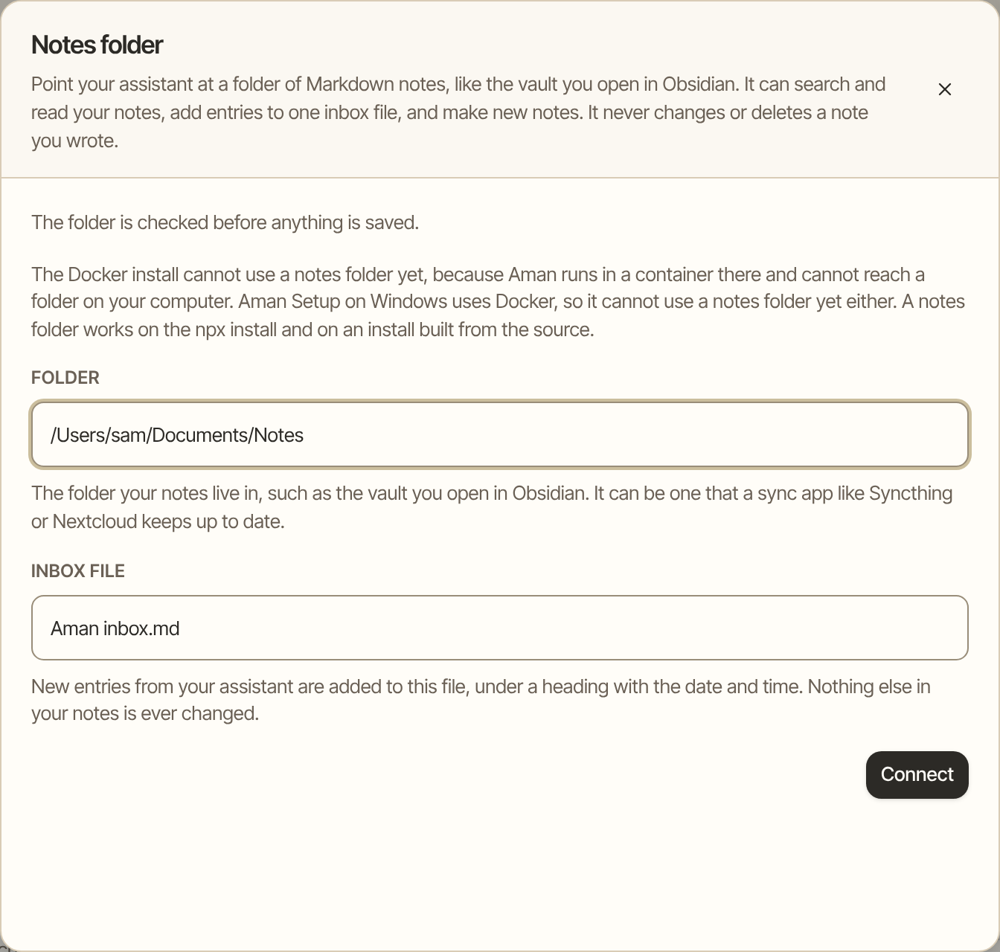
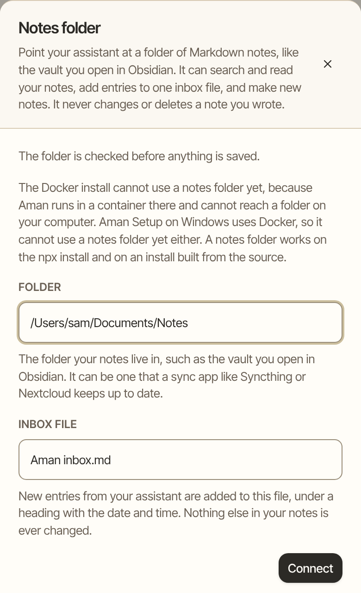

Point Aman at a folder of your Markdown notes, such as the vault you open in Obsidian. Aman can then search and read your notes in a chat, add entries to one inbox file, and make new notes. It never changes or deletes a note you wrote.

How to get there: Click **More** in the left bar, then **Settings**, then **Connectors**, then find **Notes folder**.

=== "Computer"

    

=== "Phone"

    

!!! note "Before you start"

    A notes folder works when Aman runs straight on your computer: the npx install, or an install built from the source.

    It doesn't work yet when Aman runs in Docker. That includes the installer on a Mac or Linux and Aman Setup on Windows. There, Aman runs in a container, a sealed-off box that can't see the folders on your computer, so the folder can't be found.

## Connect your notes folder

1. Click **More** in the left bar, then **Settings**, then **Connectors**.
2. Find **Notes folder** and click **Connect**.
3. In **Folder**, type the path of the folder your notes live in, on the computer Aman runs on.
4. In **Inbox file**, type the name of the file new entries go to, or keep the name that's there (Aman inbox.md).
5. Click **Connect**.

Aman checks the folder first. Then the panel says it's connected and how many notes the folder holds.

!!! tip "Synced folders work"

    The folder can be one that a sync app keeps up to date, such as Syncthing or Nextcloud. Obsidian doesn't need to be running, and you don't need an Obsidian plugin. Aman reads the files themselves.

## Use your notes in a chat

- Ask about your notes. In any chat, ask something like "What did I write about the trip to Lisbon?" or "Where did I note that recipe?" Aman searches your notes and reads the ones that match.
- Keep something. Ask Aman to add it to your inbox, or to make a new note. Aman adds an inbox entry under a heading with the date and time, so a file your sync app is also updating keeps both sets of words.
- Change a note. Aman doesn't edit your notes. If you ask it to change one, it adds the new words as an inbox entry or a new note instead, and says that's what it did.

Adding to your notes normally runs without asking. Once a chat has read things written by other people, such as an email, adding to your notes asks you first with a card. That's because the request may have come from something Aman read rather than from you.

## Change the folder or the inbox file

1. Click **More** in the left bar, then **Settings**, then **Connectors**.
2. Find **Notes folder** and click **Manage**.
3. Click **Change folder**.
4. Type the new **Folder** or **Inbox file**, then click **Connect**.

## Stop using the folder

1. Click **More** in the left bar, then **Settings**, then **Connectors**.
2. Find **Notes folder** and click **Manage**.
3. Click **Remove**, then **Remove folder**.

Removing the folder changes nothing inside it. Aman forgets the path and stops looking at your notes.

## Good to know

- The folder can't be one of the folders Aman keeps its own data in, or a folder inside one of them: Aman's memory folder, the persona knowledge folder, the app data folder that holds Aman's database, or the folder the sandbox workspaces live under. If you pick one, the panel says so and names the folder to pick instead.
- To search your notes, Aman keeps an index of them in its own app data folder, in a folder named notes-folder-index. Nothing for the index is written into your notes folder.
- If the card says the folder can't be found, check that the folder is still there, then click **Manage** and type the path again.
- [Notes folder setup](../../../../docs/connectors/notes-folder.md) explains how reading and writing work in more detail.

## Related

- [Connect email and calendar](connect-mail-calendar.md): the other cards on the Connectors page.
- [Memory](memory.md): what Aman remembers about you.
