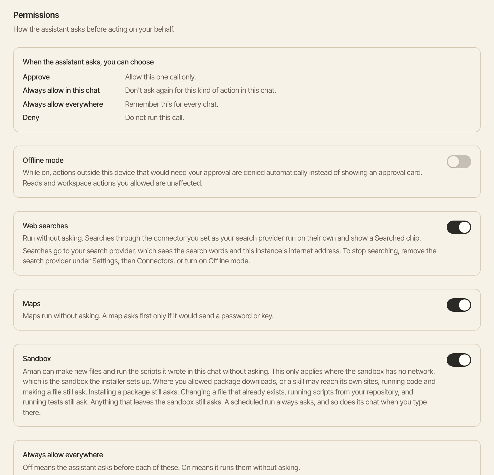
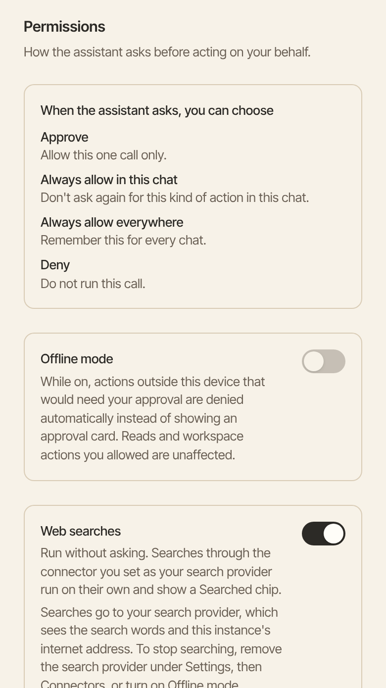

The Permissions page lets you choose what Aman may do without asking you first. It also has offline mode, which stops Aman from reaching outside your computer.

How to get there: Click **More** in the left bar, then **Settings**, then **Permissions**.

=== "Computer"

    

=== "Phone"

    

The top of the page lists the answers you can give on an approval card. [Approval cards](approvals.md) explains each one.

## Choose what runs without asking

Each switch covers one kind of action. Turn a switch on to stop the questions for that kind. Turn it off to see a card every time.

1. Click **More** in the left bar, click **Settings**, then click **Permissions**.
2. Use the **Web searches** switch. When it's on, searches run on their own and show a "Searched" chip in the chat. When it's off, every search shows a card with the exact words first.
3. Use the **Maps** switch. When it's on, maps run without asking. A map still asks first if it would send a password or a key.
4. Use the **Sandbox** switch. The sandbox is the sealed-off space on your computer where Aman runs code. When the switch is on, Aman can make new files and run scripts it wrote in the same chat without asking.
5. Under **Always allow everywhere**, turn on **Write files** if you want Aman to write files without asking.

Each switch saves as soon as you change it.

!!! note "What the Sandbox switch doesn't cover"

    The switch only works where the sandbox can't reach the internet. That's the sandbox the installer sets up. Some things still ask, even with the switch on:

    - Running code or making a file where you allowed package downloads, or where a skill may reach its own sites.
    - Installing a package.
    - Changing a file that already exists, running scripts from your own project, and running tests.
    - Anything that leaves the sandbox.
    - Anything in a scheduled run, or in its chat when you type there.

## Turn on offline mode

Offline mode keeps Aman's actions on your computer. While it's on, any action that would reach the internet is refused without a card. Reading what's already on your computer, and work you allowed in your workspace, still run.

1. Click **More** in the left bar, click **Settings**, then click **Permissions**.
2. Turn on **Offline mode**.

A small **Offline mode** sign shows on the screen while it's on. Turn the switch off to go back.

While offline mode is on, Aman can't:

- search the web or show maps,
- read or send email, or use your calendar or Google Drive,
- use connectors that reach an outside service,
- install packages, or run commands that need the internet.

!!! warning "Your model may still be online"

    Offline mode stops tools from reaching the internet. It doesn't change your model. If you use a hosted model, your chat still goes to that model's company. To keep everything on your computer, pick a model that runs on it.

## Good to know

- Sending email isn't on this page. Sending always asks.
- No setting lets a send, a delete or a package install run without a card.
- A scheduled run ignores the **Write files** and **Sandbox** switches. It holds those actions for you to approve.
- To stop web searches completely, remove the search connector in **Settings**, then **Connectors**, or turn on offline mode. The search service sees the search words and your computer's internet address.
- [Safety rules in detail](../../../../docs/safety.md) lists every rule.

## Related

- [Approval cards](approvals.md)
- [Activity log](activity-log.md)
- [Your privacy](privacy.md)
