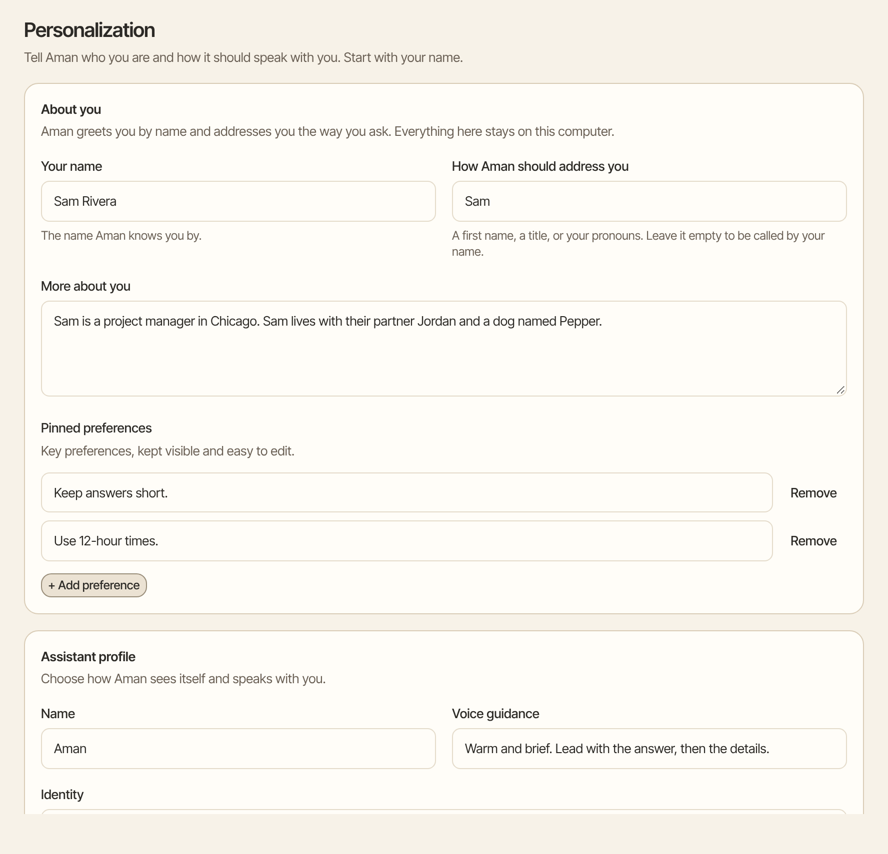
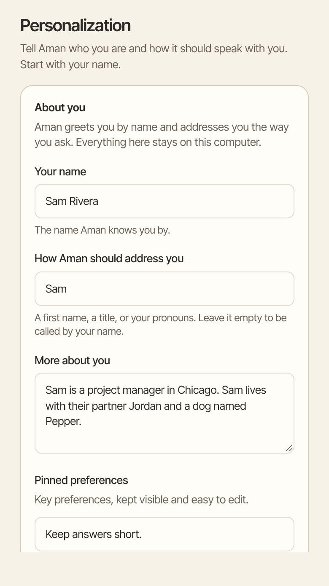

Tell Aman who you are and how you like to be spoken to. You can also give the assistant its own name and a way of talking that suits you.

How to get there: Click **More** in the left bar, then **Settings**, then **Personalization**.

=== "Computer"

    

=== "Phone"

    

## Tell Aman about you

1. Under **About you**, type **Your name**, such as Sam Rivera.
2. In the next box, type how Aman should address you, such as Sam or Dr. Rivera. Leave it empty to be called by your name.
3. In **More about you**, add anything that helps, such as where you live, what you work on and what you care about.
4. Under **Pinned preferences**, click **+ Add preference** and type one thing you always want, such as "Use short bullet points". You can pin up to 12.
5. Click **Save personalization**.

## Give the assistant a name and a voice

1. Under **Assistant profile**, type a **Name**, such as Mannie. Aman uses this name everywhere in the app.
2. In **Voice guidance**, describe how it should sound, such as "Warm, direct, concise".
3. In **Identity**, describe its role, such as "You are my chief of staff. Keep my week calm and organized."
4. Click **Save personalization**.

!!! tip

    Not sure what to write? Start from one of the [Ready-made personalities](../../../../docs/personalities/README.md) and change it to suit you.

## Let Aman learn about you

Aman can keep a short profile of you that it updates from your chats. This is off until you turn it on.

1. Under **Learned profile**, turn on **Learn from conversations**.
2. Click **Save personalization**.

After a chat, Aman updates the profile, at most once an hour. The profile appears under **Learned profile**. Click **Edit** to change it, or **Clear learned profile** to empty it. Then click **Save personalization**.

## Good to know

- Everything on this page stays on your computer. Aman never fills it in from your chats on its own, except the learned profile when you turn it on.
- Each box holds up to 2,000 characters. The whole page holds 5,500, not counting the learned profile.
- When a [persona](personas.md) answers, it uses its own name and role instead of the assistant's. It still knows your name and preferences.
- To start over, click **Clear all**. It empties the whole page at once, without asking first, and can't be undone.
- For what is stored and what the model sees, see [Personalization details](../../../../docs/personalization.mdx).

## Related

- [Ready-made personalities](../../../../docs/personalities/README.md)
- [Memory](memory.md)
- [Personas](personas.md)
