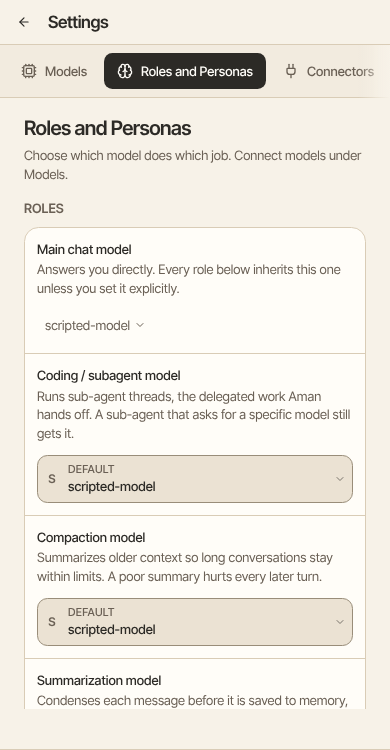

A persona is a helper that answers in your chats. It has its own name, its own instructions and its own model. For example, a travel persona can plan a trip for you.

How to get there: Click **More** in the left bar, then **Settings**, then **Roles and Personas**.

## Make a persona

1. Click **Add persona**.
2. In **Name**, type the name you will use to call the persona, such as Zara.
3. In **Also answers to**, type other names for it, with commas between them. You can skip this.
4. In **Model**, pick the model the persona should use.
5. In **Role**, write how the persona should answer.
6. Click **Save persona**.

Each persona in the list has a knowledge library. You can add documents to it there.

## Choose who answers a chat

- Start your message with the persona's name, such as "Zara, plan a long weekend". The persona answers the rest of that chat.
- Or click the small button by the message box that shows who is answering. Its tip says "Choose a persona". Click a persona in the list.

The button shows only after you have made at least one persona. To go back to Aman, click it again and click the first name in the list.

## Personas and agents

A persona answers in your chats. An agent is a saved set of instructions you build and try, and it is what runs your schedules. See "Agents".
