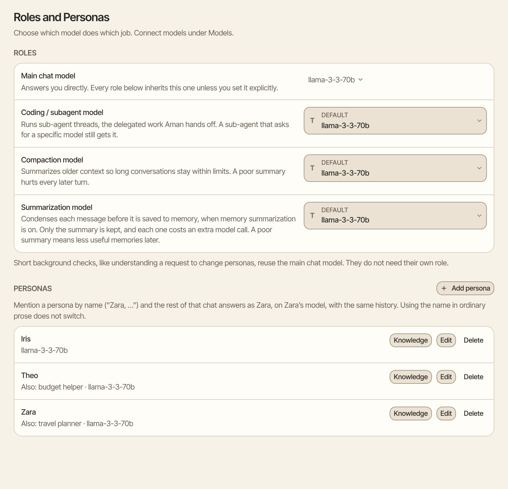
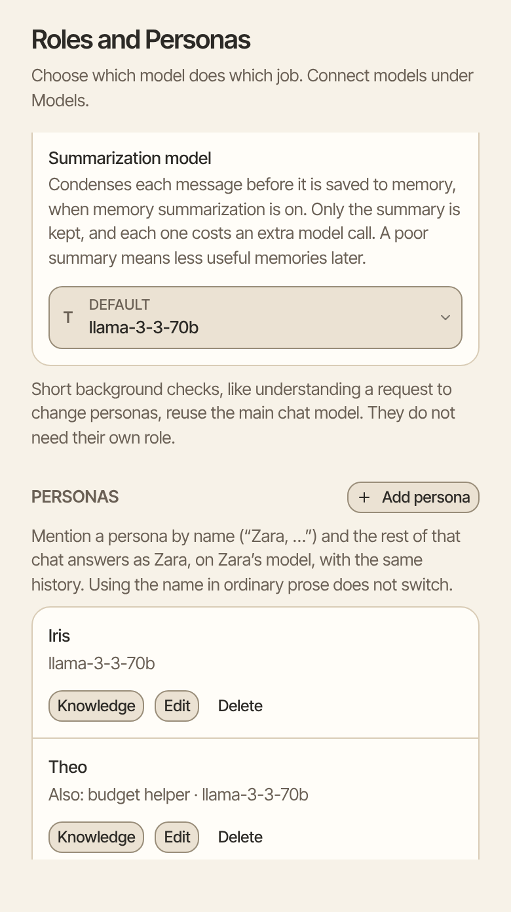

A persona is a helper with its own name, role and model that can answer in any chat. For example, a travel persona named Zara can plan your trips, while Aman handles everything else.

How to get there: Click **More** in the left bar, then **Settings**, then **Roles and Personas**.

=== "Computer"

    

=== "Phone"

    

!!! note "Persona or agent?"

    A persona talks with you in your chats, the way Aman does. An [agent](agents.md) is a saved setup for a job, such as a weekly report, that you try on its own or run on a schedule. If you want someone to chat with, make a persona.

## Make a persona

1. Click **Add persona**.
2. In **Name**, type the name you will call it by, such as Zara.
3. In **Also answers to**, type any other names for it, with commas between them, such as "Z, Zara Quinn". You can skip this.
4. In **Model**, pick the model the persona should use.
5. In **Role**, describe how it should answer, such as "You are a travel planner. Suggest two options and say what each costs."
6. Click **Create persona**.

Each name must be different from every other persona's names.

## Talk to a persona

- By name: start your message with the name, such as "Zara, plan a long weekend in Porto". Zara answers the rest of that chat, with the same history.
- From the menu: click the button beside the message box that shows who is answering. Its tip says **Choose a persona**. Under **Who answers this chat**, click a persona.

The button only shows once you have made at least one persona.

To go back to the main assistant, click the button and choose the first name in the list. Or say so in the chat, using the assistant's name, such as "Can I talk to Mannie again?"

!!! tip

    Just mentioning a name doesn't switch personas. "I was reading about Zara yesterday" keeps the same speaker.

## Give a persona its own documents

Each persona can have a private library of documents, links and notes. Only that persona searches them.

1. Click **Knowledge** on the persona's row.
2. Pick **File**, **Link** or **Text**.
3. Choose the file, paste the link, or paste the text with a title.
4. Click **Add to library**.

Aman reads new documents in the background. You can keep chatting while it does.

## Change or remove a persona

- Click **Edit** on its row, change what you need, then click **Save persona**.
- Click **Delete** on its row to remove it. It is removed at once, without asking first. Its memories are kept, and past chats still show who answered.

## Choose which model does each job

The top of this page also sets which model answers you and which does background work, such as summarizing long chats. See [A model for each job](../../../../docs/model-roles.mdx).

## Good to know

- A persona changes who answers, not what Aman may do. Tools, approvals and safety rules stay the same.
- Each persona keeps its own memories. On the **Memory** page you can choose which personas can read each other's notes. See [Memory](memory.md).
- If a persona's model is removed, the persona stays. Its row says the model is missing, so you can pick another one.

## Related

- [Agents](agents.md)
- [Personalization](personalization.md)
- [A model for each job](../../../../docs/model-roles.mdx)
