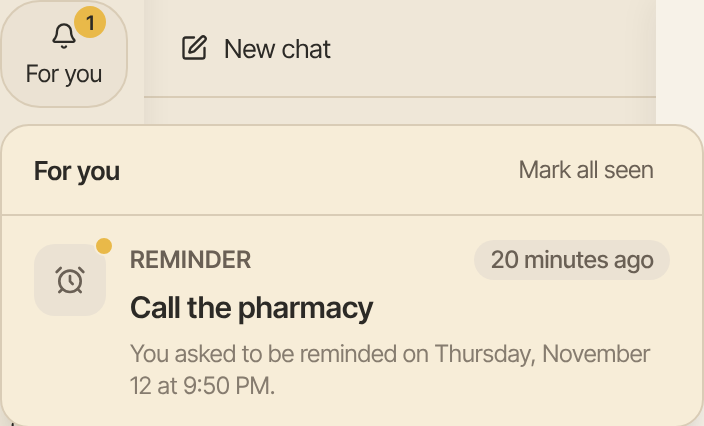
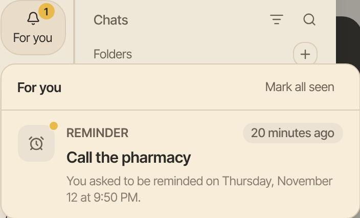

Aman can tell you about something without waiting for you to open a chat, such as a reminder, a bill due soon or a calendar clash. You choose what may reach you, and how.

How to get there: Click **More** in the left bar, then **Settings**, then **Reach me**.

## Where Aman's messages go

- The **For you** bell. Everything Aman sends you waits under the bell labeled **For you**, at the top of the left panel. On a phone, tap the menu button to see it. A number on the bell shows how many you haven't seen. Each item says what it is, when it came and why you got it.
- Notices on your devices. When you turn notices on for a device, it shows a notice even when Aman is closed. The notice says only that something is there. The details open in Aman.
- Phone calls. Calls are not set up yet, so nothing calls you.

A reminder also shows up as a line in the chat where you set it.

## Let Aman watch for things

Aman watches for nothing until you turn it on. Reminders you set reach you either way.

1. Click **More** in the left bar, then **Settings**, then **Reach me**.
2. At the top, turn on the switch called "Let Aman watch for things". It saves at once.

Once it is on, Aman watches for:

- Mail from people you marked always important. It counts only when your mail server confirms the sender. This needs a Google account. With the shared Email connector, senders can't be confirmed yet, so their mail is treated as ordinary mail.
- A bill or deadline in new mail that is due within three days.
- Two things on your own calendar at the same time.
- Time to leave for an event with a place.
- An approval that has waited longer than you chose.

Aman checks your mail every 10 minutes, your calendar every 30 minutes, and waiting approvals every 5 minutes. When the switch is off, Aman doesn't open your mail or calendar and asks no model.

The first time you turn it on, Aman starts from that moment, so old mail doesn't flood in. If you turn it off and on again within a day, Aman reads the mail that came in while it was off. After more than a day off, it skips mail older than a day and tells you once.

## How loudly Aman tells you

- A note is quiet. It waits under the bell. Most things are notes.
- A nudge is a notice on the devices where you turned notices on.
- A call is a phone call. Calls are not set up yet.

A model suggests how loudly to tell you, and your settings decide. The model's words show only under the bell, never in a notice on your phone. Words in a message, such as "urgent", can never make it louder than a note. Aman sends at most 5 nudges a day unless you change that. Reminders you set never count toward that limit.

To have an urgent reminder call you once calls are set up, tick **Call me for reminders I mark urgent**.

## Turn on notices for a device

Do this on each device where you want notices, such as your phone and your laptop.

1. Open Aman on that device.
2. Click **More** in the left bar, then **Settings**, then **Reach me**.
3. Under **Notices on this device**, click **Turn on for this device**.
4. When the browser asks whether to allow notices, allow them.

The page then says "On for this device."

!!! note "On an iPhone"

    Notices only work once Aman is on your Home Screen. In Safari, tap the Share button, choose Add to Home Screen, then open Aman from there and come back to this page.

To stop notices on a device, open the same page on that device and click **Turn off on this device**. Your other devices keep their notices, and everything still waits under the bell.

## Check that it works

1. Click **More** in the left bar, then **Settings**, then **Reach me**.
2. Click **Try it** next to a way to reach you.
3. A test item shows under the bell. For notices, Aman also says how many devices it reached.

## Read what Aman sent

=== "Computer"

    

=== "Phone"

    

1. Click **For you**, the bell at the top of the left panel. On a phone, tap the menu button first.
2. An item that came from a chat ends with **Open chat**. Click the item to go to that chat.
3. To clear the count, click **Mark all seen**.

## If notices won't turn on

The page says what's in the way. The usual ones:

- It needs a secure address. Open Aman at its address that starts with https, or on the computer itself at localhost, then come back to this page. See [Phone and other devices](phone.md).
- The device doesn't trust the computer yet. Do the trust step on this device, as [Phone and other devices](phone.md) shows, then try again.
- The browser is blocking notices. Allow notices for this site in the browser's settings for the site, then come back.
- The browser can't show notices. Try a recent version of Chrome, Edge, Firefox or Safari.
- Notices aren't set up on this server. Ask the person who runs Aman to turn them on.

## If Aman couldn't check your mail

If the mail Aman has read is more than an hour behind, **Reach me** says so at the top, with the time it first fell behind. The same notice shows for your calendar. It goes away after a check that reads all your new mail.

- If your mail is slow to read, or the server is busy, wait for Aman to catch up. If this lasts a day, ask whoever runs your mail.
- If you need to sign in to Google again, click **Settings**, then **Connectors**, then **Google**, and choose **Reconnect**. Aman shows the problem and doesn't switch to the shared Email connector.
- If the shared Email connector can't log in, click **Settings**, then **Connectors**, then **Email**. Make a new app password and save it again.
- For any other problem, click **Settings**, then **Connectors**, and check that your mail is still connected.

When Aman leaves some mail unread for good, it tells you once for each stretch of trouble, with the time it arrived, or the times it arrived between. **Reach me** also says which mail Aman is watching: your Google mail, or the shared Email connector if you have no Google mail connected.

## Related

- [Reminders](reminders.md): set a reminder.
- [Phone and other devices](phone.md): open Aman on your phone.
- [Your privacy](privacy.md): what Aman sends to a model when it notices something.
