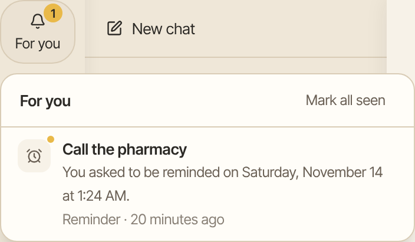

A reminder is a short note Aman gives you at the time you ask, such as "Remind me at 5 pm to call the pharmacy". It only ever reaches you, so Aman sets it without asking.

How to get there: In any chat, ask Aman to remind you.

## Set a reminder

1. In any chat, ask with a time, such as "Remind me at 5 pm to call the pharmacy".
2. Aman sets it. A line in the chat says when it is due and what it says.

Not sure when? Click **Don't let me forget** on the new chat screen. Aman asks what you must not forget, suggests a good time, and asks before it sets it.

A reminder can also repeat every day, every weekday, or on the days you choose, such as "Remind me every Monday at 8 am to put the bins out".

## When a reminder is due

- It shows under the bell at the top of the screen. A number on the bell counts what you haven't seen.
- It also appears at the end of the chat you set it in. If Aman is still answering in that chat, the line waits until the answer ends.
- That chat shows an unread mark in your chat list until you open it.
- If you turned on notices, your device shows one too, even when Aman is closed. The notice only says "Reminder". The words open in Aman. You choose how reminders reach you in **Settings**, then **Reach me**. See [Reach me](reach-me.md).

## Use the bell

1. Click the bell at the top of the screen. The **Notifications** panel opens.
2. Each item says what it is, when it came, and why you got it.
3. Click an item to open its chat.
4. Click **Mark all seen** to clear the count.

A reminder whose chat was deleted still shows under the bell.

## Turn on notices

After you set your first reminder, Aman offers to show notices on this device. Click **Turn on notices**, then allow them when your browser asks. Click **Not now** to skip. Aman offers again with your next reminder.

To change it later:

1. Click **More** in the left bar, then **Settings**, then **Reach me**.
2. Under **Notices on this device**, click **Turn on for this device** or **Turn off on this device**.

Each device has its own setting. If the page says notices are not set up on this server, ask the person who runs your Aman to turn them on.

## Mark a reminder urgent

Say so when you ask, such as "Remind me at 5 pm to call the pharmacy, it's urgent". An urgent reminder can call you once phone calls are set up and you tick **Call me for reminders I mark urgent** in **Reach me**.

## See or cancel reminders

1. In any chat, ask, such as "What reminders do I have?"
2. To cancel one, ask, such as "Cancel the pharmacy reminder".
3. A card shows the reminder. Click **Allow** to cancel it, or **Not now** to keep it.

A canceled reminder is gone for good.

## Good to know

- Reminders don't show on the Schedules page. Ask in a chat to see them.
- An incognito chat can't set or cancel a reminder. Ask in a normal chat.
- A scheduled run can't set a reminder by itself. It holds the reminder for your OK.
- A reminder costs nothing when it fires. Aman doesn't use a model to deliver it.
- Each reminder that is set or fires is one line under **Settings**, **Audit**.

## Related

- [Schedules](schedules.md)
- [Calendar](calendar.md)
- [Your morning brief](daily-brief.md)
