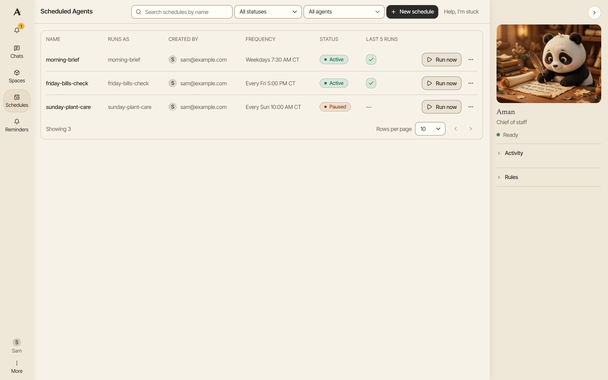
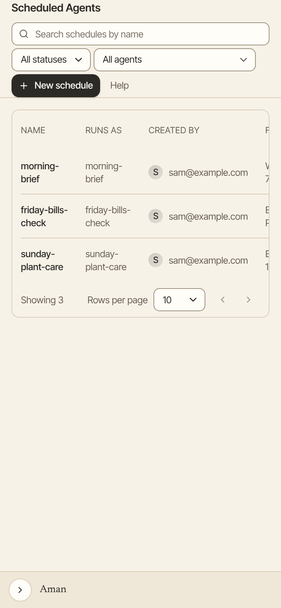

A schedule asks Aman to do the same job again and again, such as "Every weekday at 7:30, send me my morning brief". Each run is saved as a chat, so you can open it and see what Aman found.

How to get there: Click **Schedules** in the left bar.

=== "Computer"

    

=== "Phone"

    

A schedule repeats and does work for you. For a simple nudge at a set time, use a [reminder](reminders.md) instead.

## Make a schedule by asking

1. Click **Chats** in the left bar, then click **New chat**.
2. Type what you want and how often, such as "Every weekday at 7:30, send me my morning brief". If the time is unclear, Aman asks.
3. A card shows the schedule: its name, when it runs, who runs it, the next few runs, and what it will do each time. Check it.
4. The card also lists what the schedule may use: your **Connectors**, your **Skills**, **Run code** and **Memory**. Aman ticks the ones it thinks the task needs. Tick or untick any of them. A skill needs **Run code**, so that box stays ticked while a skill is ticked.
5. If you changed a tick, click **Update the card**. Aman shows the card again with your choices.
6. Click **Allow** to start it. Click **Change it** to reword it first, or **Not now** to drop it.

Aman saves your choices as a new agent with the same name as the schedule. To change them later, click **Agents** in the left bar and open that agent. Deleting the schedule doesn't delete the agent. The schedule keeps the persona you were using.

If you ask from a chat that already uses one of your agents, the schedule runs as that agent. The card then shows that agent's tools, with nothing to tick.

## Make a schedule on the Schedules page

1. Click **Schedules** in the left bar.
2. Click **New schedule**.
3. In **Agent**, pick the agent that should do the job. If you have none, see [Agents](agents.md).
4. Type a **Name** and a **Task**. The task is what Aman does on each run.
5. Under **Frequency**, click **Hourly**, **Daily** or **Weekly**. For **Weekly**, pick the **Days**.
6. Set the **Hour**, the **Minute** and the **Timezone**.
7. Click **Save**. The schedule is saved paused, so it doesn't run yet.
8. To try it once, click **Run test**. Your schedule doesn't change.
9. Click **Activate Schedule** to start it.

Runs are always at least one hour apart.

## Run, pause, change or delete a schedule

On the Schedules page:

- Click **Run now** on a row to run it at once. Aman opens the run's chat.
- Click the three dots on a row, then click **Edit**, **Pause**, **Resume** or **Delete**.
- **Delete** asks you to confirm. A deleted schedule stops for good.

Or ask in any chat, such as "Pause my morning brief" or "Delete the weekly report schedule". A card shows the schedule and when it runs. Click **Allow** to go ahead. Aman asks every time.

## What a scheduled run holds for your OK

A scheduled run happens while you are away, so it never sends or changes anything of yours by itself.

1. The run reads and searches, the same as a chat.
2. Anything that would show a card in a chat is held instead. That includes running code and setting a reminder, which a chat may do without asking.
3. When the run ends, its chat ends with a **Needs your OK** list. Nothing on it has been done yet.
4. Click **Allow** on an item to do it, or **Deny** to drop it.
5. When you approve, Aman checks the item again. If anything on it changed since, nothing is done, and Aman says to ask again in a chat.

Held items expire after 24 hours.

A space is the one exception. A run can make and change any space without asking, so a list it keeps for you stays up to date. Every change keeps a version you can ask Aman to bring back. Each change is also one line under **Settings**, **Audit**. Aman can't delete a space.

## Good to know

- A scheduled run sends no notice. Its results wait in its chat until you open it.
- A scheduled run can read your Gmail, but it never drafts or sends Gmail mail.
- An incognito chat can't make, pause or delete a schedule. Ask in a normal chat.
- Reminders don't show on the Schedules page. See [Reminders](reminders.md).
- The full rules for what a run may do are on [How schedules hold actions](../../../../docs/schedules.md).

## Related

- [Reminders](reminders.md)
- [Your morning brief](daily-brief.md)
- [Approval cards](approvals.md)
