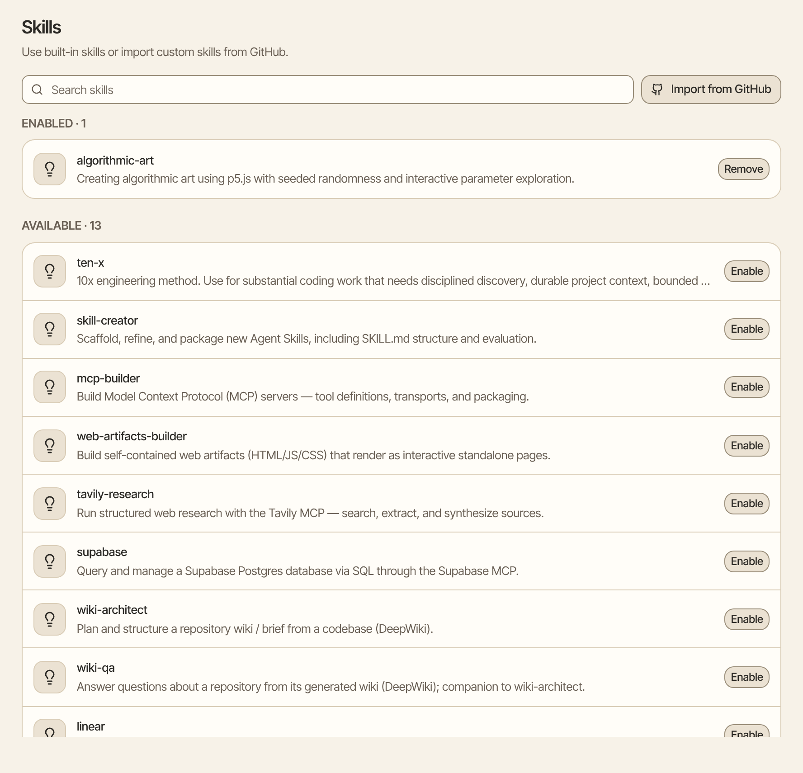
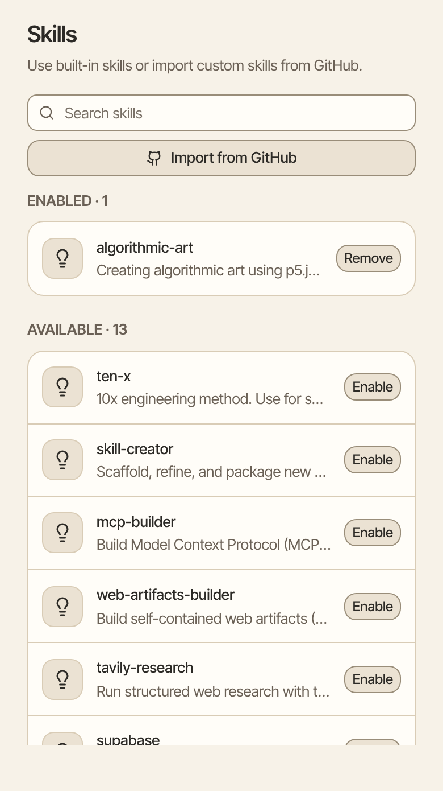

A skill is a set of step-by-step instructions that teaches Aman a particular job, such as writing release notes or following a checklist. Turn on the skills you want, then switch them on in the chats that need them.

How to get there: Click **More** in the left bar, then **Settings**, then **Skills**.

=== "Computer"

    

=== "Phone"

    

!!! note "Before you start"

    Skills run in the sandbox, a closed-off workspace where Aman can run code. Set up the sandbox first. See [Run code](code.md).

## Turn on a skill

1. Find the skill under Available. Type in **Search skills** to narrow the list.
2. Click **Enable**. The skill moves up to Enabled.

## Use a skill in a chat

1. In the chat, click **Add files and tools** beside the message box.
2. Click **Add-ons**, then the **Skills** tab.
3. Select the skill.

When a skill is on for a chat, Aman reads its instructions when the job comes up. Reading them doesn't ask you.

Some skills come with their own scripts. Aman runs them in the sandbox, from the skill's folder. A skill's own script runs without asking, because you installed the skill. It asks first when the sandbox can reach the internet, or when Aman edited one of the skill's files in that chat.

A skill script that needs a website or an extra package can't get it on its own. When that happens, Aman tells you instead of trying workarounds.

## Add your own skill from GitHub

1. Click **Import from GitHub**.
2. Fill in **Name** and **Description**, so you can recognize the skill later.
3. In **Repository URL**, paste the web address of the GitHub project that holds the skill.
4. In **Folder containing the SKILL.md**, type the folder that holds the skill's instructions file, such as skills/release-notes.
5. In **Branch**, type the branch to use, such as main.
6. Click **Import**.

You need to fill in every box.

## Add a skill from a chat

You can also ask Aman in a chat to add a skill.

1. In a chat, say which skill you want, or paste its GitHub address, such as "add the skill at github.com/acme/skills/tree/main/skills/release-notes".
2. A card shows the skill before anything is added: its name, what it's for, where it comes from and the exact version. Aman reads the name and description from the skill itself.
3. Click **Allow** to add it, or **Not now** to skip it. This card asks every time.

After you allow it, the skill is on for that chat from your next message. It also shows in Settings, under Skills, where you can remove it.

!!! warning "Add only skills you trust"

    A skill is instructions written by someone else. Add one only if you trust where it comes from.

From a chat, Aman can only add a skill. It can't change or remove one, and a skill that wants to reach sites still needs your OK in Settings. Only skills in a public GitHub repository can be added from a chat. An incognito chat can't add a skill, and neither can a scheduled run.

## Turn a skill off

Click **Remove** on the skill's row under Enabled. For a skill you imported, Aman asks first: click **Remove skill**. You can import it again later.

## Let a skill reach the internet

Some skills need to reach certain websites. After you enable one, Aman lists the sites it asks for.

- Click **Allow** to let chats using this skill reach those sites, and no others.
- Click **Don’t allow** to keep it offline. Click **Review the sites** to decide again later.
- To take access back, click **Remove network access**.

!!! warning

    A skill with internet access can send any of your data to the sites it lists. Only allow this for a skill you trust. If a site can send email, Aman says so, because the skill could then send email as you without asking each time.

## Good to know

- Aman only reads a skill's full instructions when it decides the skill fits the job, so skills you don't need cost nothing.
- For how skills are built and where they come from, see [Skills setup](../../../../docs/skills.mdx).

## Related

- [Run code](code.md)
- [Agents](agents.md)
- [Connectors](../../../../docs/mcp-servers.mdx)
