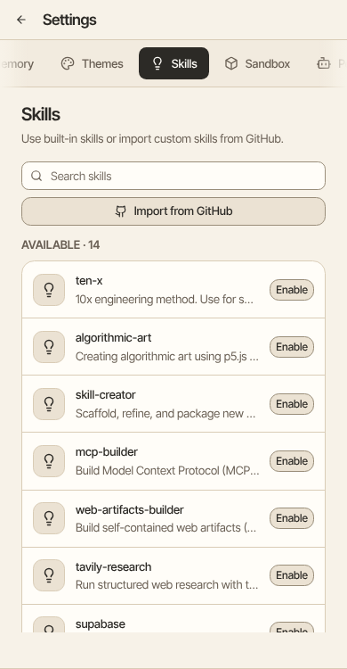

Aman can learn a new skill. For example, ask it to learn how to turn a photo of a receipt into a line in your expense list.

How to get there: Click **More** in the left bar, then **Settings**, then **Skills**.

Skills run in the sandbox, so the sandbox must be set up first. Open Settings, then Skills to see the skills Aman has, to add one, or to turn one off.

The "Learn new skills" card only appears once the sandbox is ready.
