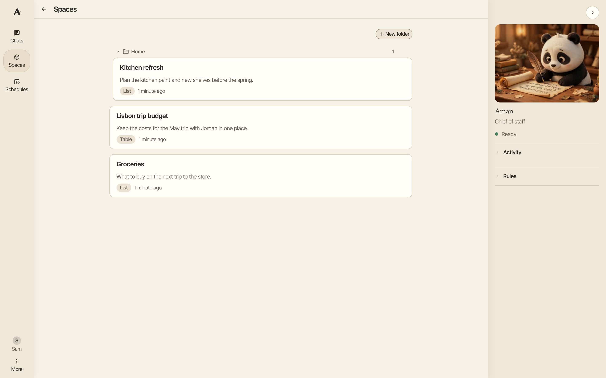
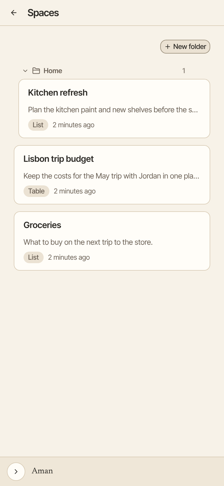

A space is a page Aman makes and keeps up to date for you, as a list, a table or a board. Use one to compare options, track a project or keep notes you come back to.

How to get there: Click **Spaces** in the left bar.

=== "Computer"

    

=== "Phone"

    

## Make a space

1. Click **Chats**, then click **New chat**.
2. Ask for the page you want, such as "Make a space called Dog breeds that compares family dogs".
3. Aman builds the page and gives you a link to it in the chat.
4. Click the link, or click **Spaces** in the left bar and then click your space.

Before it makes a new space, Aman checks whether one already covers the subject. If one does, it updates that one instead. Each space has its own name.

## Change a space

Ask Aman in any chat, such as "Add the Beagle to Dog breeds". Aman changes only the part you asked about.

You can also open the space and click the button at the top that asks Aman to change it. A new chat opens with the space's name already typed in.

## Undo a change

Aman keeps every earlier version of a space. If a change went wrong, ask Aman to bring back the earlier one, such as "Undo the last change to Dog breeds".

## Add pictures and links

You can't add a picture yourself. Ask Aman instead, such as "Add a photo of each breed to Dog breeds".

Aman can only use a picture from a web page or search result it found in that same chat. If it has not looked yet, it searches first. Pictures from your own computer can't be added.

Links work the same way. A link or picture that did not come from that chat is left out, and Aman tells you.

## Organize spaces in folders

1. On the **Spaces** page, click **New folder**.
2. Type a name and click **Create**.
3. Open a space, click **Space actions**, then click **Move to folder**.
4. Click the folder. To take a space out of its folder, click **No folder**.

You can also ask Aman, such as "Put Dog breeds in my Pets folder". If no folder has that name, Aman makes it.

To rename or delete a folder, click the settings button next to its name. Then click **Rename** or **Delete folder**. Deleting a folder keeps every space that was in it.

## Delete a space

1. Open the space.
2. Click **Space actions**, then click **Delete space**.
3. Click **Delete space** again to confirm.

!!! warning
Deleting a space removes the page and everything on it for good. It can't be undone.

## What a space can hold

A space can show text, lists, tables, colors and pictures. It is a page to look at, not a small app:

- No scripts run in a space. Nothing in it can act on its own or reach your files.
- A space loads nothing from the internet, apart from its pictures, which come through Aman.
- A space can be marked as archived. It still shows on the **Spaces** page, with an "Archived" tag.

## Good to know

- Making or changing a space runs without asking, because every change keeps a version you can go back to.
- In an incognito chat, Aman can read your spaces but can't make or change them, because a space outlives the chat.
- One change can add about 25 table rows or 40 short lines. Aman builds a bigger space in steps.

## Related

- [Living documents](documents.md)
- [Search the web](web.md)
- [Schedules](schedules.md)
