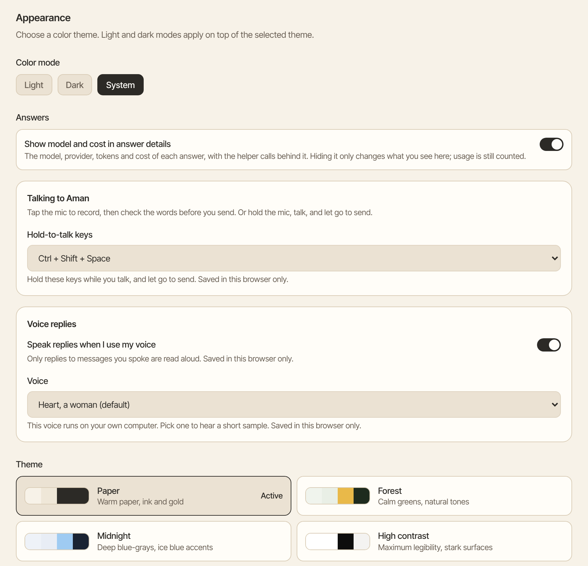
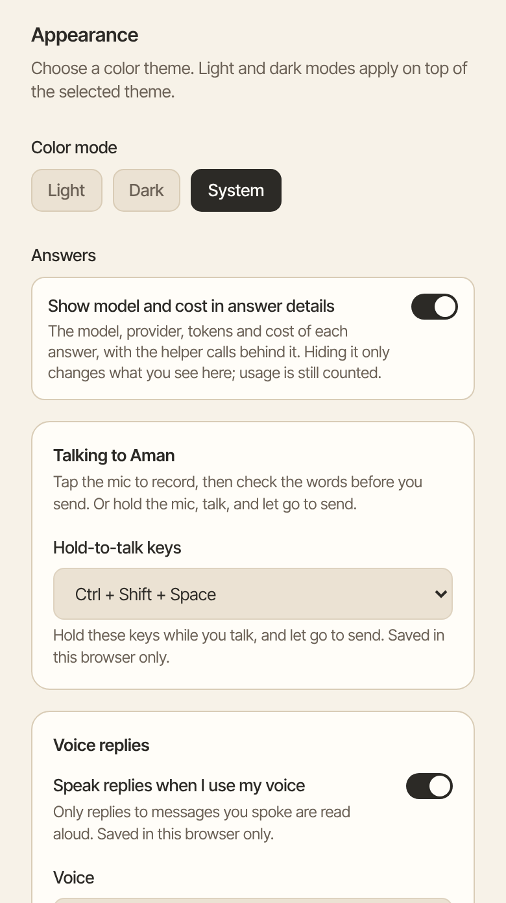

You can talk to Aman instead of typing. Record a short message, hold a key while you talk, or turn on voice mode and have a spoken conversation. Your voice is turned into words on your own computer.

How to get there: Open a chat. The microphone and the sound-wave button are at the right end of the message box.

!!! note "Before you start"

    The first time, your browser asks if Aman may use the microphone. Choose Allow. If the microphone and sound-wave buttons are missing, voice is not running on this Aman. See [Voice setup](../../../../docs/voice-input.mdx).

## Record a message

1. Tap the microphone and talk.
2. Tap it again to stop.
3. Your words appear in the message box. Check them, change anything that's wrong, then send.

A recording stops by itself after 3 minutes. Tap the microphone again to record the next part. To stop Aman while it is writing down your words, click **Cancel**.

## Hold to talk

Hold the microphone, talk, and let go. Your words are sent as soon as they are written down, without a stop in the message box.

On a computer you can use keys instead. Hold ++ctrl+shift+space++ while you talk, and let go to send.

To pick other keys, or turn them off:

1. Click **More** in the left bar, then **Settings**, then **Themes**.
2. Under **Talking to Aman**, pick from **Hold-to-talk keys**.

The choice is saved in this browser only.

## Have a conversation in voice mode

In voice mode you just talk. Aman writes down what you say when you pause, answers out loud, and keeps listening.

1. Tap the sound-wave button next to the microphone.
2. Talk, then pause. The button shows "Listening", "Thinking" or "Speaking", and Aman's picture follows.
3. To interrupt, talk while Aman is answering. It stops to listen.
4. To end voice mode, tap the sound-wave button again.

Point at either button, or move to it with the ++tab++ key, to see what it does.

If you speak again before Aman has written down your last two phrases, it misses that part. It says so, and you say it again.

Voice mode is never on unless you turn it on, and it only listens in the chat where you turned it on. It also ends when:

- you switch chats, leave the page or hide the tab
- you use the microphone button yourself
- the connection closes
- you say nothing for 2 minutes (a long answer or a long task doesn't count as quiet)
- 30 minutes have passed, however much you talk
- your computer can't keep up with the sound

Aman tells you why it ended. Tap the sound-wave button to start again.

## Approve a card by voice

When Aman needs your OK in voice mode, such as before it sends an email, it reads the whole card out loud and waits. Then say exactly one of these:

- "yes, send it" for an email
- "yes, approve"
- "yes, delete it" for deleting a scheduled task
- "no"

Say the whole phrase in one go. A short stop between the words is fine. Other words, extra words around the phrase, a question, or silence don't approve anything. What you said before Aman finished reading the card never counts as the answer.

If you say something else while a card is waiting, Aman reminds you once. After that it treats your words as a new message and leaves the card in the app. After it acts, Aman says what it did.

Aman reads out only cards it can say in full:

- an email with no hidden copy and no new address
- a new calendar event with no guests
- deleting a scheduled task

Every other card stays on the screen for you to answer there, and Aman says so. That includes a card with a web link, code, a list or a word that isn't in plain English letters, and every card that runs a command, spends money, changes files or makes a new schedule. If more than one card is waiting, they stay on the screen too.

??? note "Why a card was left on the screen"

    Aman leaves a card on the screen when the voice might say part of it differently from how it is written. Then you could hear something other than what you approve. For example:

    - a long card, a folder path, or a number like "$1,5" or "10.0.0.1"
    - two numbers side by side, such as "1000 (500)" or "1000 and 500", which can sound like one amount
    - a web address inside a message, such as "my.bank.com"
    - a name, title or subject that runs over two lines
    - a time zone written as an offset, such as Etc/GMT+5

    Dates and times such as "March 5, 2026" or "Fri Nov 6, 2:30", ranges such as "between 100 and 150", "5 million" and "the 14th" are read out.

    Aman first says how many addresses, events or schedules the card holds. Then it reads each address before the name next to it, and each subject or title on its own line. An event card ends by saying the time again. Dots and dashes in an address are said as "dot" and "dash".

    Aman never takes an answer while it is talking, or in the second and a half after it stops. If your answer comes too soon, it asks you to say it again. If the card changed or timed out, or Aman couldn't read all of it, a "yes" does nothing, and the card stays in the app.

## Hear replies read aloud

When you speak a message, Aman reads its reply aloud when it is done. It also keeps that reply short and plain, without lists or tables.

To hear any other reply, click **Read aloud** under it. Click **Stop reading aloud** to stop.

To change this:

1. Click **More** in the left bar, then **Settings**, then **Themes**.
2. Under **Voice replies**, turn **Speak replies when I use my voice** on or off.
3. In **Voice**, pick one of twelve voices. Heart is the default. Aman plays a short sample when you pick one.
4. To hear a long reply in full, turn on **Read whole messages aloud**. When it is off, a long reply is read in part, and the rest stays on screen.

**Backup voice** is your browser's own voice. It reads replies when the voice on your computer is not running. These choices are saved in this browser only.

=== "Computer"

    

=== "Phone"

    

## Good to know

- Your recordings, the words written down from them, and the spoken replies never leave your computer. No speech service on the internet is used.
- Recordings are not saved. Only the messages themselves stay in the chat, like typed ones.
- If the microphone heard nothing, it says "Nothing was heard" instead of leaving the message box empty. Tap the microphone and try again.
- A recording also stops if you switch chats or the app moves to the background. The microphone says so when you come back, so a recording never disappears without a word.
- If the browser says the microphone is blocked, the microphone button shows a line through it. Tap it for help, allow the microphone in your browser's site settings, then click **Try again**.
- To paste copied text into your message, click **Add**, then "Paste from clipboard".
- How the voice runs, and the settings that need a terminal, are in [Voice setup](../../../../docs/voice-input.mdx).

## Related

- [Chats](chats.md)
- [Approval cards](approvals.md)
- [Appearance](appearance.md)
